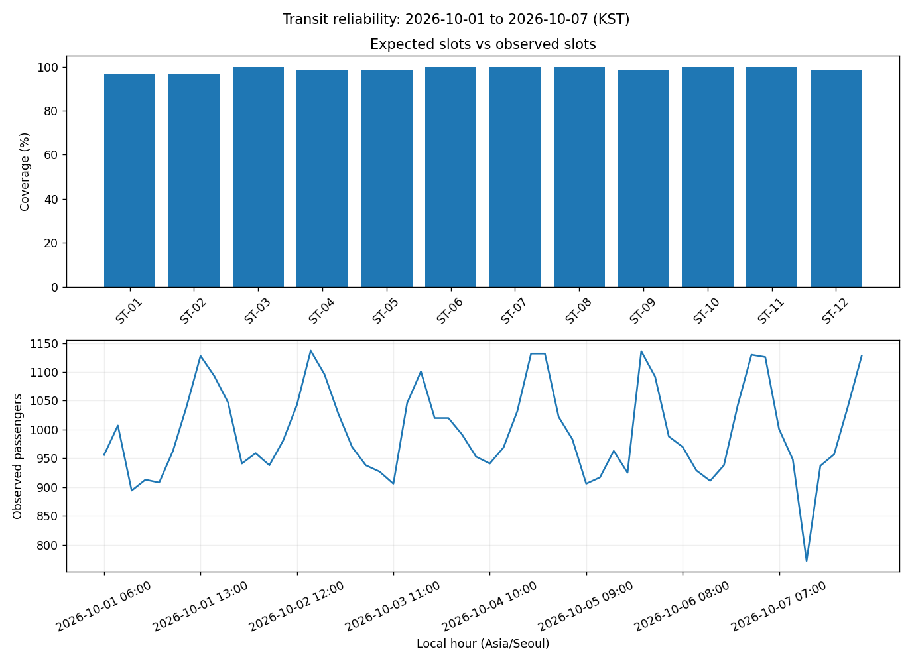

# Chapter 09. Data Visualization Project

데이터를 읽고 그래프를 그리는 단계에서 나아가, **문제를 정의하고 자료를 검증한 뒤 해석 가능한 분석 결과를 전달하는 과정**을 학습합니다. Mini Project에서는 정적 보고서를, Advanced Project에서는 필터·완전성·지표의 일관성을, Challenge에서는 다중 입력·예외 처리·자동 검증을 다룹니다.

입력 데이터의 구성은 [Data Provenance](./resources/DATA_PROVENANCE.md)에서 확인할 수 있습니다.

이번 장에는 총 **10개의 독립 프로젝트**가 있습니다. 각 프로젝트는 `README.md`, 시작 코드, 입력 데이터, 모범 구현과 테스트에 연결되어 있으며, 모범 구현의 출력 그림을 제공합니다.

<details>
<summary><strong>선행 학습 목록</strong></summary>

- [Chapter 01 — Introduction to Data Visualization](../Chapter-01/)
- [Chapter 02 — Principles of Data Visualization](../Chapter-02/)
- [Chapter 03 — Matplotlib](../Chapter-03/)
- [Chapter 04 — Seaborn](../Chapter-04/)
- [Chapter 05 — Exploratory Data Analysis & Statistical Visualization](../Chapter-05/)
- [Chapter 06 — Time Series Visualization](../Chapter-06/)
- [Chapter 07 — Plotly & Interactive Visualization](../Chapter-07/)
- [Chapter 08 — Streamlit](../Chapter-08/)
- [Data Processing Chapter 04 — Pandas & DataFrames](../../Data_Processing/Chapter-04/)
- [Data Processing Chapter 06 — Data Cleaning & Validation](../../Data_Processing/Chapter-06/)
- [Data Processing Chapter 07 — Data Transformation & Aggregation](../../Data_Processing/Chapter-07/)

</details>

<a id="contents"></a>
## Contents

| Section | Topic |
|:---:|---|
| [9.1](#section-9-1) | **Project Overview** — 학습 목표와 분석 결과물의 기준 |
| [9.2](#section-9-2) | **Project Preparation** — 개발 환경과 학습 자료 |
| [9.3](#section-9-3) | **Mini Projects** — 기상·매출 정적 보고서 |
| [9.4](#section-9-4) | **Advanced Projects** — 데이터 검증·지표·대시보드 구현 |
| [9.5](#section-9-5) | **Challenge Problems** — 데이터 품질·예외 처리·자동 검증 |
| [9.6](#section-9-6) | **Examples & Comprehensive Quiz** — 계산 예제와 Chapter 01~08 종합 복습 |
| [9.7](#section-9-7) | **Final Review** — 제출 전 최종 확인 |
| [9.8](#section-9-8) | **Execution & Verification** — 실행 명령과 테스트 방법 |
| [9.9](#section-9-9) | **References** — 공식 문서와 프로젝트별 참고 자료 |

---

<a id="section-9-1"></a>
## 9.1. Project Overview

이번 장에서 완성할 결과물은 데이터 자체뿐 아니라 **데이터의 유효성·수집 범위·지표의 분모·시각화의 단위·재현성**을 함께 표현해야 합니다. 아래 원칙을 각 프로젝트에서 반복해서 확인합니다.

- **Data Contract:** 어떤 열과 값이 필요한지, 잘못된 값은 어떻게 처리할지 정의합니다.
- **Observation Grain:** 한 행이 하루·주문·시간·요청 중 무엇을 나타내는지 확인합니다.
- **Metric Definition:** P95, 매출액, 정시 도착률 등 지표마다 계산 범위와 분모를 명시합니다.
- **Completeness:** 관측이 없는 경우와 유효한 측정값이 0인 경우를 구별합니다.
- **Consistent Outputs:** 같은 필터를 적용한 CSV·PNG·HTML·KPI는 같은 값을 설명해야 합니다.
- **Quality Gate:** 정상 입력뿐 아니라 오류·누락·값 변경·재실행 상황까지 검증합니다.

결과 그림에 **측정 단위·날짜 기준·필터 조건**을 적절히 표시하세요. 단순히 그래프가 생성되었다는 사실만으로 분석이 완료되지는 않습니다.

<a id="section-9-2"></a>
## 9.2. Project Preparation

이 장의 주요 도구는 `pandas`, `numpy`, `matplotlib`, `plotly`입니다. Python 3.10 이상을 권장합니다.

```bash
python -m pip install -r requirements.txt
```

프로젝트의 구현 전에 필요한 내용은 [Project Preparation](./resources/PROJECT_PREPARATION.md)에 정리했습니다. 시간대 변환, 결측과 0의 차이, P95, 단위, 도표 구성, 해시와 재현성 등을 포함합니다. 기본 문법·데이터프레임 조작은 앞선 Chapter에서 학습한 내용을 적용합니다.

진행할 때는 먼저 **문제별 README → 입력 CSV → `starter.py` → 모범 구현 → 테스트** 순서로 확인하세요. 프로젝트 정답 코드는 문제 본문에 공개하지 않고 `solutions/`에 분리했습니다.

<a id="section-9-3"></a>
## 9.3. Mini Projects

| 프로젝트 | 주요 목표 | 결과 예시 |
|---|---|---|
| [Mini 01 — Weather Visualization Report](./projects/mini_01_weather_report/README.md) | 정렬된 기상 관측으로 서로 다른 축의 정적 보고서 작성 | [PNG](./figures/projects/mini_01_weather_report.png) |
| [Mini 02 — Retail Sales Performance Report](./projects/mini_02_retail_report/README.md) | 취소 주문을 제외한 매출액 계산과 막대그래프 | [PNG](./figures/projects/mini_02_retail_report.png) |

<a id="section-9-4"></a>
## 9.4. Advanced Projects

| 프로젝트 | 분석 질문 | 추가 구현 요소 |
|---|---|---|
| [Advanced 01 — Weather Monitoring Dashboard](./projects/advanced_01_weather_dashboard/README.md) | 관측소마다 어떤 날짜에 기록이 빠졌나요? | 관측소 × 날짜 완전성, 다중 필터 |
| [Advanced 02 — Customer Behavior Analysis](./projects/advanced_02_customer_behavior/README.md) | 어떤 고객군의 구매 참여율이 높나요? | 모집단 분모, 고객·주문 결합 |
| [Advanced 03 — Service Performance Monitoring](./projects/advanced_03_service_monitor/README.md) | 어느 서비스가 느리거나 오류가 많나요? | 요청 검증, P95, 서버 오류율, KST 변환 |
| [Advanced 04 — Regional Electricity Demand Analysis](./projects/advanced_04_electricity_demand/README.md) | 누락된 시간의 일별 에너지를 확정할 수 있나요? | MW/MWh, 24시간 완전성 |
| [Advanced 05 — Urban Transportation Dashboard](./projects/advanced_05_urban_metro/README.md) | 기록 누락과 실제 승객 0명을 어떻게 구분하나요? | 예정 운행시간, 노선 필터, 인터랙티브 차트 |

<a id="section-9-5"></a>
## 9.5. Challenge Problems

| 프로젝트 | 핵심 검증 사항 |
|---|---|
| [Challenge 01 — Airport Operations Analysis](./projects/challenge_01_airport_operations/README.md) | 운항·결항·정시도착 분모와 경계 지연시간 |
| [Challenge 02 — Energy Demand & Anomaly Detection](./projects/challenge_02_energy_anomalies/README.md) | 시간대별 중앙값 기준선, 이상 구간, 장애 구간 `[start,end)` |
| [Challenge 03 — City Transit Reliability Platform](./projects/challenge_03_transit_reliability/README.md) | 예정 슬롯, 전 행 감사, 정적·대화형 분석 일치, SHA-256, Quality Gate |

<p align="center">
  
</p>

<a id="section-9-6"></a>
## 9.6. Examples & Comprehensive Quiz

**Example 01 — P95 선형 보간(Linear Interpolation, Lerp)**

```python
import pandas as pd

latency = pd.Series([100, 200, 300])
print(latency.quantile(0.95, interpolation="linear"))  # 290.0
```

값 세 개를 정렬한 뒤 인덱스 1.9의 위치를 linear interpolation 하므로 P95는 290ms입니다. Lerp는 **시간대별 누락 데이터를 임의로 채우는 작업이 아닙니다**.

**Example 02 — 결측(Missing)과 0의 차이**

```python
import pandas as pd

boardings = pd.Series([0, None, 12])
print(boardings.notna().sum())  # 2: 유효 관측 수
print(boardings.sum())         # 12.0: 관측된 인원 합계
```

첫 번째 항목은 실제 측정값이 0명인 경우이고, 두 번째 항목은 데이터 수집 기록 자체가 누락된 상태(Missing)를 의미합니다. 예를 들어 전체 예정 슬롯 수가 3개일 때, 유효한 관측이 이루어진 슬롯이 2개라면 관측 완전성(Observation Completeness)은 2/3가 됩니다.

### Quiz — Chapter 01~08 Review

각 문제의 정답과 해설은 아래 **정답 및 해설**을 펼쳐 확인할 수 있습니다.

#### 객관식 — Visualization & Interpretation

**Q01. 서로 다른 크기의 표본 분포 비교**

A 집단에는 측정값 50개, B 집단에는 측정값 500개가 있습니다. 두 집단의 **값이 분포하는 모양**을 비교하려고 합니다. 가장 적절한 방법은 무엇인가요?

- **A.** 두 집단의 관측 개수를 그대로 표시한 히스토그램을 서로 비교합니다.
- **B.** 동일한 구간 경계를 사용하고 밀도 기준으로 정규화한 히스토그램을 비교합니다.
- **C.** 각 집단의 전체 관측 개수를 원그래프로 표현합니다.
- **D.** 측정값을 입력 순서대로 누적한 선그래프를 비교합니다.

<details>
<summary><strong>정답 및 해설</strong></summary>

**정답: B**

두 집단의 표본 크기가 10배 차이 나므로 빈도를 그대로 그리면 B 집단의 막대가 전체적으로 높아집니다. **동일한 구간 경계와 밀도 기준**을 사용하면 관측 수의 차이보다 분포의 형태에 집중할 수 있습니다. 이때 밀도는 막대 높이의 합이 아니라 **전체 막대 면적이 1**이 되도록 정규화한 값입니다.

- **A:** 원시 빈도는 표본 크기에 크게 영향을 받아 분포 형태를 공정하게 비교하기 어렵습니다.
- **C:** 집단별 표본 규모는 비교할 수 있지만 측정값의 분포는 드러나지 않습니다.
- **D:** 입력 순서에 시간적 의미가 없으며 누적합은 분포의 모양을 직접 설명하지 못합니다.

</details>

**Q02. 기준보다 높거나 낮은 값을 나타내는 색상**

지역별 실제 기온에서 평년 기온을 뺀 **편차(°C)**를 Heatmap으로 표시하려고 합니다. 음수·0·양수의 의미를 명확하게 나타내려면 어떤 색상 구성이 적절한가요?

- **A.** 값이 증가할수록 밝아지는 단일 계열의 순차형 색상
- **B.** 지역마다 고유한 색을 부여하는 범주형 색상
- **C.** 0을 중립색으로 두고 음수·양수를 구분하는 발산형 색상
- **D.** 값을 구분하지 않고 모든 셀에 같은 색상을 사용하는 방식

<details>
<summary><strong>정답 및 해설</strong></summary>

**정답: C**

편차는 **0이 기준점**이고 부호 자체에 의미가 있습니다. 발산형 색상(Diverging Colormap)은 기준보다 낮은 값과 높은 값을 서로 다른 방향의 색으로 표현하기에 적합합니다. 색상 범위를 설정할 때는 비교 목적에 맞게 0이 중간에 오도록 지정하는 것이 좋습니다.

- **A:** 순차형 색상은 크기 변화는 표현하지만, 기준점 양쪽의 의미를 직관적으로 구별하기 어렵습니다.
- **B:** 범주형 색상은 연속적인 편차 크기와 부호를 표현하기에 적절하지 않습니다.

</details>

**Q03. Matplotlib 이미지 저장 시 라벨 잘림**

그래프를 화면에서 볼 때는 정상인데 저장한 PNG에서 긴 x축 눈금 라벨의 일부가 잘렸습니다. **기존 그래프 설정을 유지하면서 저장 범위를 조정**하는 가장 직접적인 방법은 무엇인가요?

- **A.** `fig.savefig("plot.png", dpi=300)`
- **B.** `fig.savefig("plot.png", bbox_inches="tight")`
- **C.** `ax.grid(True)`
- **D.** `fig.savefig("plot.png", transparent=True)`

<details>
<summary><strong>정답 및 해설</strong></summary>

**정답: B**

`bbox_inches="tight"`는 저장할 때 텍스트와 축 등 그림 요소의 경계를 고려하여 출력 범위를 조정합니다. 레이아웃 자체가 비좁다면 `constrained_layout=True` 또는 `fig.tight_layout()`도 검토할 수 있습니다.

- **A:** DPI는 주로 출력 해상도와 관련 있으며, 잘린 요소를 반드시 포함시키지는 않습니다.
- **D:** 배경의 투명도 설정이므로 라벨 잘림 문제를 해결하지 못합니다.

</details>

**Q04. 상관계수가 0에 가까운 산점도 해석**

다음 다섯 관측값이 있습니다.

| x | -2 | -1 | 0 | 1 | 2 |
|---|---:|---:|---:|---:|---:|
| y | 4 | 1 | 0 | 1 | 4 |

Pearson 상관계수는 0에 가깝습니다. 이 데이터에 대한 가장 타당한 해석은 무엇인가요?

- **A.** 두 변수 사이에 뚜렷한 관계가 전혀 없다고 결론 내립니다.
- **B.** x가 증가하면 y도 일정한 비율로 증가하는 선형 관계입니다.
- **C.** x가 증가하면 y가 일정한 비율로 감소하는 선형 관계입니다.
- **D.** 선형 상관은 약하지만 U자형의 비선형 관계가 관찰됩니다.

<details>
<summary><strong>정답 및 해설</strong></summary>

**정답: D**

$x$가 $-2$에서 $0$으로 이동할 때 $y$는 감소하다가, $0$에서 $2$ 구간에서는 다시 증가하는 비선형 관계를 나타냅니다. 이러한 대칭적 구조에서는 **Pearson 상관계수가 0**으로 산출되지만, 산점도에는 $y = x^2$ 형태의 뚜렷한 포물선 패턴이 나타납니다. 이는 Pearson 상관계수가 두 변수 사이의 **선형 관계의 방향과 강도**를 나타내는 지표이기 때문이며, 상관계수만으로 변수 간의 모든 관계를 판단할 수 없음을 보여줍니다.

</details>

**Q05. 연도별 계절적 패턴 비교**

2024년과 2025년의 월별 수영장 이용객 수가 있습니다. 두 해에 **여름철 증가 패턴이 비슷한지** 비교하려면 어떤 그래프가 가장 효과적인가요?

- **A.** 24개월 전체 이용객 수를 하나의 원그래프로 표현합니다.
- **B.** 각 연도의 월(1~12월)을 같은 x축에 놓고 연도별 선을 구분합니다.
- **C.** 월 이름을 이용객 수가 많은 순서대로 정렬해 하나의 선으로 연결합니다.
- **D.** 두 해의 전체 이용객 합계만 막대 두 개로 비교합니다.

<details>
<summary><strong>정답 및 해설</strong></summary>

**정답: B**

각 연도를 별도 선으로 표시하고 공통 월 축을 사용하면 같은 계절의 상승·하락 시점과 변화 폭을 직접 비교할 수 있습니다. 두 해의 값이 서로 다른 규모라면 절대값 비교와 함께 상대적 변화도 보조적으로 살펴볼 수 있습니다.

- **C:** 이용객 순으로 정렬하면 1월에서 12월로 이어지는 시간의 순서가 사라집니다.
- **D:** 연간 합계만으로는 어느 계절에 이용이 증가했는지 확인할 수 없습니다.

</details>

**Q06. Plotly 범례 색상 유지**

도시별 이동량을 Plotly 선그래프로 표시합니다. 사용자가 도시를 필터링해도 **같은 도시는 언제나 같은 색상**으로 보여야 합니다. 가장 적절한 설정은 무엇인가요?

- **A.** 선택된 도시 수에 맞춰 매번 `color_discrete_sequence`를 새로 생성합니다.
- **B.** 도시명과 색상을 연결한 `color_discrete_map`을 지정합니다.
- **C.** 모든 Trace에 동일한 `line_color`를 적용합니다.
- **D.** 필터링할 때마다 범례를 숨깁니다.

<details>
<summary><strong>정답 및 해설</strong></summary>

**정답: B**

예를 들어 `color_discrete_map={"서울": "#3366CC", "부산": "#E67E22"}`처럼 **도시명과 색을 고정**하면 선택 순서나 필터 결과가 달라져도 의미가 유지됩니다. 반면 순서 기반 팔레트만 사용하면 표시되는 범주에 따라 색상 대응이 달라질 수 있습니다.

</details>

**Q07. 서로 다른 수집 주기의 시계열 비교**

한 센서는 1분마다, 다른 센서는 1시간마다 기록됩니다. 두 센서의 하루 변화 추이를 하나의 시간축에서 비교하려면 무엇을 우선 결정해야 하나요?

- **A.** 모든 1분 단위 빈칸을 0으로 채워 두 센서의 행 개수를 맞춥니다.
- **B.** 각 센서의 전체 평균만 구하고 시간 정보는 제거합니다.
- **C.** 비교할 공통 시간 단위와 변수별 집계 방식을 정하고 누락 구간을 구분합니다.
- **D.** 시각을 문자열로 바꾸고 입력된 행 순서를 그대로 x축에 사용합니다.

<details>
<summary><strong>정답 및 해설</strong></summary>

**정답: C**

먼저 **비교 단위(예: 시간별)**와 값의 성격에 맞는 집계 방법(평균·합계 등)을 정해야 합니다. 이후 실제 관측이 없는 시간과 값이 0인 시간을 구분한 상태로 같은 시간축에 표시할 수 있습니다. 센서에 따라 평균이 적절한 경우도 있고, 해당 시간 동안 누적된 건수라면 합계가 적절할 수도 있습니다.

- **A:** 누락을 0으로 바꾸면 관측되지 않은 값을 측정된 값처럼 왜곡합니다.
- **B:** 하루 안에서 언제 변화가 발생했는지 알 수 없게 됩니다.
- **D:** 입력 순서와 실제 시간 간격이 다를 수 있습니다.

</details>

#### 주관식 — Design & Explanation

**Q08. 서로 다른 지표를 활용한 보고서 설계**

세 지역의 택배 배송 기록이 있습니다. 각 기록에는 `region`, `delivery_km`, `delivered_at`이 포함되어 있습니다. 지역별 **배송 건수**와 **건별 배송 거리 분포**를 함께 설명하는 보고서를 구성하려고 합니다.

두 지표에 적합한 그래프를 각각 제안하고, 축·단위·비교 기준을 어떻게 표시할지 설명하세요.

<details>
<summary><strong>모범답안 및 해설</strong></summary>

**모범답안**

1. **배송 건수:** 지역을 x축, 배송 건수(건)를 y축으로 하는 막대그래프를 사용합니다. 비교 기간을 동일하게 맞추고 건수가 많은 순서나 고정된 지역 순서로 배치합니다.
2. **건별 배송 거리 분포:** 지역별 Boxplot과 실제 관측점을 함께 표시합니다. x축은 지역, y축은 배송 거리(km)로 표기하며 모든 지역에 동일한 거리 축을 적용합니다.
3. **설명과 주의사항:** 각 지역의 유효 배송 건수를 함께 표기하고 결측 거리 기록이 몇 개인지 밝힙니다. 배송 건수가 많은 지역이 반드시 배송 거리도 긴 지역인 것은 아닙니다.

**해설:** 건수는 **총량 비교**, 배송 거리는 **개별 관측값의 분포 비교**입니다. 서로 다른 질문에 하나의 그래프를 억지로 사용하기보다 각각의 표현 방법을 선택하는 것이 정보 전달에 유리합니다. 표본이 적다면 Boxplot만으로는 분포를 과하게 단순화할 수 있으므로 개별 점을 함께 보는 방법이 좋습니다.

</details>

**Q09. 평균이 같은 두 집단의 차이**

두 집단의 측정값이 다음과 같습니다.

- A: `10, 10, 10, 10`
- B: `4, 8, 12, 16`

두 집단의 평균은 동일합니다. **평균 막대그래프만으로 알 수 없는 특징**을 설명하고, 그 차이를 드러낼 시각화 방법을 제안하세요.

<details>
<summary><strong>모범답안 및 해설</strong></summary>

**모범답안:** 두 집단의 평균은 모두 10이지만, A는 모든 값이 10으로 같고 B는 4에서 16까지 퍼져 있습니다. 평균 막대그래프만 그리면 두 막대 높이가 같아 관측값의 퍼짐 정도를 알 수 없습니다. 표본이 각각 4개뿐이므로 **개별 관측값을 점으로 표시하는 Strip Plot**을 사용하거나 Boxplot 위에 점을 함께 표시하는 방법이 적절합니다.

**해설:** 같은 평균이더라도 변동성·분포 형태는 다를 수 있습니다. 특히 작은 표본에서는 원본 관측값을 함께 보여주는 것이 해석에 도움이 됩니다. 두 그룹의 표본 크기도 표시하면 좋습니다.

</details>

**Q10. 시계열 그래프에서 사건 전후 해석**

어떤 사이트의 주간 방문자 수는 다음과 같습니다.

| 주차 | 1 | 2 | 3 | 4 | 5 | 6 |
|---|---:|---:|---:|---:|---:|---:|
| 방문자 수 | 100 | 105 | 103 | 165 | 160 | 158 |

4주 차에 홍보 캠페인이 시작되었습니다. 변화가 잘 드러나도록 그래프를 설계하고, 이 자료만으로 **확정할 수 없는 결론**이 무엇인지 설명하세요.

<details>
<summary><strong>모범답안 및 해설</strong></summary>

**모범답안:** 주차를 x축, 방문자 수(명)를 y축으로 하는 선그래프를 그립니다. 4주 차에 세로 기준선과 `캠페인 시작` 주석을 추가하고, 캠페인 전후를 시각적으로 구분합니다. 4주 차에 방문자 수가 크게 증가한 것은 확인할 수 있지만, **그 증가가 전적으로 캠페인 때문에 발생했다고 단정할 수는 없습니다.** 같은 시기에 발생한 다른 행사나 계절적 변화 등의 영향도 가능하기 때문입니다.

**해설:** 시각화는 **언제 변화가 일어났는지**를 보여줄 수 있지만, 단일 시계열의 전후 비교만으로 인과관계가 입증되는 것은 아닙니다. 캠페인 효과를 평가하려면 적절한 비교 집단이나 추가 자료가 필요합니다.

</details>

**Q11. 인터랙티브 그래프의 정보 전달 방식**

30개 도시의 월별 대기질 지수를 보여주는 Plotly 대시보드를 만들려고 합니다. 모든 도시의 선을 한 번에 표시하면 그래프가 복잡해집니다. 사용자가 도시를 탐색하면서도 결과를 오해하지 않도록 **화면 구성과 표시 규칙 세 가지 이상**을 제안하세요.

<details>
<summary><strong>모범답안 및 해설</strong></summary>

**모범답안 예시**

- 도시를 선택하는 필터를 제공하고, 선택된 도시만 그래프에 표시합니다.
- 선택 결과가 달라져도 같은 도시는 같은 색상으로 표시합니다.
- Hover에는 도시명, 연월, 대기질 지수와 단위를 명확히 보여줍니다.
- 날짜 축과 지수 축의 기준을 유지하고, 필요하면 특정 도시를 강조하거나 비교 도시 수를 제한합니다.
- 중요한 변화나 결론은 Hover에만 의존하지 않고 제목·주석·요약 표에도 전달합니다.

**해설:** 인터랙션은 필요한 데이터를 찾기 쉽게 해 주지만, 범례 색상과 축이 매번 임의로 바뀌거나 핵심 정보가 Hover에만 있으면 해석이 어려워집니다. 필터링된 화면의 의미를 사용자가 항상 파악할 수 있도록 해야 합니다.

</details>

#### 코드 분석 — Code Reading & Debugging

**Q12. 막대그래프의 범주와 값이 일치하지 않는 문제**

다음 코드는 범주별 매출을 내림차순으로 정렬해 표시하려고 작성했습니다.

```python
import pandas as pd
import matplotlib.pyplot as plt

sales = pd.Series({"A": 30, "B": 70, "C": 50})
ranked = sales.sort_values(ascending=False)

fig, ax = plt.subplots()
ax.bar(sales.index, ranked.values)
```

실제 막대에 표시되는 **A·B·C의 값**을 순서대로 적고, 문제의 원인을 설명한 뒤 코드를 수정하세요.

<details>
<summary><strong>정답 코드 및 해설</strong></summary>

**실제 표시 값:** `A=70`, `B=50`, `C=30`입니다.

`ranked`의 값은 내림차순으로 `70, 50, 30`인데, x축에는 정렬 전 `sales.index`인 `A, B, C`를 그대로 사용했습니다. **범주와 값의 대응 관계가 어긋난 상태**입니다.

**수정 코드**

```python
fig, ax = plt.subplots()
ax.bar(ranked.index, ranked.values)
ax.set_xlabel("Category")
ax.set_ylabel("Sales")
```

수정 후에는 `B=70`, `C=50`, `A=30` 순서로 정확히 표시됩니다. 정렬을 수행한 Series의 **인덱스와 값**을 함께 전달하는 것이 핵심입니다.

</details>

**Q13. 날짜형 데이터인데 선이 시간 순서대로 연결되지 않는 문제**

```python
import pandas as pd
import matplotlib.pyplot as plt

df = pd.DataFrame({
    "date": ["2026-04-03", "2026-04-01", "2026-04-02"],
    "orders": [14, 8, 11],
})
df["date"] = pd.to_datetime(df["date"])

fig, ax = plt.subplots()
ax.plot(df["date"], df["orders"], marker="o")
```

위 코드에서 선이 연결되는 날짜 순서를 설명하고, **시간 순서대로 연결되도록** 수정하세요.

<details>
<summary><strong>정답 코드 및 해설</strong></summary>

**현재 연결 순서:** `4월 3일(14건) → 4월 1일(8건) → 4월 2일(11건)`입니다.

`pd.to_datetime()`은 날짜의 **자료형**을 바꾸지만 행의 **순서**를 자동으로 정렬하지는 않습니다. `ax.plot()`은 전달받은 데이터 순서대로 선을 연결하므로 x축의 위치가 앞뒤로 이동하는 그래프가 만들어집니다.

**수정 코드**

```python
ordered = df.sort_values("date")

fig, ax = plt.subplots()
ax.plot(ordered["date"], ordered["orders"], marker="o")
ax.set_xlabel("Date")
ax.set_ylabel("Orders")
```

수정 후에는 `4월 1일(8건) → 4월 2일(11건) → 4월 3일(14건)` 순서로 이어집니다. 시간 데이터는 **변환뿐 아니라 정렬**도 확인해야 합니다.

</details>

**Q14. Streamlit 비교 화면의 중복 위젯 오류**

두 도시를 각각 선택해 비교하려는 화면입니다.

```python
import streamlit as st

cities = ["Seoul", "Busan", "Daejeon"]
left, right = st.columns(2)

with left:
    city_a = st.selectbox("비교 도시", cities)

with right:
    city_b = st.selectbox("비교 도시", cities)
```

두 Selectbox가 동일한 설정으로 생성될 때 발생할 수 있는 오류의 원인을 설명하고, **각각 독립적으로 선택**할 수 있도록 수정하세요.

<details>
<summary><strong>정답 코드 및 해설</strong></summary>

**문제 원인:** 두 Selectbox의 레이블과 옵션 등 위젯 구성이 같아, 명시적인 키가 없으면 Streamlit이 동일한 위젯 ID로 판단하여 `StreamlitDuplicateElementId` 오류가 발생할 수 있습니다. 서로 다른 Column에 배치했다는 사실만으로 위젯 ID가 구분되지는 않습니다.

**수정 코드**

```python
with left:
    city_a = st.selectbox("비교 도시", cities, key="compare_city_a")

with right:
    city_b = st.selectbox("비교 도시", cities, key="compare_city_b")
```

서로 다른 `key`를 지정하면 두 위젯의 상태가 독립적으로 관리됩니다. 비교용 그래프에도 각각 `city_a`, `city_b`의 선택값을 연결해야 합니다.

</details>

<a id="section-9-7"></a>
## 9.7. Final Review

결과물을 제출하기 전에 [Final Review](./resources/FINAL_REVIEW.md)에서 다음 항목을 확인하세요. 데이터 검증 사유, 분모와 단위, 날짜·시간대, 관측 완전성, 정적·대화형 결과의 일치, 반복 실행 및 시각적 가독성을 다룹니다.

<a id="section-9-8"></a>
## 9.8. Execution & Verification

모든 경로는 이 `Chapter-09/` 폴더를 기준으로 작성되어 있습니다.

```bash
# 모범 구현 실행 예시
python solutions/mini_01_weather_report/reference_solution.py
python solutions/advanced_03_service_monitor/reference_solution.py
python solutions/challenge_03_transit_reliability/reference_solution.py

# 전체 테스트
python -m unittest discover -s tests -v

# Challenge 03의 변형 입력/재현성/산출물 검증
python projects/challenge_03_transit_reliability/quality_gate.py --script solutions/challenge_03_transit_reliability/reference_solution.py
```

테스트할 프로그램은 `--data`, `--output` 옵션으로 별도 입력·출력 경로를 지정할 수 있어야 합니다. 구현 과정에서는 정답을 그대로 복사하기보다 입력값을 바꾸어도 규칙대로 계산되는지 확인하세요. **정상 정책에 따라 오류 행을 제외한 경우는 성공 실행이 될 수 있지만, 필수 기준정보의 계약 위반은 실패**로 처리합니다.

**자동 검증 범위:** 파일·숫자·스키마·필터·해시·주요 Figure/Trace 구성입니다. 색상 대비·글자 겹침·정보 전달력 등은 결과 PNG·HTML을 열어 별도로 검토해야 합니다.

---

모든 데이터는 교육 목적으로 생성한 가상 데이터입니다. 그래프 수치와 예시 출력은 이 저장소의 모범 구현을 실행해 확인한 결과입니다.

참고 그림을 최신 모범 구현 결과로 다시 만들려면 다음 명령을 사용합니다.

```bash
python scripts/regenerate_figures.py
```

<a id="section-9-9"></a>
## 9.9. References

### 공식 참고 문서

- [Pandas Documentation](https://pandas.pydata.org/docs/)
- [Pandas — Series.quantile](https://pandas.pydata.org/docs/reference/api/pandas.Series.quantile.html) — P95와 선형 보간
- [Pandas — to_datetime](https://pandas.pydata.org/docs/reference/api/pandas.to_datetime.html) — 시각 파싱 및 UTC 변환
- [Pandas — Series.dt.tz_convert](https://pandas.pydata.org/docs/reference/api/pandas.Series.dt.tz_convert.html) — 시간대 변환
- [Matplotlib — pyplot.savefig](https://matplotlib.org/stable/api/_as_gen/matplotlib.pyplot.savefig.html) — 정적 그래프 출력
- [Plotly Python Documentation](https://plotly.com/python/) — 대화형 시각화
- [Python — unittest](https://docs.python.org/3/library/unittest.html) — 자동 테스트
- [Python — hashlib](https://docs.python.org/3/library/hashlib.html) — SHA-256 무결성 검증

### 프로젝트별 참고 자료

- [Advanced 03 — P95·Audit Log·서버 오류율](./projects/advanced_03_service_monitor/REFERENCES.md)
- [Data Provenance](./resources/DATA_PROVENANCE.md) — 예제 데이터 생성 및 출처

---
[← Data Visualization](../README.md) · [Chapter 08 — Streamlit](../Chapter-08/) · [↑ Contents](#contents)
