# Chapter 09. Data Visualization Project

앞서 학습한 **데이터 처리 → 탐색 → 통계적 해석 → 정적·인터랙티브 시각화 → 대시보드 → 자동 검증**을 하나의 프로젝트 과정으로 연결합니다. 학습 목표는 그래프를 많이 만드는 것이 아니라, **서로 다른 입력 조건에서도 정확하고 재현 가능한 시각화 결과물을 제작하는 능력**을 갖추는 것입니다.

이번 챕터에는 **Mini Project 2개, Advanced Project 5개, Challenge 3개**를 포함합니다. Challenge 03은 다중 데이터 원천, 누락 관측, 오류 데이터, 자동 검증, 결과 해시까지 모두 충족해야 하는 최종 과제입니다. 어려운 요구사항은 서로 모순되지 않도록 명확하게 정의했으며, 아직 배우지 않은 이론을 억지로 끌어오지는 않습니다.

**작성 원칙:** 처음 등장하는 핵심 개념을 정의하고 왜 필요한지 설명합니다. 이미 학습한 Matplotlib·Pandas·Plotly 문법은 필요한 만큼만 복습합니다. 수식은 불필요한 경우 생략하며, 수식 내부에 한글을 넣지 않습니다. 모든 데이터는 **교육용 가상 데이터**입니다. 실제 기상·철도·항공·전력·기업 통계가 아닙니다.

**정답 공개:** Example 코드는 README에 공개합니다. Quiz는 문항별 `<details>` 안에서 정답·해설·필요한 추가 코드를 확인할 수 있습니다. Coding Practice·Mini·Advanced·Challenge는 README에 정답 코드를 공개하지 않으며 `solutions/`에 별도의 모범 구현을 제공합니다.

<details>
<summary><strong>선행 학습 목록</strong></summary>

- [Chapter 01 — Introduction to Data Visualization](../Chapter-01/)
- [Chapter 02 — Principles of Data Visualization](../Chapter-02/)
- [Chapter 03 — Matplotlib](../Chapter-03/)
- [Chapter 04 — Seaborn](../Chapter-04/)
- [Chapter 05 — Exploratory Data Analysis & Statistical Visualization](../Chapter-05/)
- [Chapter 06 — Time Series Visualization](../Chapter-06/)
- [Chapter 07 — Plotly & Interactive Visualization](../Chapter-07/)
- [Chapter 08 — Dashboard Development with Streamlit](../Chapter-08/)
- [Data Processing Chapter 08 — Data Processing Project](../../Data_Processing/Chapter-08/)

</details>

<a id="contents"></a>
## Contents

| Section | Topic |
|:---:|---|
| [9.1](#section-9-1) | **Project Goals & Deliverables** — 완료 기준과 최종 결과물 |
| [9.2](#section-9-2) | **Getting Started** — 실행 환경·실행 명령 |
| [9.3](#section-9-3) | **System Architecture** — 데이터 검증·집계·표현 계층 |
| [9.4](#section-9-4) | **Data Sources & Provenance** — 데이터 구조·관측 단위·출처 |
| [9.5](#section-9-5) | **Data Quality & Audit Trail** — 중복·결측·오류와 감사 기록 |
| [9.6](#section-9-6) | **Aggregation & Denominators** — 집계·비율·분모·단위 |
| [9.7](#section-9-7) | **Time Alignment & Coverage** — 시간대·예정 슬롯·완전성 |
| [9.8](#section-9-8) | **Statistics & Interpretation** — 분포·백분위수·불확실성 |
| [9.9](#section-9-9) | **Visualization Design Review** — 그래프 선택·축·레이아웃·접근성 |
| [9.10](#section-9-10) | **Interactive & Static Reports** — Plotly·Matplotlib·Streamlit |
| [9.11](#section-9-11) | **Reproducibility & Automation** — 재현성·해시·반복 실행 |
| [9.12](#section-9-12) | **Testing & Quality Gates** — 오류 주입·자동 테스트·수동 검토 |
| [9.13](#section-9-13) | **Guided Examples** — 실제 상황과 코드·시각화 |
| [9.14](#section-9-14) | **Coding Practice** — 부분 완성형 코드 20문제 |
| [9.15](#section-9-15) | **Mini Project 01 — Weather Brief** — 관측소별 기상 요약 |
| [9.16](#section-9-16) | **Mini Project 02 — Retail Brief** — 매장별 매출 요약 |
| [9.17](#section-9-17) | **Advanced Project 01 — Weather Station Review** — 다중 관측소 품질·그래프 자동화 |
| [9.18](#section-9-18) | **Advanced Project 02 — Retail Performance Review** — 매출과 주문 규모를 구별한 매장 분석 |
| [9.19](#section-9-19) | **Advanced Project 03 — Service Reliability Review** — P95 지연과 오류율 |
| [9.20](#section-9-20) | **Advanced Project 04 — Regional Electricity Demand** — 시간대·전력 단위 검증 |
| [9.21](#section-9-21) | **Advanced Project 05 — Metro Operations Audit** — 역별 시간대 관측 완전성 |
| [9.22](#section-9-22) | **Challenge 01 — Airport Punctuality Review** — 항공편 지연·정시 운항률·누락 |
| [9.23](#section-9-23) | **Challenge 02 — Electricity Load Audit** — 시계열 품질·전력 수요 이상구간 |
| [9.24](#section-9-24) | **Challenge 03 — City Transit Reliability Audit** — 다중 원천·재현성·품질 게이트 |
| [9.25](#section-9-25) | **Quiz & Explanations** — 상황 기반 24문제·해설 |
| [9.26](#section-9-26) | **Final Review Checklist** — 최종 검증 기준 |
| [9.27](#section-9-27) | **References & Directory Structure** — 공식 문서·자료 구조 |

---

<a id="section-9-1"></a>
## 9.1. Project Goals & Deliverables

### 목표

1. 관측 데이터의 **한 행이 무엇을 의미하는지(Grain)** 정확히 정의합니다.
2. 결측 관측, 실제 0, 오류 행, 중복 행을 구별하여 감사 기록을 유지합니다.
3. 값의 단위와 분모를 확인한 뒤 그래프에 적절한 집계를 사용합니다.
4. 동일한 선택 조건으로 KPI와 모든 그래프를 생성합니다.
5. 이미지·CSV·JSON·인터랙티브 HTML 등 목적에 맞는 결과를 생성합니다.
6. 정상 입력뿐 아니라 잘못된 입력에도 예상 가능한 방식으로 대응합니다.
7. 요구사항을 테스트로 검증하고, 결과 해시와 로그로 재현성을 확인합니다.

### 학습 단계

| 단계 | 학습 산출물 | 완료 기준 |
|---|---|---|
| 개념 및 Example | 시각화 기초 18개 | 코드 실행·축 해석 |
| Coding Practice | 부분 완성 코드 20문제 | 요구한 변수·값·그래프 구성 |
| Mini Project | 기상·매출 2개 | 정해진 입력과 보고서 생성 |
| Advanced Project | 서로 다른 분야 5개 | 예외·동적 조건까지 대응 |
| Challenge | 현실적 통합 과제 3개 | 요구사항·자동 검증·품질 심사 |

**Challenge 03은 선택적 최상위 난도**입니다. 짧은 문제의 정답을 빠르게 찾는 능력보다, 데이터 기준을 명세하고 유지하면서 오류를 재현·수정하는 능력을 요구합니다.

---

<a id="section-9-2"></a>
## 9.2. Getting Started

### 설치

Chapter-09 폴더에서 다음 명령어를 실행합니다.

```bash
python -m pip install -r requirements.txt
python examples/01_01_project_question.py
python -m unittest discover -s tests -v
```

> 예제 파일의 정확한 경로는 아래 `Guided Examples`의 파일명과 동일합니다. 직접 입력하는 명령어는 저장소 구조 기준으로 실행하세요.

정적 보고서와 Plotly HTML은 `requirements.txt`의 패키지만으로 실행할 수 있습니다. Streamlit 대시보드 실행이 필요한 경우 별도의 의존성을 설치합니다.

```bash
python -m pip install -r requirements-dashboard.txt
python -m streamlit run dashboard.py
```

Streamlit 실행을 위한 패키지가 없는 환경에서도 **데이터 처리·정적 그래프·테스트는 독립적으로 실행**됩니다. Streamlit이 실제 브라우저에서 정상 작동하는지 여부는 반드시 로컬에서 확인해야 합니다.

**실행 환경:** Python 3.11 이상 권장. 실습 코드는 Python 3.13 기반으로 제작했습니다. 운영체제별 글꼴 설정 차이를 줄이기 위해 그래프 축 제목은 영어로 표기합니다. 

### 프로젝트 실행

```bash
python solutions/advanced_01_weather_station/reference_solution.py
python solutions/challenge_03_transit_reliability/cli.py --stops X01 X07
```

`output/`은 실행 결과 폴더이며 Git에 포함하지 않습니다. **원본 `data/`는 수정하지 않습니다.**

---

<a id="section-9-3"></a>
## 9.3. System Architecture

### 데이터 처리 계층과 시각화 계층

하나의 화면 함수에서 CSV 로딩, 데이터 정제, 비율 계산, 그래프 생성까지 모두 수행하면, 필터 하나를 수정했을 때 여러 수치가 서로 달라지는 오류가 발생하기 쉽습니다. 이번 과정은 역할을 분리합니다.

```text
CSV / Reference Data
        |
        v
Schema & Reference Validation
        |
        v
Record Audit (Accepted / Excluded)
        |
        v
Expected Time Slots + Completeness
        |
        v
Metrics & Aggregation (Pure Functions)
        |
        +----> Matplotlib PNG Reports
        +----> Plotly Interactive HTML
        +----> Streamlit Dashboard (optional)
        +----> CSV / JSON / Manifest / Tests
```

- **Input layer:** 필수 열과 기준 데이터의 키를 검증하고 날짜·숫자를 안전하게 변환합니다.
- **Validation layer:** 각 행을 포함하거나 제외하는 이유를 기록합니다. 동일 시각에 충돌하는 관측값을 근거 없이 선택하지 않습니다.
- **Analysis layer:** 유효 데이터만으로 집계합니다. 함수는 가능한 한 입력에서 출력이 결정되도록 구성합니다.
- **Presentation layer:** 동일한 집계 데이터를 정적 이미지나 웹 화면에 표시합니다. 차트별로 계산 규칙을 따로 구현하지 않습니다.

**개념 — 순수 함수(Pure Function):** 같은 입력에 같은 출력을 반환하고, 외부 파일이나 공유 상태를 예상치 못하게 변경하지 않는 함수입니다. 이와 비슷하게 로딩·분석·차트 생성 단계를 분리하면 각 단계만 독립적으로 테스트할 수 있습니다. 실제 프로젝트 전체는 파일 입출력을 수행하므로 모든 함수가 순수한 것은 아닙니다.

자세한 구현은 [`core/analytics.py`](./core/analytics.py)에서 확인할 수 있습니다.

---

<a id="section-9-4"></a>
## 9.4. Data Sources & Provenance

### 데이터 출처와 단위

**데이터 출처(Provenance)**는 자료가 어디에서 왔고 어떤 가정을 거쳐 생성되었는지에 관한 기록입니다. 같은 값이라도 수집 시각과 단위가 다르면 전혀 다른 의미가 될 수 있습니다.

| 데이터 | 관측 단위(Grain) | 분석에 필요한 주의점 |
|---|---|---|
| 기상 관측 | 관측소·시각 | 하루 2회, 평균 기온과 구간 강수량 구별 |
| 매장 매출 | 주문상품 행 | 취소 주문 제외, 수량 × 단가 |
| 서비스 응답 | 요청 1회 | 중위수·P95·오류율 구별 |
| 전력 수요 | 지역·UTC 시간 | MW 단위를 무조건 합계 내면 안 됨 |
| 도시철도 | 역·현지 시각 | 05–22시 예정 슬롯, 실제 0과 누락 구별 |
| 항공편 | 공항·날짜·편 슬롯 | 지연시간과 정시운항률의 분모 확인 |
| 교통 운영 | 정류장·현지 시각 | 운행 관측·기준정보·사고 기록 결합 |

모든 실습 CSV는 가상 데이터입니다. 원본 열의 의미와 누락 규칙은 [Data Dictionary](./data/DATA_DICTIONARY.md)를 참고하세요.

### 원본 파일을 변경하지 않는 이유

원본을 변경하면 나중에 **어떤 값이 실제 입력이고 어떤 값이 정제된 값인지** 확인하기 어렵습니다. 교육용 데이터에서도 원본은 그대로 두고 처리 결과를 `output/`에 저장하는 습관이 중요합니다.

<details>
<summary><strong>보충 설명 — Metadata와 Data Dictionary</strong></summary>

Metadata는 데이터에 대한 데이터로, 관측 기간·시간대·수집 방법·단위 등을 포함합니다. Data Dictionary는 각 열의 의미·자료형·허용 범위·결측 표현을 정리한 문서입니다. 이번 자료의 `metadata.json`과 `DATA_DICTIONARY.md`에서 예시를 확인할 수 있습니다.

</details>

---

<a id="section-9-5"></a>
## 9.5. Data Quality & Audit Trail

### 처음 등장하는 개념 — Audit Trail

**Audit Trail(감사 기록)**은 어떤 데이터가 어떤 이유로 처리·제외·변경되었는지 추적할 수 있도록 남기는 기록입니다. 예를 들어 기온이 101°C로 기록되었다면 단순히 행을 삭제하는 대신 `invalid_temperature_c` 같은 오류 사유를 남깁니다.

하나의 관측소·시각에 두 개의 값이 존재하는 경우, 어느 값이 올바른지 결정할 근거가 없다면 두 레코드를 모두 검토 대상으로 분리합니다. 이때 **원본 행 수와 유효·제외 행 수가 맞는지** 확인해야 합니다.

```python
from core.analytics import weather_summary

accepted, excluded, daily, coverage = weather_summary()
print(len(accepted), len(excluded))
```

```text
236 4
```

여기서 `excluded` 4행과 **누락 슬롯** 4개는 우연히 개수가 같지만 의미가 다릅니다. 예정 슬롯의 원본 관측이 아예 없는 경우도 있고, 예정 외 잘못된 시각이 기록된 경우도 있습니다.

**검증 항목:** 필수 열, 참조 키의 유일성, 관측 시각, 허용 범위, 중복 슬롯, 분모·단위의 일치성입니다.

<details>
<summary><strong>보충 설명 — Data Validation과 Data Cleaning</strong></summary>

Validation은 입력이 규칙을 만족하는지 판단하는 과정이고, Cleaning은 오류를 수정하거나 제거하는 과정입니다. 규칙을 확인하기 전에 값을 수정하면 원인 추적이 어려워집니다. 따라서 이번 프로젝트에서는 검증 결과를 먼저 기록하고, 자동 보정은 근거가 명확한 경우로 제한합니다.

</details>

---

<a id="section-9-6"></a>
## 9.6. Aggregation & Denominators

### 평균·합계·비율은 서로 다른 질문에 답합니다

어떤 지표를 합산할지, 평균 낼지, 비율로 표현할지는 **측정한 양의 의미**에 달려 있습니다.

- **방문자 수(명)**는 일정 기간의 총량을 구할 수 있습니다. 단, 같은 사람의 중복 집계 여부를 확인해야 합니다.
- **기온(°C)**은 특정 시간 범위의 대표값으로 평균을 사용할 수 있지만, 단순 합계는 일반적인 기온의 의미를 갖지 않습니다.
- **응답시간(ms)**은 평균 외에도 중앙값과 P95를 같이 확인하는 것이 유용합니다. 극단적으로 느린 요청을 평균이 가릴 수 있기 때문입니다.
- **오류율(%)**은 오류 건수를 전체 요청 건수로 나누어 계산합니다. 서비스 규모가 다르면 오류 건수만으로 비교하기 어렵습니다.
- **전력(MW)**은 순간 또는 구간 평균 전력이고 **에너지(MWh)**는 시간 적분에 해당합니다. 시간 구간이 정의되지 않았다면 MW의 합계에 MWh라고 이름 붙일 수 없습니다.

예를 들어 하루 1,000건의 요청에서 20건 오류가 났다면 오류율은 2%입니다. 반면 다른 서비스에서 50건 오류가 났더라도 전체 요청이 10,000건이라면 오류율은 0.5%입니다. **원하는 질문에 맞는 분모를 선택**해야 합니다.

<details>
<summary><strong>보충 설명 — Weighted Average</strong></summary>

평균의 평균이 반드시 전체 평균인 것은 아닙니다. 예를 들어 10건의 평균이 100ms, 100건의 평균이 200ms라면 두 평균값을 단순히 평균 내는 것은 전체 요청의 평균이 아닙니다. 표본 수를 가중치로 반영해야 합니다.

</details>

---

<a id="section-9-7"></a>
## 9.7. Time Alignment & Coverage

### 시간 기준과 예정 슬롯

**Timestamp**는 한 시점을 나타내고, **Timezone**은 해당 시점의 지역별 시각 해석 규칙을 나타냅니다. 이미 UTC로 저장된 기록을 한국 날짜별로 집계한다면, UTC에서 한국시간으로 변환한 뒤 날짜를 추출해야 합니다.

- `tz_localize()`는 시간대가 없는 시각에 해당 시간대의 의미를 부여합니다.
- `tz_convert()`는 이미 시간대가 있는 시각을 다른 지역 시각으로 표시합니다.

**Expected Slot(예정 관측 슬롯)**은 기록이 존재해야 하는 기준 시간 조합입니다. 예정 슬롯을 만들지 않으면 관측이 완전히 빠진 시간은 `groupby()` 결과에 나타나지 않습니다.

```python
from core.analytics import metro_summary

accepted, excluded, daily, slots = metro_summary()
print(len(slots), int(slots["available"].sum()))
```

```text
3240 3232
```

이는 **3,240개 예정 슬롯 가운데 3,232개에 유효 관측이 존재함**을 의미합니다. 유효 관측이 없는 슬롯은 8개이며, 원본 오류 6행과 혼동하면 안 됩니다.

일별 합계를 비교할 때는 18시간 중 17시간만 수집한 날을 따로 표시해야 합니다. 누락된 한 시간이 가장 혼잡한 시간이었다면 실제 차이가 크게 왜곡될 수 있기 때문입니다.

---

<a id="section-9-8"></a>
## 9.8. Statistics & Interpretation

### 분포와 백분위수

**중앙값(Median)**은 관측을 크기순으로 정렬했을 때 중앙에 위치하는 값입니다. 데이터에 매우 큰 값이 소수 존재하면 평균보다 대표값으로 더 적합한 경우가 있습니다.

**P95(95th Percentile)**는 관측값 중 약 95%가 그 값 이하에 위치하도록 하는 분위수입니다. 서버 응답시간에서 P95가 높다면 대부분의 요청이 빨라도 일부 요청이 현저히 느릴 수 있음을 의미합니다.

```python
from core.analytics import latency_summary

requests, summary = latency_summary()
print(summary[["service", "median_ms", "p95_ms"]])
```

이 수치 역시 분석 기간, 필터 범위, 오류 요청의 포함 여부에 따라 달라집니다. 같은 서비스의 P95를 여러 날짜에서 비교할 때도 표본 수와 누락 여부를 함께 확인해야 합니다.

### 불확실성 표시

표본 수가 작은 집단의 평균이나 비율은 관측 변동에 민감할 수 있습니다. 예를 들어 5건의 요청에서 오류 1건이 발생한 비율과 5,000건 중 오류 1,000건이 발생한 비율은 모두 20%지만, 추정치의 안정성이 다릅니다. 필요한 경우 표본 수와 신뢰구간 또는 분포 그래프를 함께 제공합니다.

**주의:** 신뢰구간이 좁거나 표본 수가 크다고 해서 측정 과정의 편향이 사라지는 것은 아닙니다. 수집 조건이 대표성을 가지는지 별도로 확인해야 합니다.

---

<a id="section-9-9"></a>
## 9.9. Visualization Design Review

### 그래프 선택은 질문에 맞춰야 합니다

| 질문 | 적합한 표현 | 특히 주의할 점 |
|---|---|---|
| 시간에 따른 변화 | Line | 누락 구간 연결 여부, 시각 간격 |
| 범주별 합계 비교 | Bar / Horizontal Bar | 0 기준선, 단위, 정렬 |
| 분포와 극단값 | Histogram / Boxplot | 구간 너비·P95·표본 크기 |
| 두 변수의 관계 | Scatter | 상관관계를 인과관계로 해석하지 않기 |
| 시간대·대상별 패턴 | Heatmap | 컬러바·결측 색상·축 라벨 |
| 같은 단위의 여러 집단 | Small Multiples | 축 범위 통일 여부 |

**접근성(Accessibility)**도 품질 조건입니다. 색만으로 범주를 구분하지 말고 범례, 축 제목, 선 모양 등을 적절히 활용합니다. 색상 차이를 읽기 어려운 사용자도 결과를 이해할 수 있어야 합니다.

**시각적 진실성(Visual Integrity):** 막대그래프 축을 의도 없이 잘라 작은 차이를 과장하거나, 서로 다른 집계 기준의 숫자를 동일한 척도로 비교하지 않습니다.

<details>
<summary><strong>보충 설명 — 축 범위를 항상 같게 해야 할까요?</strong></summary>

동일한 단위의 여러 패널을 직접 비교할 때는 축 범위 통일이 유리합니다. 그러나 세부 변화를 관찰하는 목적이라면 개별 범위가 필요할 수 있습니다. 중요한 것은 비교 목적과 축 선택을 명시하여 오해를 줄이는 것입니다.

</details>

---

<a id="section-9-10"></a>
## 9.10. Interactive & Static Reports

### 정적·인터랙티브·웹 앱의 차이

- **Matplotlib / Seaborn PNG**는 문서·보고서에 삽입하기 쉽고 결과가 고정됩니다.
- **Plotly HTML**은 확대·축소·범례·Hover를 지원합니다. 그러나 그래프에서 보이는 데이터만 변경하는 기능이 항상 Python의 집계를 다시 계산하지는 않습니다.
- **Streamlit Dashboard**는 선택 위젯의 값에 따라 Python 코드를 다시 실행하고, 계산 결과와 그래프를 함께 갱신하는 데 적합합니다.

이번 챕터는 환경이 허용하는 경우 세 형식을 모두 확인하도록 설계합니다. Streamlit은 선택 의존성이며, 데이터 로직은 웹 서버 없이도 테스트합니다.

**문제 상황:** 사용자가 지역을 변경했더니 그래프는 바뀌었지만 KPI 총량은 바뀌지 않는다면, 계산에 사용한 필터 데이터가 서로 다르기 때문일 수 있습니다. KPI와 그래프가 모두 같은 `filtered` DataFrame에서 파생되도록 설계해야 합니다.

[`dashboard.py`](./dashboard.py)는 Streamlit이 설치된 환경에서 실행할 수 있는 학습용 탐색 앱입니다.

---

<a id="section-9-11"></a>
## 9.11. Reproducibility & Automation

### 동일 입력에서 동일한 결과 얻기

**Reproducibility(재현성)**는 같은 입력 데이터와 같은 규칙으로 실행할 때 같은 분석 결과를 얻을 수 있음을 뜻합니다. 출력 파일 이름만 같다고 재현성이 달성되는 건 아닙니다. 데이터 순서, 난수, 시간대, 필터, 반올림 규칙도 결과에 영향을 줍니다.

**Manifest**는 분석에 사용한 입력 파일의 식별 정보와 출력 파일의 식별 정보를 기록한 목록입니다. 이번 Challenge 03의 모범 구현은 SHA-256 해시를 사용하여 파일 내용이 달라졌는지 확인하도록 합니다.

```bash
python solutions/challenge_03_transit_reliability/cli.py --stops X01 X07
```

출력되는 `manifest.json`은 입력·출력 파일 이름과 SHA-256을 기록합니다. 해시가 같다는 사실은 같은 바이트를 확인했다는 의미이지, 분석 결과가 현실을 올바르게 설명한다는 보증은 아닙니다.

<details>
<summary><strong>보충 설명 — SHA-256</strong></summary>

SHA-256은 입력 내용을 고정 길이의 해시값으로 변환하는 함수입니다. 파일이 조금이라도 달라지면 일반적으로 해시가 바뀝니다. 학습자료에서는 입력 데이터 변경 여부와 결과물 재현성 검사를 위한 식별값으로 사용합니다.

</details>

---

<a id="section-9-12"></a>
## 9.12. Testing & Quality Gates

### 자동 테스트와 사람의 검토

자동 테스트는 정확한 수치와 오류 처리를 반복해서 확인하는 데 유용합니다. 특히 다음 항목은 테스트로 검증해야 합니다.

- 필수 열과 참조 ID의 유일성
- 수치 범위·음수·비유한값·잘못된 시각
- 동일 슬롯 중복과 원본 행수 보존
- 예정 슬롯 수와 실제 유효 슬롯 수
- 필터 변경에 따른 집계값의 일관성
- 선택 대상이 0개·1개·여러 개인 경우
- 결과 파일 재실행 시 재현성

하지만 **그래프가 읽기 쉬운지, 축이 오해를 만드는지, 설명이 잘못된 인과관계를 암시하는지**는 사람의 시각적 검토가 필요합니다. 파일 생성 성공을 곧바로 그래프 품질 합격으로 간주하지 않습니다.

```bash
python -m unittest discover -s tests -v
```

오류 주입 테스트에서는 일부러 잘못된 데이터를 넣어 검사기가 이를 포착하는지 확인합니다. 실제 분석 프로그램에서 오류를 숨기고 계속 실행하는 것보다, 원인을 명확히 알려주고 중단하는 것이 안전한 경우가 많습니다.

---

<a id="section-9-13"></a>
## 9.13. Guided Examples

### Example 읽는 방법

각 예제는 **문제 상황 → 필요한 개념 → 코드 → 실행 결과 → 핵심 설명** 순서로 제시합니다. 코드의 전체 버전은 `examples/`에 별도로 저장되어 있습니다. 본문은 핵심 계산을 중심으로 보여주고, 실제 그래프 이미지도 함께 확인할 수 있습니다.

예제 파일은 모두 `Chapter-09` 폴더를 기준으로 독립 실행할 수 있습니다.


### Example 01 — 질문에서 차트까지

**문제 상황:** 날짜별 방문 또는 관측 기록을 어떤 단위로 집계해야 하는지 확인. 아래 예제는 어떤 데이터를 집계하고 어떤 단위를 그래프에 표시하는지 확인합니다.

**필요한 개념:** 질문에서 차트까지을 다룰 때는 입력 데이터의 Grain과 결과 그래프의 의미를 명확하게 구별해야 합니다. 코드는 원본을 직접 변경하지 않고 공통 분석 함수의 결과를 이용합니다.

**실행 파일:** [`examples/01_01_project_question.py`](./examples/01_01_project_question.py)

```python
good,bad,daily,slots=weather_summary()
summary=daily.groupby('region').temperature_c.mean().sort_values()
fig,ax=plt.subplots(figsize=(8,4));ax.barh(summary.index,summary.values)
ax.set(title='Average Temperature by Region',xlabel='Mean temperature (C)')
```

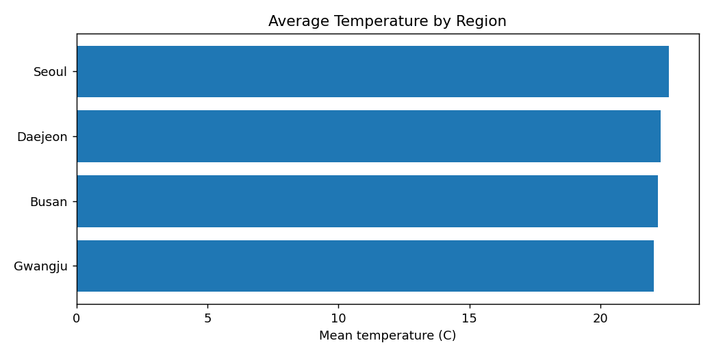

**해설:** 그래프에 표시된 축 단위와 비교 대상의 범위를 먼저 확인하세요. 같은 값이라도 평균·합계·빈도의 차이에 따라 다른 질문에 답합니다. 해당 그림은 제공한 Python 예제를 실행해 생성한 결과입니다.

### Example 02 — 관측 단위와 집계 단위

**문제 상황:** 개별 기록과 일별 평균은 서로 다른 단위. 아래 예제는 어떤 데이터를 집계하고 어떤 단위를 그래프에 표시하는지 확인합니다.

**필요한 개념:** 관측 단위와 집계 단위을 다룰 때는 입력 데이터의 Grain과 결과 그래프의 의미를 명확하게 구별해야 합니다. 코드는 원본을 직접 변경하지 않고 공통 분석 함수의 결과를 이용합니다.

**실행 파일:** [`examples/02_02_grain_vs_aggregation.py`](./examples/02_02_grain_vs_aggregation.py)

```python
good,bad,daily,slots=weather_summary(); sample=good[good.station_id.eq('ST-01')]
fig,ax=plt.subplots(figsize=(10,4));ax.scatter(sample['_parsed'],sample.temperature_c,s=14,label='Observations')
part=daily[daily.station_id.eq('ST-01')];ax.plot(part.date,part.temperature_c,label='Daily mean')
ax.set(title='Observation vs Daily Aggregate',ylabel='Temperature (C)');ax.legend()
```

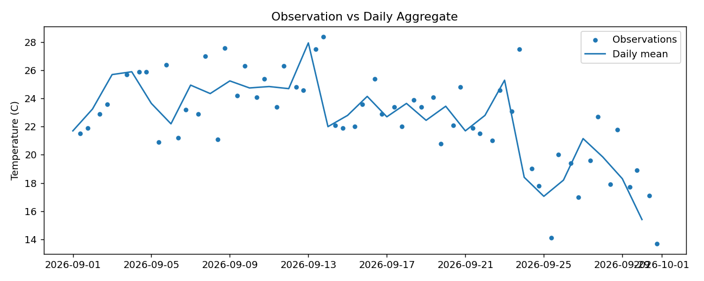

**해설:** 그래프에 표시된 축 단위와 비교 대상의 범위를 먼저 확인하세요. 같은 값이라도 평균·합계·빈도의 차이에 따라 다른 질문에 답합니다. 해당 그림은 제공한 Python 예제를 실행해 생성한 결과입니다.

### Example 03 — 품질 감사와 제외 사유

**문제 상황:** 오류 행을 임의로 누락시키지 않고 사유를 표시. 아래 예제는 어떤 데이터를 집계하고 어떤 단위를 그래프에 표시하는지 확인합니다.

**필요한 개념:** 품질 감사와 제외 사유을 다룰 때는 입력 데이터의 Grain과 결과 그래프의 의미를 명확하게 구별해야 합니다. 코드는 원본을 직접 변경하지 않고 공통 분석 함수의 결과를 이용합니다.

**실행 파일:** [`examples/03_03_quality_audit.py`](./examples/03_03_quality_audit.py)

```python
good,bad,daily,slots=weather_summary()
counts=bad['_reason'].value_counts();fig,ax=plt.subplots(figsize=(9,4));ax.barh(counts.index,counts.values)
ax.set(title='Excluded Rows by Reason',xlabel='Rows (count)')
```

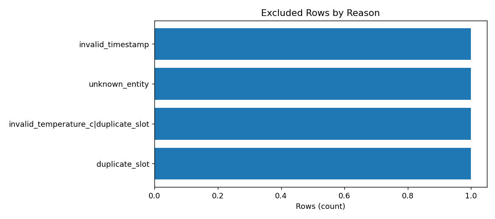

**해설:** 그래프에 표시된 축 단위와 비교 대상의 범위를 먼저 확인하세요. 같은 값이라도 평균·합계·빈도의 차이에 따라 다른 질문에 답합니다. 해당 그림은 제공한 Python 예제를 실행해 생성한 결과입니다.

### Example 04 — 기준정보 결합

**문제 상황:** 관측 ID를 정류장 등 참조정보와 연결. 아래 예제는 어떤 데이터를 집계하고 어떤 단위를 그래프에 표시하는지 확인합니다.

**필요한 개념:** 기준정보 결합을 다룰 때는 입력 데이터의 Grain과 결과 그래프의 의미를 명확하게 구별해야 합니다. 코드는 원본을 직접 변경하지 않고 공통 분석 함수의 결과를 이용합니다.

**실행 파일:** [`examples/04_04_reference_join.py`](./examples/04_04_reference_join.py)

```python
good,bad,daily,slots=metro_summary()
c=good.groupby('line').boardings.sum();fig,ax=plt.subplots(figsize=(7,4));ax.bar(c.index,c.values)
ax.set(title='Boardings by Transit Line',ylabel='Validated boardings (persons)')
```

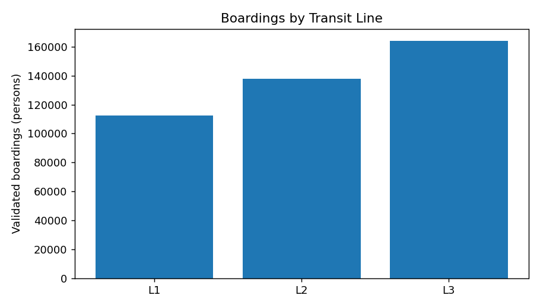

**해설:** 그래프에 표시된 축 단위와 비교 대상의 범위를 먼저 확인하세요. 같은 값이라도 평균·합계·빈도의 차이에 따라 다른 질문에 답합니다. 해당 그림은 제공한 Python 예제를 실행해 생성한 결과입니다.

### Example 05 — 결측과 0 구별

**문제 상황:** 실제로 기록되지 않은 관측 슬롯은 측정값 0이 아님. 아래 예제는 어떤 데이터를 집계하고 어떤 단위를 그래프에 표시하는지 확인합니다.

**필요한 개념:** 결측과 0 구별을 다룰 때는 입력 데이터의 Grain과 결과 그래프의 의미를 명확하게 구별해야 합니다. 코드는 원본을 직접 변경하지 않고 공통 분석 함수의 결과를 이용합니다.

**실행 파일:** [`examples/05_05_missing_vs_zero.py`](./examples/05_05_missing_vs_zero.py)

```python
good,bad,daily,slots=weather_summary();sub=slots[slots.station_id.eq('ST-02')]
c=sub.groupby('date').available.sum();fig,ax=plt.subplots(figsize=(10,4));ax.plot(c.index,c.values,marker='o')
ax.set(title='Daily Observation Coverage',ylabel='Valid records (0–2)',ylim=(-.1,2.3))
```

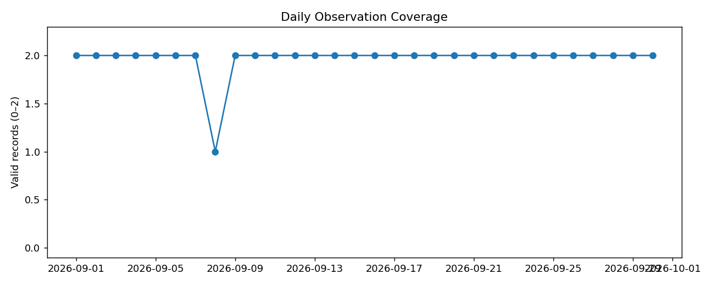

**해설:** 그래프에 표시된 축 단위와 비교 대상의 범위를 먼저 확인하세요. 같은 값이라도 평균·합계·빈도의 차이에 따라 다른 질문에 답합니다. 해당 그림은 제공한 Python 예제를 실행해 생성한 결과입니다.

### Example 06 — 일관된 필터 적용

**문제 상황:** KPI와 그래프에 동일한 데이터 필터를 적용. 아래 예제는 어떤 데이터를 집계하고 어떤 단위를 그래프에 표시하는지 확인합니다.

**필요한 개념:** 일관된 필터 적용을 다룰 때는 입력 데이터의 Grain과 결과 그래프의 의미를 명확하게 구별해야 합니다. 코드는 원본을 직접 변경하지 않고 공통 분석 함수의 결과를 이용합니다.

**실행 파일:** [`examples/06_06_consistent_filters.py`](./examples/06_06_consistent_filters.py)

```python
good,daily=retail_summary();part=daily[daily.store_id.eq('S-01')]
fig,ax=plt.subplots(figsize=(9,4));ax.plot(pd.to_datetime(part.date),part.revenue_krw)
ax.set(title=f'Store S-01 Revenue — Total {int(part.revenue_krw.sum()):,} KRW',ylabel='Revenue (KRW)')
```

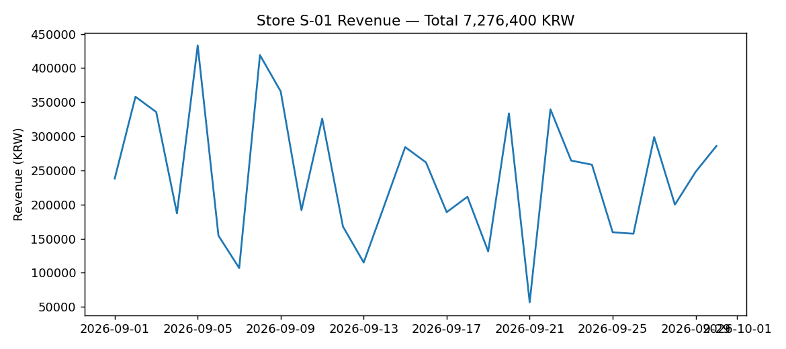

**해설:** 그래프에 표시된 축 단위와 비교 대상의 범위를 먼저 확인하세요. 같은 값이라도 평균·합계·빈도의 차이에 따라 다른 질문에 답합니다. 해당 그림은 제공한 Python 예제를 실행해 생성한 결과입니다.

### Example 07 — 비율과 분모

**문제 상황:** 오류 건수보다 요청 대비 오류율이 중요한 경우. 아래 예제는 어떤 데이터를 집계하고 어떤 단위를 그래프에 표시하는지 확인합니다.

**필요한 개념:** 비율과 분모을 다룰 때는 입력 데이터의 Grain과 결과 그래프의 의미를 명확하게 구별해야 합니다. 코드는 원본을 직접 변경하지 않고 공통 분석 함수의 결과를 이용합니다.

**실행 파일:** [`examples/07_07_rates_denominators.py`](./examples/07_07_rates_denominators.py)

```python
good,summary=latency_summary();fig,ax=plt.subplots(figsize=(7,4));ax.bar(summary.service,summary.error_rate*100)
ax.set(title='Service Error Rate',ylabel='Error rate (%)')
```

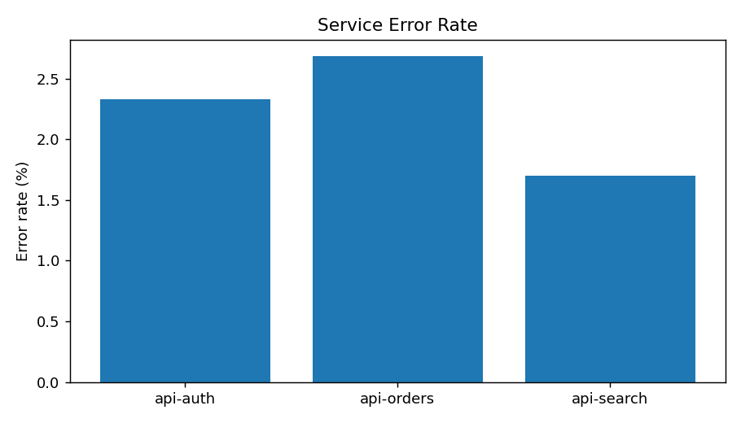

**해설:** 그래프에 표시된 축 단위와 비교 대상의 범위를 먼저 확인하세요. 같은 값이라도 평균·합계·빈도의 차이에 따라 다른 질문에 답합니다. 해당 그림은 제공한 Python 예제를 실행해 생성한 결과입니다.

### Example 08 — 분포와 백분위수

**문제 상황:** 평균만으로는 응답 지연의 긴 꼬리를 파악하기 어려움. 아래 예제는 어떤 데이터를 집계하고 어떤 단위를 그래프에 표시하는지 확인합니다.

**필요한 개념:** 분포와 백분위수을 다룰 때는 입력 데이터의 Grain과 결과 그래프의 의미를 명확하게 구별해야 합니다. 코드는 원본을 직접 변경하지 않고 공통 분석 함수의 결과를 이용합니다.

**실행 파일:** [`examples/08_08_distribution_quantiles.py`](./examples/08_08_distribution_quantiles.py)

```python
good,summary=latency_summary();fig,ax=plt.subplots(figsize=(9,4));ax.boxplot([g.latency_ms for _,g in good.groupby('service')],tick_labels=list(good.groupby('service').groups),showfliers=False)
ax.set(title='Latency Distribution by Service',ylabel='Latency (ms)')
```

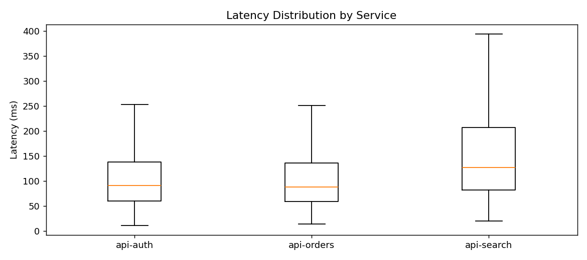

**해설:** 그래프에 표시된 축 단위와 비교 대상의 범위를 먼저 확인하세요. 같은 값이라도 평균·합계·빈도의 차이에 따라 다른 질문에 답합니다. 해당 그림은 제공한 Python 예제를 실행해 생성한 결과입니다.

### Example 09 — UTC와 지역 시각

**문제 상황:** UTC 날짜와 한국시간 날짜의 경계가 다를 수 있음. 아래 예제는 어떤 데이터를 집계하고 어떤 단위를 그래프에 표시하는지 확인합니다.

**필요한 개념:** UTC와 지역 시각을 다룰 때는 입력 데이터의 Grain과 결과 그래프의 의미를 명확하게 구별해야 합니다. 코드는 원본을 직접 변경하지 않고 공통 분석 함수의 결과를 이용합니다.

**실행 파일:** [`examples/09_09_timezone_conversion.py`](./examples/09_09_timezone_conversion.py)

```python
good,bad,daily=electricity_summary();g=good[good.region.eq('North')].head(48)
fig,ax=plt.subplots(figsize=(10,4));ax.plot(g.timestamp_kst,g.demand_mw)
ax.set(title='Hourly Demand (Asia/Seoul)',ylabel='Demand (MW)')
```

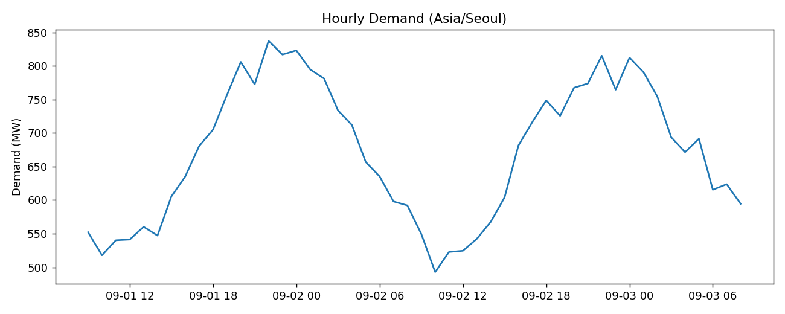

**해설:** 그래프에 표시된 축 단위와 비교 대상의 범위를 먼저 확인하세요. 같은 값이라도 평균·합계·빈도의 차이에 따라 다른 질문에 답합니다. 해당 그림은 제공한 Python 예제를 실행해 생성한 결과입니다.

### Example 10 — 전력과 에너지 구별

**문제 상황:** 전력 MW를 합계 내는 것이 자동으로 에너지 MWh가 되지는 않음. 아래 예제는 어떤 데이터를 집계하고 어떤 단위를 그래프에 표시하는지 확인합니다.

**필요한 개념:** 전력과 에너지 구별을 다룰 때는 입력 데이터의 Grain과 결과 그래프의 의미를 명확하게 구별해야 합니다. 코드는 원본을 직접 변경하지 않고 공통 분석 함수의 결과를 이용합니다.

**실행 파일:** [`examples/10_10_mw_vs_mwh.py`](./examples/10_10_mw_vs_mwh.py)

```python
good,bad,daily=electricity_summary();summary=daily.groupby('region').mean_demand_mw.mean().sort_values()
fig,ax=plt.subplots(figsize=(8,4));ax.barh(summary.index,summary.values)
ax.set(title='Mean Power Demand by Region',xlabel='Power (MW)')
```

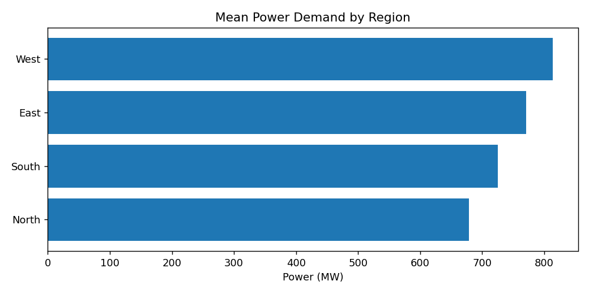

**해설:** 그래프에 표시된 축 단위와 비교 대상의 범위를 먼저 확인하세요. 같은 값이라도 평균·합계·빈도의 차이에 따라 다른 질문에 답합니다. 해당 그림은 제공한 Python 예제를 실행해 생성한 결과입니다.

### Example 11 — 완전한 관측일

**문제 상황:** 부분 기록의 일별 총량을 완전 관측일과 섞어 비교하지 않음. 아래 예제는 어떤 데이터를 집계하고 어떤 단위를 그래프에 표시하는지 확인합니다.

**필요한 개념:** 완전한 관측일을 다룰 때는 입력 데이터의 Grain과 결과 그래프의 의미를 명확하게 구별해야 합니다. 코드는 원본을 직접 변경하지 않고 공통 분석 함수의 결과를 이용합니다.

**실행 파일:** [`examples/11_11_completeness.py`](./examples/11_11_completeness.py)

```python
good,bad,daily,slots=metro_summary();counts=daily.groupby('complete').size().reindex([False,True],fill_value=0)
fig,ax=plt.subplots(figsize=(7,4));ax.bar(['Incomplete','Complete'],counts.values)
ax.set(title='Daily Station Coverage State',ylabel='Station-days (count)')
```

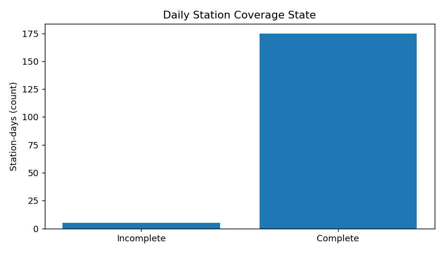

**해설:** 그래프에 표시된 축 단위와 비교 대상의 범위를 먼저 확인하세요. 같은 값이라도 평균·합계·빈도의 차이에 따라 다른 질문에 답합니다. 해당 그림은 제공한 Python 예제를 실행해 생성한 결과입니다.

### Example 12 — 표본수와 변동성

**문제 상황:** 표본수가 적은 집계 결과는 신뢰도가 떨어질 수 있음. 아래 예제는 어떤 데이터를 집계하고 어떤 단위를 그래프에 표시하는지 확인합니다.

**필요한 개념:** 표본수와 변동성을 다룰 때는 입력 데이터의 Grain과 결과 그래프의 의미를 명확하게 구별해야 합니다. 코드는 원본을 직접 변경하지 않고 공통 분석 함수의 결과를 이용합니다.

**실행 파일:** [`examples/12_12_uncertainty.py`](./examples/12_12_uncertainty.py)

```python
good,summary=latency_summary();fig,ax=plt.subplots(figsize=(8,4));ax.bar(summary.service,summary.median_ms,label='Median')
ax.scatter(summary.service,summary.p95_ms,color='black',zorder=3,label='P95')
ax.set(title='Median vs P95 Latency',ylabel='Latency (ms)');ax.legend()
```

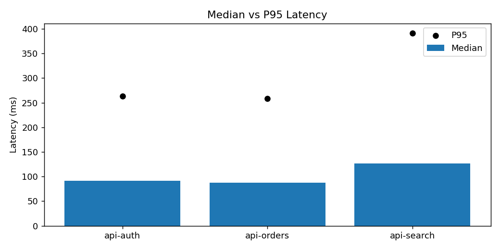

**해설:** 그래프에 표시된 축 단위와 비교 대상의 범위를 먼저 확인하세요. 같은 값이라도 평균·합계·빈도의 차이에 따라 다른 질문에 답합니다. 해당 그림은 제공한 Python 예제를 실행해 생성한 결과입니다.

### Example 13 — 시간대 히트맵

**문제 상황:** 서로 다른 정류장의 시간별 이용 분포 확인. 아래 예제는 어떤 데이터를 집계하고 어떤 단위를 그래프에 표시하는지 확인합니다.

**필요한 개념:** 시간대 히트맵을 다룰 때는 입력 데이터의 Grain과 결과 그래프의 의미를 명확하게 구별해야 합니다. 코드는 원본을 직접 변경하지 않고 공통 분석 함수의 결과를 이용합니다.

**실행 파일:** [`examples/13_13_heatmap.py`](./examples/13_13_heatmap.py)

```python
good,bad,daily,slots,incidents=transit_summary();heat=good.assign(hour=good['_parsed'].dt.hour).pivot_table(index='stop_id',columns='hour',values='boardings',aggfunc='mean')
fig,ax=plt.subplots(figsize=(11,5));im=ax.imshow(heat.to_numpy(),aspect='auto')
ax.set(title='Mean Boardings by Stop and Hour',yticks=range(len(heat.index)),yticklabels=heat.index,xticks=range(len(heat.columns)),xticklabels=heat.columns)
fig.colorbar(im,ax=ax,label='Mean boardings (persons)')
```

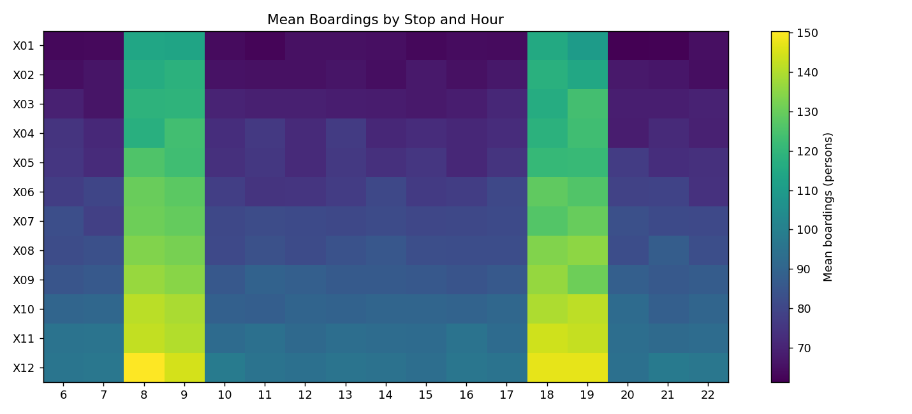

**해설:** 그래프에 표시된 축 단위와 비교 대상의 범위를 먼저 확인하세요. 같은 값이라도 평균·합계·빈도의 차이에 따라 다른 질문에 답합니다. 해당 그림은 제공한 Python 예제를 실행해 생성한 결과입니다.

### Example 14 — 정적과 인터랙티브 차이

**문제 상황:** PNG는 공유에 유리하고 Plotly HTML은 필터·확대가 가능. 아래 예제는 어떤 데이터를 집계하고 어떤 단위를 그래프에 표시하는지 확인합니다.

**필요한 개념:** 정적과 인터랙티브 차이을 다룰 때는 입력 데이터의 Grain과 결과 그래프의 의미를 명확하게 구별해야 합니다. 코드는 원본을 직접 변경하지 않고 공통 분석 함수의 결과를 이용합니다.

**실행 파일:** [`examples/14_14_static_vs_interactive.py`](./examples/14_14_static_vs_interactive.py)

```python
good,bad,daily,slots=weather_summary();s=daily[daily.station_id.eq('ST-02')]
fig,ax=plt.subplots(figsize=(9,4));ax.plot(s.date,s.temperature_c,marker='o')
ax.set(title='Static PNG Weather Overview',ylabel='Temperature (C)')
```

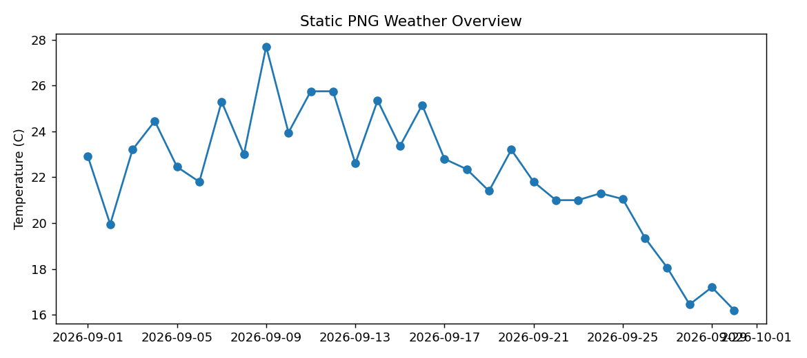

**해설:** 그래프에 표시된 축 단위와 비교 대상의 범위를 먼저 확인하세요. 같은 값이라도 평균·합계·빈도의 차이에 따라 다른 질문에 답합니다. 해당 그림은 제공한 Python 예제를 실행해 생성한 결과입니다.

### Example 15 — 재현 가능한 보고서

**문제 상황:** 동일 입력·동일 기준은 같은 결과를 산출해야 함. 아래 예제는 어떤 데이터를 집계하고 어떤 단위를 그래프에 표시하는지 확인합니다.

**필요한 개념:** 재현 가능한 보고서을 다룰 때는 입력 데이터의 Grain과 결과 그래프의 의미를 명확하게 구별해야 합니다. 코드는 원본을 직접 변경하지 않고 공통 분석 함수의 결과를 이용합니다.

**실행 파일:** [`examples/15_15_report_reproducibility.py`](./examples/15_15_report_reproducibility.py)

```python
good,bad,daily,slots,incidents=transit_summary();c=good.groupby('line').boardings.sum().sort_index()
fig,ax=plt.subplots(figsize=(8,4));ax.bar(c.index,c.values)
ax.set(title='Validated Transit Boardings',ylabel='Boardings (persons)')
```

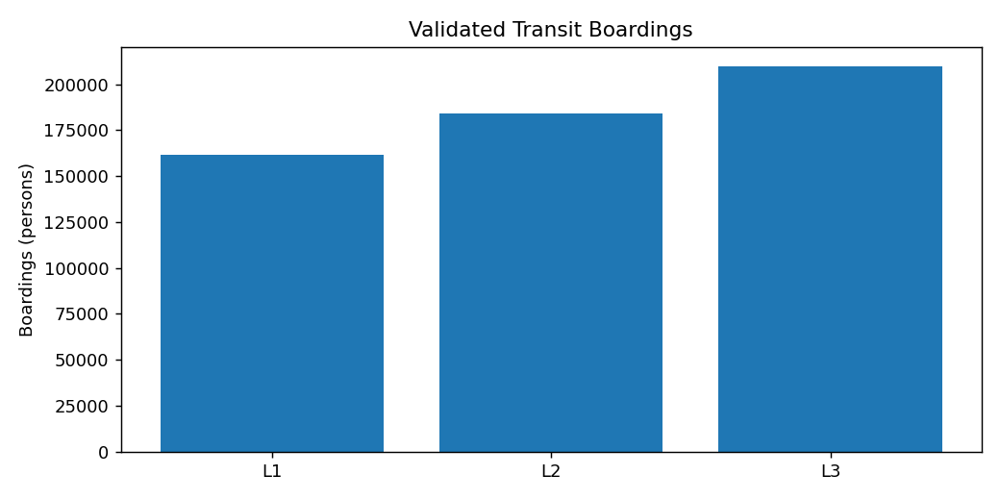

**해설:** 그래프에 표시된 축 단위와 비교 대상의 범위를 먼저 확인하세요. 같은 값이라도 평균·합계·빈도의 차이에 따라 다른 질문에 답합니다. 해당 그림은 제공한 Python 예제를 실행해 생성한 결과입니다.

### Example 16 — 품질 게이트

**문제 상황:** 불완전한 날짜를 모른 채 일별 합계를 확정하지 않음. 아래 예제는 어떤 데이터를 집계하고 어떤 단위를 그래프에 표시하는지 확인합니다.

**필요한 개념:** 품질 게이트을 다룰 때는 입력 데이터의 Grain과 결과 그래프의 의미를 명확하게 구별해야 합니다. 코드는 원본을 직접 변경하지 않고 공통 분석 함수의 결과를 이용합니다.

**실행 파일:** [`examples/16_16_quality_gate.py`](./examples/16_16_quality_gate.py)

```python
good,bad,daily,slots,incidents=transit_summary();p=slots.groupby('stop_id').available.mean()
fig,ax=plt.subplots(figsize=(8,4));ax.bar(p.index,p.values*100)
ax.set(title='Expected Slot Coverage',ylabel='Coverage (%)',ylim=(0,102))
```

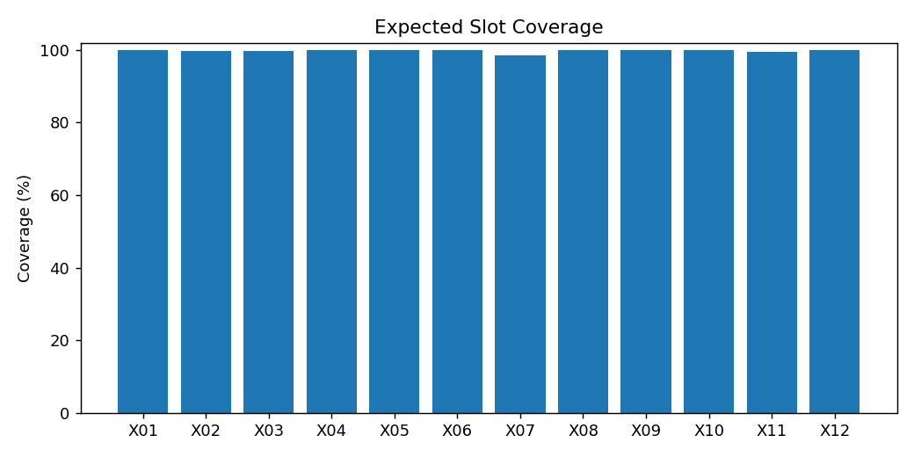

**해설:** 그래프에 표시된 축 단위와 비교 대상의 범위를 먼저 확인하세요. 같은 값이라도 평균·합계·빈도의 차이에 따라 다른 질문에 답합니다. 해당 그림은 제공한 Python 예제를 실행해 생성한 결과입니다.

### Example 17 — Plotly HTML 내보내기

**문제 상황:** 확대·범례를 직접 조작할 수 있는 인터랙티브 결과. 아래 예제는 어떤 데이터를 집계하고 어떤 단위를 그래프에 표시하는지 확인합니다.

**필요한 개념:** Plotly HTML 내보내기을 다룰 때는 입력 데이터의 Grain과 결과 그래프의 의미를 명확하게 구별해야 합니다. 코드는 원본을 직접 변경하지 않고 공통 분석 함수의 결과를 이용합니다.

**실행 파일:** [`examples/17_17_plotly_interactive.py`](./examples/17_17_plotly_interactive.py)

```python
good,bad,daily,slots=weather_summary();import plotly.express as px
p=px.line(daily,x='date',y='temperature_c',color='region',title='Interactive Daily Mean Temperature')
html=ROOT/'figures'/'interactive'/'17_weather_plotly.html';html.parent.mkdir(parents=True,exist_ok=True)
p.write_html(str(html),include_plotlyjs=True,full_html=True)
fig,ax=plt.subplots(figsize=(9,4));
for region,g in daily.groupby('region'):ax.plot(g.date,g.temperature_c,label=region)
ax.set(title='Interactive Plotly — Static Reference',ylabel='Temperature (C)');ax.legend(ncol=4)
```

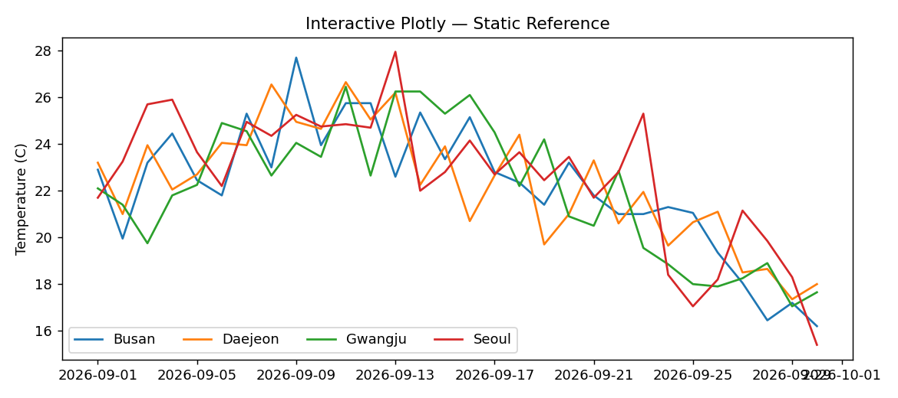

**해설:** 그래프에 표시된 축 단위와 비교 대상의 범위를 먼저 확인하세요. 같은 값이라도 평균·합계·빈도의 차이에 따라 다른 질문에 답합니다. 해당 그림은 제공한 Python 예제를 실행해 생성한 결과입니다.

### Example 18 — 그래프 완성도

**문제 상황:** 축·단위·라벨·폰트 등 기본 가독성을 점검. 아래 예제는 어떤 데이터를 집계하고 어떤 단위를 그래프에 표시하는지 확인합니다.

**필요한 개념:** 그래프 완성도을 다룰 때는 입력 데이터의 Grain과 결과 그래프의 의미를 명확하게 구별해야 합니다. 코드는 원본을 직접 변경하지 않고 공통 분석 함수의 결과를 이용합니다.

**실행 파일:** [`examples/18_18_chart_readability.py`](./examples/18_18_chart_readability.py)

```python
good,daily=retail_summary();g=daily.groupby('store_id').revenue_krw.sum().sort_values()
fig,ax=plt.subplots(figsize=(9,4));bars=ax.barh(g.index,g.values)
ax.bar_label(bars,padding=4,fmt='%.0f');ax.set(title='Completed Sales by Store',xlabel='Revenue (KRW)')
```

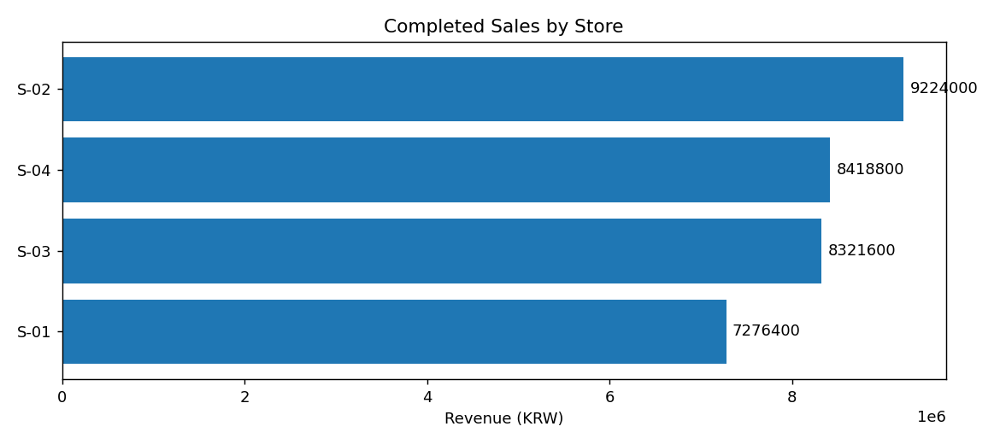

**해설:** 그래프에 표시된 축 단위와 비교 대상의 범위를 먼저 확인하세요. 같은 값이라도 평균·합계·빈도의 차이에 따라 다른 질문에 답합니다. 해당 그림은 제공한 Python 예제를 실행해 생성한 결과입니다.

---

<a id="section-9-14"></a>
## 9.14. Coding Practice

Coding Practice는 **일부 작성된 코드를 완성하는 방식**입니다. 처음부터 긴 프로그램을 새로 작성하기보다, 이미 존재하는 데이터 흐름에서 핵심 계산을 추가하도록 설계했습니다. 아래 문제는 학생이 직접 구현하는 부분이며 모범답안 코드는 본문에 공개하지 않습니다.

**풀이 순서:** 문제 이해 → `exercises/` 파일 수정 → 실행 결과 확인 → 필요시 `solutions/` 비교. 오류가 발생하면 원본을 수정하기보다 입력 조건과 단위를 먼저 점검하세요.

### Practice 01 — 기온 평균

**상황과 요구사항:** region별 평균 기온을 계산하고 `summary`에 저장. 이 값은 보고서의 지표나 그래프 입력값을 만드는 데 사용합니다.

- 시작 파일: [`01_weather_mean.py`](./exercises/01_weather_mean.py)
- 완료 기준: 요구된 변수 `summary`가 정의되고, 데이터 단위·집계 기준이 문제 조건과 일치해야 합니다.

### Practice 02 — 제외 행 개수

**상황과 요구사항:** 검증 제외 행을 세어 `excluded_count`에 저장. 이 값은 보고서의 지표나 그래프 입력값을 만드는 데 사용합니다.

- 시작 파일: [`02_weather_audit.py`](./exercises/02_weather_audit.py)
- 완료 기준: 요구된 변수 `excluded_count`가 정의되고, 데이터 단위·집계 기준이 문제 조건과 일치해야 합니다.

### Practice 03 — 수집률

**상황과 요구사항:** 전체 예정 슬롯 중 유효 관측 비율을 `coverage`에 저장. 이 값은 보고서의 지표나 그래프 입력값을 만드는 데 사용합니다.

- 시작 파일: [`03_weather_coverage.py`](./exercises/03_weather_coverage.py)
- 완료 기준: 요구된 변수 `coverage`가 정의되고, 데이터 단위·집계 기준이 문제 조건과 일치해야 합니다.

### Practice 04 — 완료 날짜 수

**상황과 요구사항:** 관측소별 하루 유효 기록이 2개인 날의 수를 `complete_days`에 저장. 이 값은 보고서의 지표나 그래프 입력값을 만드는 데 사용합니다.

- 시작 파일: [`04_weather_days.py`](./exercises/04_weather_days.py)
- 완료 기준: 요구된 변수 `complete_days`가 정의되고, 데이터 단위·집계 기준이 문제 조건과 일치해야 합니다.

### Practice 05 — 완료 매출 합계

**상황과 요구사항:** 매출 `revenue_krw` 합계를 `total`에 저장. 이 값은 보고서의 지표나 그래프 입력값을 만드는 데 사용합니다.

- 시작 파일: [`05_retail_total.py`](./exercises/05_retail_total.py)
- 완료 기준: 요구된 변수 `total`가 정의되고, 데이터 단위·집계 기준이 문제 조건과 일치해야 합니다.

### Practice 06 — 매장별 매출

**상황과 요구사항:** 매장별 총매출 Series를 `totals`에 저장. 이 값은 보고서의 지표나 그래프 입력값을 만드는 데 사용합니다.

- 시작 파일: [`06_retail_group.py`](./exercises/06_retail_group.py)
- 완료 기준: 요구된 변수 `totals`가 정의되고, 데이터 단위·집계 기준이 문제 조건과 일치해야 합니다.

### Practice 07 — 매출 상위 매장

**상황과 요구사항:** 총매출이 가장 높은 매장 ID를 `top_store`로 저장. 이 값은 보고서의 지표나 그래프 입력값을 만드는 데 사용합니다.

- 시작 파일: [`07_retail_top.py`](./exercises/07_retail_top.py)
- 완료 기준: 요구된 변수 `top_store`가 정의되고, 데이터 단위·집계 기준이 문제 조건과 일치해야 합니다.

### Practice 08 — P95 응답 지연

**상황과 요구사항:** 서비스별 P95 지연을 `p95` Series로 저장. 이 값은 보고서의 지표나 그래프 입력값을 만드는 데 사용합니다.

- 시작 파일: [`08_service_p95.py`](./exercises/08_service_p95.py)
- 완료 기준: 요구된 변수 `p95`가 정의되고, 데이터 단위·집계 기준이 문제 조건과 일치해야 합니다.

### Practice 09 — 오류율

**상황과 요구사항:** 전체 요청 중 오류 응답 비율을 `error_rate`에 저장. 이 값은 보고서의 지표나 그래프 입력값을 만드는 데 사용합니다.

- 시작 파일: [`09_service_errors.py`](./exercises/09_service_errors.py)
- 완료 기준: 요구된 변수 `error_rate`가 정의되고, 데이터 단위·집계 기준이 문제 조건과 일치해야 합니다.

### Practice 10 — 가장 느린 서비스

**상황과 요구사항:** P95 지연이 가장 높은 서비스를 `slowest`에 저장. 이 값은 보고서의 지표나 그래프 입력값을 만드는 데 사용합니다.

- 시작 파일: [`10_service_slowest.py`](./exercises/10_service_slowest.py)
- 완료 기준: 요구된 변수 `slowest`가 정의되고, 데이터 단위·집계 기준이 문제 조건과 일치해야 합니다.

### Practice 11 — UTC를 KST로

**상황과 요구사항:** KST 시간 기준 날짜를 `days` 시리즈로 저장. 이 값은 보고서의 지표나 그래프 입력값을 만드는 데 사용합니다.

- 시작 파일: [`11_electricity_timezone.py`](./exercises/11_electricity_timezone.py)
- 완료 기준: 요구된 변수 `days`가 정의되고, 데이터 단위·집계 기준이 문제 조건과 일치해야 합니다.

### Practice 12 — 시간별 평균 전력

**상황과 요구사항:** 지역별 평균 전력 수요를 `average_mw`로 저장. 이 값은 보고서의 지표나 그래프 입력값을 만드는 데 사용합니다.

- 시작 파일: [`12_electricity_average.py`](./exercises/12_electricity_average.py)
- 완료 기준: 요구된 변수 `average_mw`가 정의되고, 데이터 단위·집계 기준이 문제 조건과 일치해야 합니다.

### Practice 13 — 제외 사유별 건수

**상황과 요구사항:** 검증 제외 사유별 건수를 `excluded`에 저장. 이 값은 보고서의 지표나 그래프 입력값을 만드는 데 사용합니다.

- 시작 파일: [`13_electricity_excluded.py`](./exercises/13_electricity_excluded.py)
- 완료 기준: 요구된 변수 `excluded`가 정의되고, 데이터 단위·집계 기준이 문제 조건과 일치해야 합니다.

### Practice 14 — 역별 승차 인원

**상황과 요구사항:** 역별 총승차 인원을 `boardings`에 저장. 이 값은 보고서의 지표나 그래프 입력값을 만드는 데 사용합니다.

- 시작 파일: [`14_metro_boardings.py`](./exercises/14_metro_boardings.py)
- 완료 기준: 요구된 변수 `boardings`가 정의되고, 데이터 단위·집계 기준이 문제 조건과 일치해야 합니다.

### Practice 15 — 미관측 슬롯

**상황과 요구사항:** 예정되었으나 유효 기록이 없는 슬롯 수를 `missing_slots`로 저장. 이 값은 보고서의 지표나 그래프 입력값을 만드는 데 사용합니다.

- 시작 파일: [`15_metro_missing.py`](./exercises/15_metro_missing.py)
- 완료 기준: 요구된 변수 `missing_slots`가 정의되고, 데이터 단위·집계 기준이 문제 조건과 일치해야 합니다.

### Practice 16 — 일별 완전성

**상황과 요구사항:** 모든 시간에 관측된 일자 행 수를 `complete_rows`에 저장. 이 값은 보고서의 지표나 그래프 입력값을 만드는 데 사용합니다.

- 시작 파일: [`16_metro_complete.py`](./exercises/16_metro_complete.py)
- 완료 기준: 요구된 변수 `complete_rows`가 정의되고, 데이터 단위·집계 기준이 문제 조건과 일치해야 합니다.

### Practice 17 — 노선별 승차 인원

**상황과 요구사항:** 노선별 총승차 인원을 `line_totals`에 저장. 이 값은 보고서의 지표나 그래프 입력값을 만드는 데 사용합니다.

- 시작 파일: [`17_transit_line.py`](./exercises/17_transit_line.py)
- 완료 기준: 요구된 변수 `line_totals`가 정의되고, 데이터 단위·집계 기준이 문제 조건과 일치해야 합니다.

### Practice 18 — 오류 사유

**상황과 요구사항:** 검증 제외된 행의 사유를 `reasons`로 저장. 이 값은 보고서의 지표나 그래프 입력값을 만드는 데 사용합니다.

- 시작 파일: [`18_transit_reasons.py`](./exercises/18_transit_reasons.py)
- 완료 기준: 요구된 변수 `reasons`가 정의되고, 데이터 단위·집계 기준이 문제 조건과 일치해야 합니다.

### Practice 19 — 사고 유형별 건수

**상황과 요구사항:** 사고 유형별 발생 건수를 `incidents_by_type`에 저장. 이 값은 보고서의 지표나 그래프 입력값을 만드는 데 사용합니다.

- 시작 파일: [`19_transit_incidents.py`](./exercises/19_transit_incidents.py)
- 완료 기준: 요구된 변수 `incidents_by_type`가 정의되고, 데이터 단위·집계 기준이 문제 조건과 일치해야 합니다.

### Practice 20 — 관측소별 수집률

**상황과 요구사항:** 정류장별 예정 슬롯 기준 수집률을 `rates`에 저장. 이 값은 보고서의 지표나 그래프 입력값을 만드는 데 사용합니다.

- 시작 파일: [`20_transit_rates.py`](./exercises/20_transit_rates.py)
- 완료 기준: 요구된 변수 `rates`가 정의되고, 데이터 단위·집계 기준이 문제 조건과 일치해야 합니다.


---

<a id="section-9-15"></a>
## 9.15. Mini Project 01 — Weather Brief

**문제 상황:** 관측소별 기온과 강수량을 비교하는 보고서가 필요합니다. 단위와 필터가 정확한 시각화 보고서를 만드세요.

**시작 자료:** [`projects/mini_01_weather_brief/TASK.md`](./projects/mini_01_weather_brief/TASK.md), [`starter.py`](./projects/mini_01_weather_brief/starter.py)

**구현 단계:** 원본 로드 → 검증 → 집계 → 그래프 생성 → CSV·JSON 내보내기. 실행 완료 후 그래프의 축·레이블과 수치가 일치하는지 확인해야 합니다.

**예상 결과(코드 미공개)**

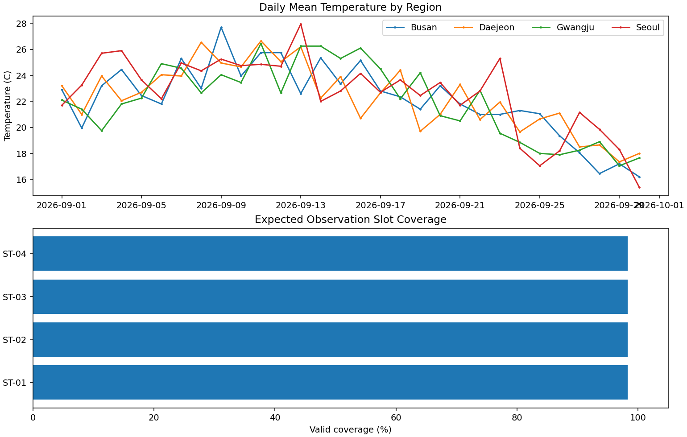


---

<a id="section-9-16"></a>
## 9.16. Mini Project 02 — Retail Brief

**문제 상황:** 매장별 일매출 추이와 상품별 매출 구성가 필요합니다. 단위와 필터가 정확한 시각화 보고서를 만드세요.

**시작 자료:** [`projects/mini_02_retail_brief/TASK.md`](./projects/mini_02_retail_brief/TASK.md), [`starter.py`](./projects/mini_02_retail_brief/starter.py)

**구현 단계:** 원본 로드 → 검증 → 집계 → 그래프 생성 → CSV·JSON 내보내기. 실행 완료 후 그래프의 축·레이블과 수치가 일치하는지 확인해야 합니다.

**예상 결과(코드 미공개)**


---

<a id="section-9-17"></a>
## 9.17. Advanced Project 01 — Weather Station Review

**문제 상황:** 관측소 선택에 따라 보고서 레이아웃이 변하는 기상 관측 품질 분석가 필요합니다. 미리 정해진 데이터에서만 작동하는 화면이 아니라, 조건 변경과 오류 입력을 처리할 수 있어야 합니다.

**자료:** [`TASK.md`](./projects/advanced_01_weather_station/TASK.md) · [`starter.py`](./projects/advanced_01_weather_station/starter.py) · [`HINTS.md`](./projects/advanced_01_weather_station/HINTS.md)

**핵심 요구사항**

- 관측소 수가 달라져도 그림과 범례를 동적으로 생성하세요.
- 예정 관측 슬롯과 유효 관측 수집률을 관측소별로 계산하세요.
- 강수량 0과 미관측을 구별하세요.
- 급격한 기온 변동이 실제 관측인지 검토할 수 있도록 원본 시점도 보존하세요.

**검증 기준:** 오류 행은 감사 파일에 기록하고, 잘못된 참조 ID가 나타나도 집계값이 조용히 달라지지 않아야 합니다. 그래프는 대상 수가 변해도 축·범례가 읽혀야 합니다.


---

<a id="section-9-18"></a>
## 9.18. Advanced Project 02 — Retail Performance Review

**문제 상황:** 매장 매출·주문 건수·취소율 기준을 구별하는 매출 분석가 필요합니다. 미리 정해진 데이터에서만 작동하는 화면이 아니라, 조건 변경과 오류 입력을 처리할 수 있어야 합니다.

**자료:** [`TASK.md`](./projects/advanced_02_retail_performance/TASK.md) · [`starter.py`](./projects/advanced_02_retail_performance/starter.py) · [`HINTS.md`](./projects/advanced_02_retail_performance/HINTS.md)

**핵심 요구사항**

- 취소 주문을 완료 매출에 포함하지 마세요.
- 매장별 매출 합계와 주문 건수, 평균 주문상품 매출을 구별하세요.
- 기간별 수치가 달라질 때 KPI와 그래프 필터 범위를 일치시키세요.
- 매장 데이터에 존재하지 않는 상품이 추가되면 참조 기준을 확인할 수 있게 만드세요.

**검증 기준:** 오류 행은 감사 파일에 기록하고, 잘못된 참조 ID가 나타나도 집계값이 조용히 달라지지 않아야 합니다. 그래프는 대상 수가 변해도 축·범례가 읽혀야 합니다.

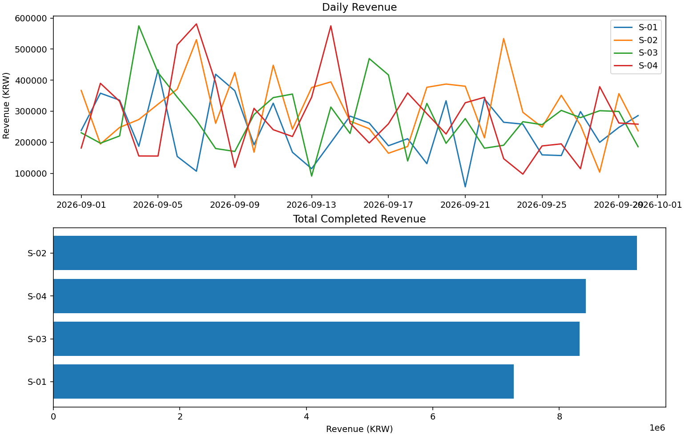


---

<a id="section-9-19"></a>
## 9.19. Advanced Project 03 — Service Reliability Review

**문제 상황:** 서비스별 P95 지연·오류율을 함께 검토하는 성능 분석가 필요합니다. 미리 정해진 데이터에서만 작동하는 화면이 아니라, 조건 변경과 오류 입력을 처리할 수 있어야 합니다.

**자료:** [`TASK.md`](./projects/advanced_03_service_reliability/TASK.md) · [`starter.py`](./projects/advanced_03_service_reliability/starter.py) · [`HINTS.md`](./projects/advanced_03_service_reliability/HINTS.md)

**핵심 요구사항**

- 서비스별 중앙값·P95·오류율을 동시에 표현하세요.
- 응답 지연의 긴 꼬리를 평균 하나로 숨기지 마세요.
- 요청 건수가 다른 서비스의 오류 건수와 오류율을 별도로 보여주세요.
- 선택한 서비스의 유효 요청이 없으면 그래프 대신 명확한 안내를 제공하세요.

**검증 기준:** 오류 행은 감사 파일에 기록하고, 잘못된 참조 ID가 나타나도 집계값이 조용히 달라지지 않아야 합니다. 그래프는 대상 수가 변해도 축·범례가 읽혀야 합니다.

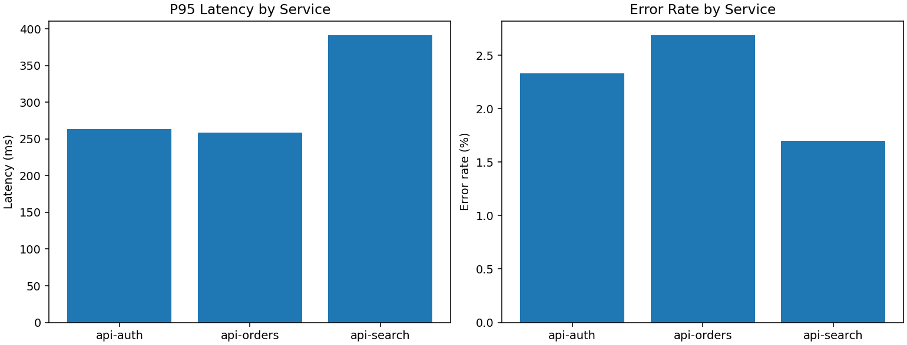


---

<a id="section-9-20"></a>
## 9.20. Advanced Project 04 — Regional Electricity Demand

**문제 상황:** UTC 시간대·실측 전력과 에너지를 구별한 지역별 수요 보고서가 필요합니다. 미리 정해진 데이터에서만 작동하는 화면이 아니라, 조건 변경과 오류 입력을 처리할 수 있어야 합니다.

**자료:** [`TASK.md`](./projects/advanced_04_electricity_demand/TASK.md) · [`starter.py`](./projects/advanced_04_electricity_demand/starter.py) · [`HINTS.md`](./projects/advanced_04_electricity_demand/HINTS.md)

**핵심 요구사항**

- UTC를 한국시간으로 변환한 다음 날짜별 집계를 수행하세요.
- 순간 전력(MW)과 에너지(MWh)의 차이를 설명하고 단위를 정확히 사용하세요.
- 수집 누락 시각과 비정상 수요를 감사 기록으로 남기세요.
- 지역별 수요 비교는 같은 시간대와 같은 단위로 수행하세요.

**검증 기준:** 오류 행은 감사 파일에 기록하고, 잘못된 참조 ID가 나타나도 집계값이 조용히 달라지지 않아야 합니다. 그래프는 대상 수가 변해도 축·범례가 읽혀야 합니다.

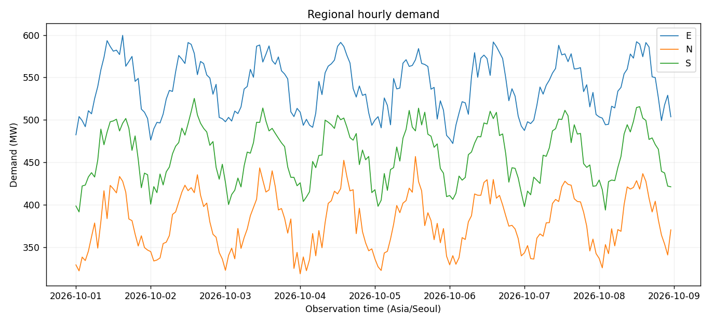


---

<a id="section-9-21"></a>
## 9.21. Advanced Project 05 — Metro Operations Audit

**문제 상황:** 역별 예정 슬롯과 누락 시간을 구별한 도시철도 보고서가 필요합니다. 미리 정해진 데이터에서만 작동하는 화면이 아니라, 조건 변경과 오류 입력을 처리할 수 있어야 합니다.

**자료:** [`TASK.md`](./projects/advanced_05_metro_operations/TASK.md) · [`starter.py`](./projects/advanced_05_metro_operations/starter.py) · [`HINTS.md`](./projects/advanced_05_metro_operations/HINTS.md)

**핵심 요구사항**

- 역별 05–22시의 모든 예정 관측 슬롯을 생성하세요.
- 부분 관측일은 완전 관측일과 구별하세요.
- 역 이름·노선의 기준정보와 정확하게 결합하세요.
- 중복 관측 슬롯은 임의 선택하지 말고 제외 사유를 기록하세요.

**검증 기준:** 오류 행은 감사 파일에 기록하고, 잘못된 참조 ID가 나타나도 집계값이 조용히 달라지지 않아야 합니다. 그래프는 대상 수가 변해도 축·범례가 읽혀야 합니다.

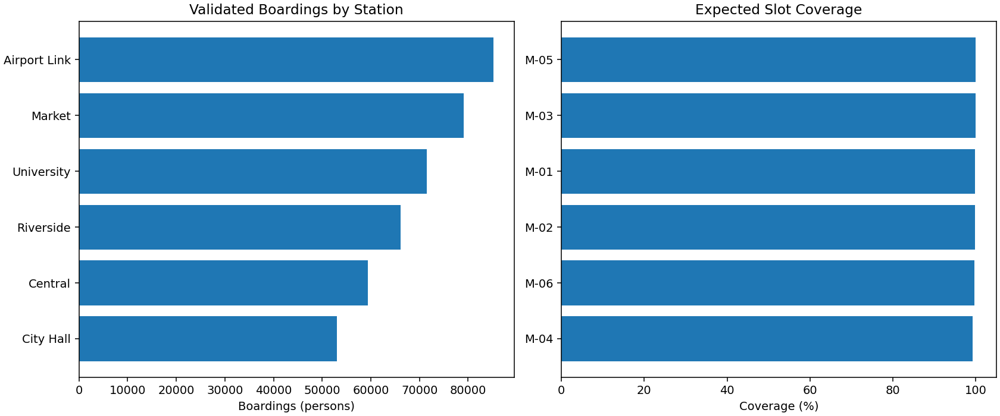


---

<a id="section-9-22"></a>
## 9.22. Challenge 01 — Airport Punctuality Review

**문제 상황:** 세 공항의 가상 운항 기록을 이용해 지연시간과 정시 운항률을 비교하는 분석 보고서가 필요합니다. 단순히 평균 지연을 나열하는 것만으로는 충분하지 않습니다. 지연 분포가 서로 다르고, 일부 편은 아예 기록이 없기 때문입니다.

**조건 및 합격 기준**

1. 공항·날짜·편 슬롯별 원본 관측을 확인합니다.
2. 정시 기준은 **지연 15분 이하**라고 명시합니다. 기준을 바꿀 수 있도록 설계하세요.
3. 평균 지연과 P90, 지연 운항 비율을 각각 계산합니다.
4. 공항별로 하루 예정 편 수가 다른 경우, 누락을 0분 지연으로 처리하지 않습니다.
5. 특정 공항만 선택해도 그림과 보고서가 정상적으로 생성되어야 합니다.
6. 보고서 본문에 관측 편 수와 지연 편 수를 함께 표시합니다.

**시작 파일:** [`projects/challenge_01_flight_punctuality/starter.py`](./projects/challenge_01_flight_punctuality/starter.py). **검증 자료:** [`TASK.md`](./projects/challenge_01_flight_punctuality/TASK.md), [`HINTS.md`](./projects/challenge_01_flight_punctuality/HINTS.md).

**예상 결과**

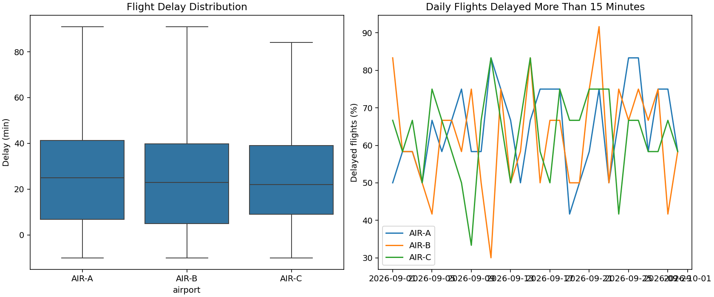

---

<a id="section-9-23"></a>
## 9.23. Challenge 02 — Electricity Load Audit

**문제 상황:** 4개 지역의 시간별 전력 수요를 비교하여 급격한 변화와 수집 누락을 파악하는 분석 시스템을 제작합니다. UTC로 기록한 측정값을 한국시간 날짜별로 분석하며, 값이 높다는 이유만으로 센서 오류라고 단정해서는 안 됩니다.

**조건 및 합격 기준**

1. UTC를 한국시간으로 변환하고, 시각 기준 변경으로 날짜가 달라질 수 있음을 설명합니다.
2. 비정상 숫자·잘못된 시각·중복 관측을 별도로 감사 기록으로 남깁니다.
3. 지역별 시간 구간 비교에서 동일한 시간축을 사용합니다.
4. 이상 구간은 명시된 규칙(예: 일정 시간 내 수요 변화율)으로 탐지합니다. **규칙의 한계**를 설명해야 합니다.
5. 누락이 있는 구간은 데이터 공백으로 표시하며 임의 보간을 하려면 근거를 제시합니다.
6. MW와 MWh를 혼동하지 않고, 요약 지표의 단위·분모를 기록합니다.
7. 그래프·감사 데이터·기준값·요약 보고서를 분리 저장합니다.

**시작 파일:** [`projects/challenge_02_grid_incident/starter.py`](./projects/challenge_02_grid_incident/starter.py). **검증 자료:** [`TASK.md`](./projects/challenge_02_grid_incident/TASK.md), [`HINTS.md`](./projects/challenge_02_grid_incident/HINTS.md).

**예상 결과**

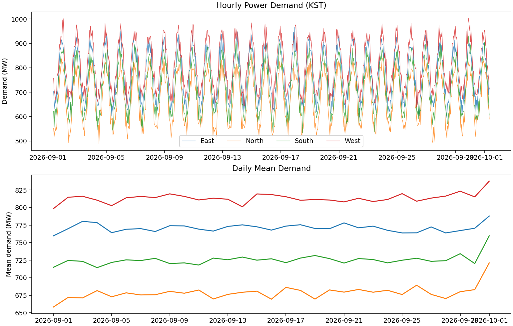

---

<a id="section-9-24"></a>
## 9.24. Challenge 03 — City Transit Reliability Audit

### 최고 난도 — City Transit Reliability Audit & Reporting Platform

**문제 상황**

도시 교통 운영 데이터는 하나의 표로 완결되지 않습니다. 실제 이용 기록은 시간별로 쌓이고, 정류장의 노선·지역 정보는 별도 기준 테이블에 있고, 사고 기록은 별도의 사건 목록에 저장됩니다. 이 자료를 합쳐 **운영 상황을 요약하는 통합 보고서**가 필요합니다.

문제는 자료가 깨끗하지 않다는 것입니다. 어떤 시간에는 데이터가 아예 없고, 같은 슬롯에 서로 다른 값이 중복 기록되며, 존재하지 않는 정류장 ID가 나타나고, 시각과 측정값이 잘못된 레코드도 포함됩니다. 이런 상태에서 그래프만 먼저 그리면 그럴듯하지만 틀린 보고서가 만들어질 수 있습니다.

이 과제에서는 **데이터 처리 규칙을 명세하고, 모든 단계의 정확성을 검증한 뒤, 결과를 재현 가능한 형태로 저장**해야 합니다.

#### 제공 데이터

| 파일 | 목적 | 기준 |
|---|---|---|
| `transit_stops.csv` | 정류장·노선·지역 | 정류장 12개 |
| `transit_operations.csv` | 승차 인원·지연 분 | 6,114행의 가상 기록 |
| `transit_incidents.csv` | 사고 유형·지속 시간 | 90건의 가상 기록 |
| `metadata.json` | 기간·시간대·예정 슬롯 | 2026년 9월, 한국시간 |

**예정 슬롯은 12개 정류장 × 30일 × 하루 17시간 = 6,120개**입니다. 원본 행 수는 6,114개이며, 유효 관측은 6,106개입니다. 원본의 오류 행 8개와 유효 관측이 없는 예정 슬롯 14개는 서로 다른 지표입니다.

#### 필수 요구사항 — 5개 단계

**Stage A. 입력 계약 및 검증**

1. 필수 열과 자료형을 확인하고, 정류장 기준정보의 `stop_id` 유일성을 검사합니다.
2. 운영 관측과 사고 기록의 정류장 참조 ID가 실제 존재하는지 검증합니다.
3. 시각 변환 실패, 음수 승차 인원, 음수 지연, 중복 슬롯을 탐지합니다.
4. 중복 슬롯의 값이 다르고 우선순위 근거가 없다면 해당 슬롯의 모든 후보를 제외합니다.
5. 검증 제외 행은 원래 값과 기계 판독 가능한 오류 사유를 함께 저장합니다.

**Stage B. 관측 완전성 및 집계**

6. 데이터가 존재하지 않는 시간도 파악할 수 있도록 **전체 예정 슬롯 조합을 생성**합니다.
7. 유효 관측 수와 예정 슬롯 수를 분리하고, 정류장·날짜별 수집률을 계산합니다.
8. 관측 17시간이 모두 채워진 날짜만 완전 관측일로 구분합니다.
9. 불완전한 날의 총승차 인원을 완전 관측일과 동일한 조건인 것처럼 비교하지 않습니다.
10. 노선별 지연 평균, 승차 인원 합계, 사고 유형별 건수를 서로 다른 분모로 계산합니다.

**Stage C. 시각화 보고서**

11. 노선별 승차 인원·정류장 수집률·시간별 히트맵·사고 유형 차트를 생성합니다.
12. 선택 정류장이 1개, 2개, 12개인 경우에도 그래프가 정상적으로 만들어져야 합니다.
13. 단위와 축 범위, 결과 기간, 데이터 출처를 명확히 표시합니다.
14. 사고 건수와 지연 시간의 동시 변화가 인과관계를 증명하지 않는다는 설명을 포함합니다.
15. 선택 조건에 맞는 CSV·JSON을 만들고 정적 그래프도 생성합니다.

**Stage D. 재현성 및 감사 가능성**

16. 입력 파일에 대한 SHA-256과 출력 파일에 대한 SHA-256을 `manifest.json`에 기록합니다.
17. 같은 파일·같은 설정으로 두 번 실행했을 때 요약값과 해시가 동일해야 합니다.
18. 원본 행 수는 `accepted + excluded`와 일치해야 합니다.
19. 유효 관측 행 수와 전체 예정 슬롯에서 `available=True`인 행 수는 일치해야 합니다.
20. 검증 실패 시 값을 임의 대체하여 계속 진행하지 않고 원인을 알리는 오류를 발생시킵니다.

**Stage E. 자동 테스트 및 반례**

21. 참조 ID 중복, 미등록 정류장, 잘못된 시각, 음수 값, 중복 관측을 주입합니다.
22. 비어 있는 선택 조건과 존재하지 않는 정류장 선택을 검사합니다.
23. 경계 시각과 결측 슬롯에서 집계 규칙이 유지되는지 검사합니다.
24. 출력 폴더를 바꾸어 재실행해도 동일한 분석 결과가 나오는지 검사합니다.
25. 차트 파일의 생성과 별개로 **집계 정확성 및 가독성 검토**를 수행합니다.

#### 기본 실행과 입력 조건

```bash
python projects/challenge_03_transit_reliability/starter.py
```

다음은 **모범 구현을 참고한 경우에만** 검증용으로 사용할 수 있는 명령행 실행 형식입니다. 학습자는 동일한 인터페이스를 구현해 보세요.

```bash
python solutions/challenge_03_transit_reliability/cli.py --stops X01 X07
python -m unittest discover -s tests -v
```

실행할 때 `--stops`에 전달한 정류장만 분석하고, 미등록 ID는 명확히 거부해야 합니다. 파일 생성이 성공했다는 사실만으로 과제 완성을 인정하지 않습니다.

**시작 파일:** [`starter.py`](./projects/challenge_03_transit_reliability/starter.py). **문제 전문:** [`TASK.md`](./projects/challenge_03_transit_reliability/TASK.md). **단계별 힌트:** [`HINTS.md`](./projects/challenge_03_transit_reliability/HINTS.md).

#### 예상 결과


이 그림은 요구사항의 일부를 보여주는 정적 참고 결과입니다. 최종 완성은 **감사 로그·선택 조건·완전성·재현성·자동 테스트를 모두 통과**해야 합니다.

<details>
<summary><strong>Challenge 03 — 난도가 높은 이유</strong></summary>

어려운 이유는 공식이 복잡해서가 아닙니다. 관측이 빠진 슬롯과 잘못 기록된 행을 혼동하면 보고서 수치가 틀리고, 중복 기준정보를 결합하면 집계값이 증식하며, 지역 시각을 잘못 해석하면 날짜별 수치가 달라지기 때문입니다. 그림이 보기 좋아도 계산이 틀리면 요구사항을 충족하지 못합니다. 따라서 단순 구현, 반례 검증, 보고서 재현성, 가독성 검토를 모두 수행해야 합니다.

</details>

---

<a id="section-9-25"></a>
## 9.25. Quiz & Explanations

Quiz는 이미 학습한 개념을 실제 상황에 적용하는 문제입니다. 복잡한 추론을 억지로 요구하지 않으며, **헷갈리기 쉬운 차이**를 중심으로 구성했습니다. 그래프 선택지의 경우 네 그림 모두 비슷한 형태지만 데이터 순서·결측·축·비율이 달라집니다. 모든 문제의 정답과 해설은 개별 `<details>`에서 확인할 수 있습니다.

### Q01. 관측 단위

기온 원본 한 행이 관측소 1개·시각 1개인 경우, 하루 평균으로 집계하면 관측 단위가 어떻게 달라지나요?

<details>
<summary><strong>Q01. 정답 및 해설 확인</strong></summary>

**정답:** 관측소·날짜당 한 행

**해설:** 원본 관측의 Grain은 관측소·시각이며, 일별 평균은 관측소·날짜입니다. 행 수 감소는 정보 손실과 관련되므로 원본을 보존합니다.

</details>

### Q02. 집계 데이터 생성

`df`에 `region`, `temperature_c`가 있습니다. 지역별 평균을 `mean_temp`에 저장하도록 빈칸을 완성하세요: `mean_temp = df.groupby("region")["temperature_c"].____()`

<details>
<summary><strong>Q02. 정답 및 해설 확인</strong></summary>

**정답:** mean

**해설:** `groupby()` 뒤 `mean()`을 호출합니다. 기온의 합계는 일반적으로 지역의 대표 기온으로 해석할 수 없습니다.

</details>

### Q03. 결측 처리

`df["reading"] = df["reading"].fillna(0)`을 적용한 뒤 결측 건수를 집계했습니다. 어떤 문제가 있을까요?

<details>
<summary><strong>Q03. 정답 및 해설 확인</strong></summary>

**정답:** 기존 결측을 실제 0과 구분할 수 없습니다.

**해설:** 관측 누락은 데이터 부재이고 0은 측정값입니다. 원본 결측 여부나 별도 `observed` 플래그를 유지해야 합니다.

</details>

### Q04. Q04. Sorted Barh

코드: `values = pd.Series({"A":4,"B":7,"C":3}).sort_values()`; `ax.barh(values.index, values.values)`를 실행했습니다. 해당하는 결과를 고르세요.

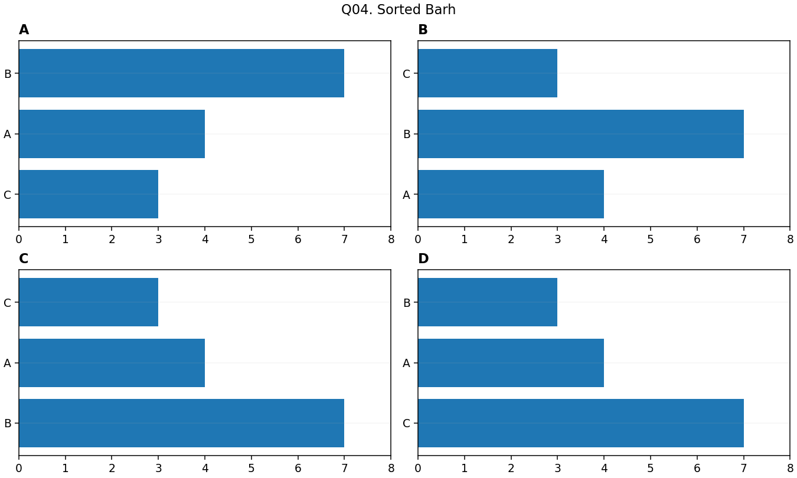

<details>
<summary><strong>Q04. 정답 및 해설 확인</strong></summary>

**정답:** A

**해설:** 정답은 A입니다. 값 3,4,7 오름차순으로 Series가 정렬되며, barh의 첫 범주는 기본적으로 아래쪽에 놓입니다.

**오답 해설:** B는 정렬 전 범주 순서, C는 내림차순 배열, D는 값과 범주의 연결 오류입니다.

</details>

### Q05. 필터와 KPI

`selected`는 필터를 적용한 데이터입니다. 화면의 KPI가 전체 데이터 기준으로 표시되는 오류를 고치세요: `total = all_rows["sales"].sum()`

<details>
<summary><strong>Q05. 정답 및 해설 확인</strong></summary>

**정답:** `total = selected["sales"].sum()`

**해설:** 그래프와 KPI는 동일한 필터 결과에서 계산해야 합니다. 다만 비교를 위해 전체 합계가 필요한 경우 라벨을 명확히 분리합니다.

</details>

### Q06. 중복 슬롯

같은 관측소의 같은 시각 데이터가 2건인데, 어떤 것이 올바른지 알 수 없습니다. 가장 안전한 처리는 무엇인가요?

<details>
<summary><strong>Q06. 정답 및 해설 확인</strong></summary>

**정답:** 두 행을 검토 대상으로 분리하고 근거 없이 하나를 선택하지 않습니다.

**해설:** 처음 나온 행만 선택하면 데이터의 정확성에 대한 근거 없는 가정이 됩니다. 예외적으로 정해진 최신 레코드 규칙이 있으면 그 규칙을 명시하고 적용할 수 있습니다.

</details>

### Q07. Q07. Missing Observation

`ax.plot([0,1,2,3], [3, np.nan, 5, 4], marker="o")`의 결과를 고르세요.

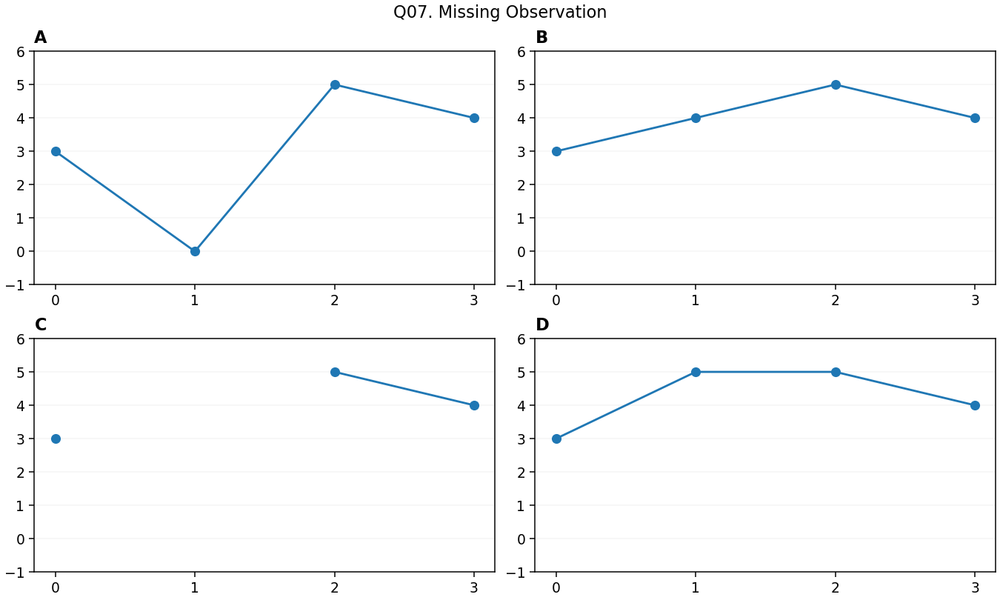

<details>
<summary><strong>Q07. 정답 및 해설 확인</strong></summary>

**정답:** C

**해설:** 정답은 C입니다. `NaN`은 0이 아니라 값이 없는 지점이며, Matplotlib 선은 해당 구간에서 끊어집니다.

**오답 해설:** A는 0 대체, B는 보간, D는 임의 값 대체입니다.

**확인용 코드**

```python
import numpy as np
import matplotlib.pyplot as plt

plt.plot([0, 1, 2, 3], [3, np.nan, 5, 4], marker="o")
plt.show()
```

선이 끊기는 이유는 결측값에 임의 수치를 넣지 않았기 때문입니다.

</details>

### Q08. P95 계산

서비스 지연의 95백분위수를 계산하려면 `df["latency_ms"].quantile(____)`에 무엇을 입력해야 할까요?

<details>
<summary><strong>Q08. 정답 및 해설 확인</strong></summary>

**정답:** 0.95

**해설:** `quantile(0.95)`는 표본 지연값의 95번째 백분위수 추정치입니다. 평균과 다르며 극단값의 영향을 비교하는 데 유용합니다.

</details>

### Q09. 시간대 변환

UTC 시간대를 포함한 `timestamp`를 한국시간으로 변환하려면 `tz_localize()`와 `tz_convert()` 중 어떤 함수를 써야 하나요?

<details>
<summary><strong>Q09. 정답 및 해설 확인</strong></summary>

**정답:** `tz_convert("Asia/Seoul")`

**해설:** 이미 UTC로 시간대가 지정된 시각은 `tz_convert()`로 표시 시간대만 바꿉니다. 시간대가 없는 원본에 시간대 의미를 부여하는 경우 `tz_localize()`를 사용합니다.

</details>

### Q10. Q10. Subplot Index

`fig, axes = plt.subplots(2,2)` 다음 `axes[1,0].bar(...)`을 실행했습니다. 막대그래프가 배치되는 영역을 고르세요.

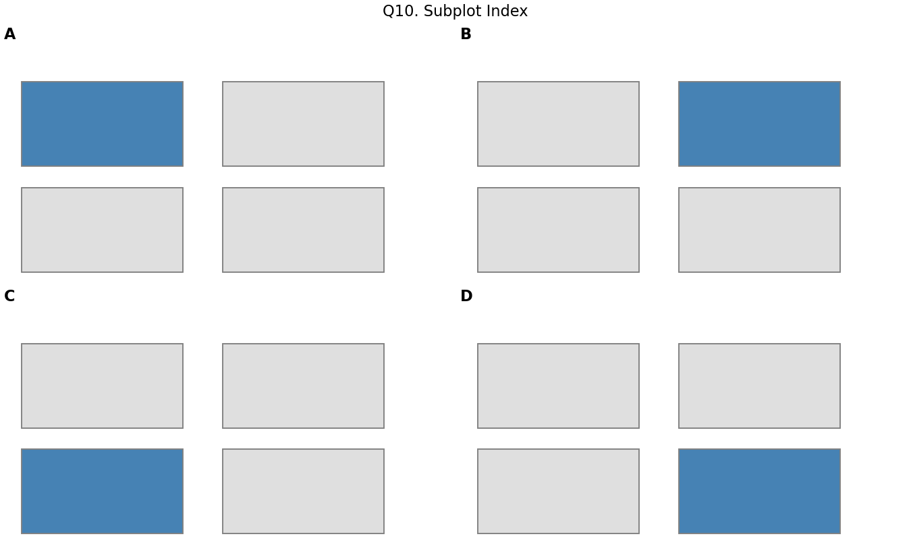

<details>
<summary><strong>Q10. 정답 및 해설 확인</strong></summary>

**정답:** C

**해설:** 정답은 C입니다. `axes[1,0]`은 두 번째 행의 첫 번째 열, 즉 왼쪽 아래 영역입니다.

**오답 해설:** A는 왼쪽 위, B는 오른쪽 위, D는 오른쪽 아래입니다.

**확인용 코드**

```python
import matplotlib.pyplot as plt

fig, axes = plt.subplots(2, 2)
axes[1, 0].bar(["A", "B"], [3, 5])
plt.show()
```

</details>

### Q11. 전력 단위

전력 수요 MW 관측값 24개를 합해 `Daily energy (MWh)`로 표기했습니다. 어떤 전제가 빠졌을까요?

<details>
<summary><strong>Q11. 정답 및 해설 확인</strong></summary>

**정답:** 각 관측이 나타내는 시간 구간과 간격이 명시되어야 합니다.

**해설:** 일정한 1시간 간격의 평균 전력 MW라면 1시간을 곱한 합계가 MWh가 될 수 있습니다. 단순 순간 전력 측정치의 합계는 곧 에너지가 아닙니다.

</details>

### Q12. 완전한 하루

하루 18개 예정 관측 중 17개만 있는 날의 총승차 인원은 완전한 날과 직접 비교해도 될까요?

<details>
<summary><strong>Q12. 정답 및 해설 확인</strong></summary>

**정답:** 완전성 플래그를 표시하고 직접 비교에 주의해야 합니다.

**해설:** 합계의 크기는 관측 누락 때문에 작아질 수 있습니다. 필요한 경우 완전한 날만 비교하거나 보정 근거와 불확실성을 명시합니다.

</details>

### Q13. Q13. Rate and Units

`error_rate=[0.2,0.8]`; `ax.bar(labels, np.array(error_rate)*100)`; `ax.set_ylabel("Error rate (%)")` 결과를 고르세요.

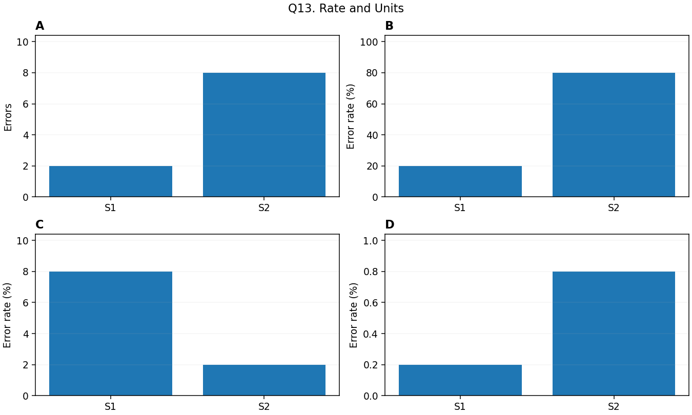

<details>
<summary><strong>Q13. 정답 및 해설 확인</strong></summary>

**정답:** B

**해설:** 정답은 B입니다. 비율 0.2, 0.8에 100을 곱했으므로 20%, 80%입니다.

**오답 해설:** A는 비율을 잘못 변환, C는 값의 순서 변경, D는 비율을 퍼센트로 바꾸지 않은 결과입니다.

</details>

### Q14. 날짜 기준

`utc_series`가 이미 UTC 시간대를 가진 시각입니다. 한국 날짜별 집계 전에 `kst = utc_series.____("Asia/Seoul")`를 완성하세요.

<details>
<summary><strong>Q14. 정답 및 해설 확인</strong></summary>

**정답:** tz_convert

**해설:** 시간대를 바꾸면 날짜가 바뀌는 레코드가 생길 수 있으므로 KST 변환 이후 날짜를 추출해야 합니다.

</details>

### Q15. 정규화 지표

이용객이 많은 역과 적은 역의 오류 건수만 비교해 운영 품질 순위를 정했습니다. 어떤 부분을 개선해야 할까요?

<details>
<summary><strong>Q15. 정답 및 해설 확인</strong></summary>

**정답:** 전체 관측 수나 승객 수 등 적절한 분모로 나눈 비율을 함께 비교합니다.

**해설:** 절대 건수는 규모의 영향을 받습니다. 다만 승객당 비율과 관측당 비율은 서로 다른 의미이므로 목적에 맞는 분모를 선택해야 합니다.

</details>

### Q16. Q16. Coverage by Station

예정 슬롯이 각 10개, 유효 기록이 X=6, Y=8, Z=10개입니다. `valid / expected * 100`을 순서대로 그린 그래프를 고르세요.

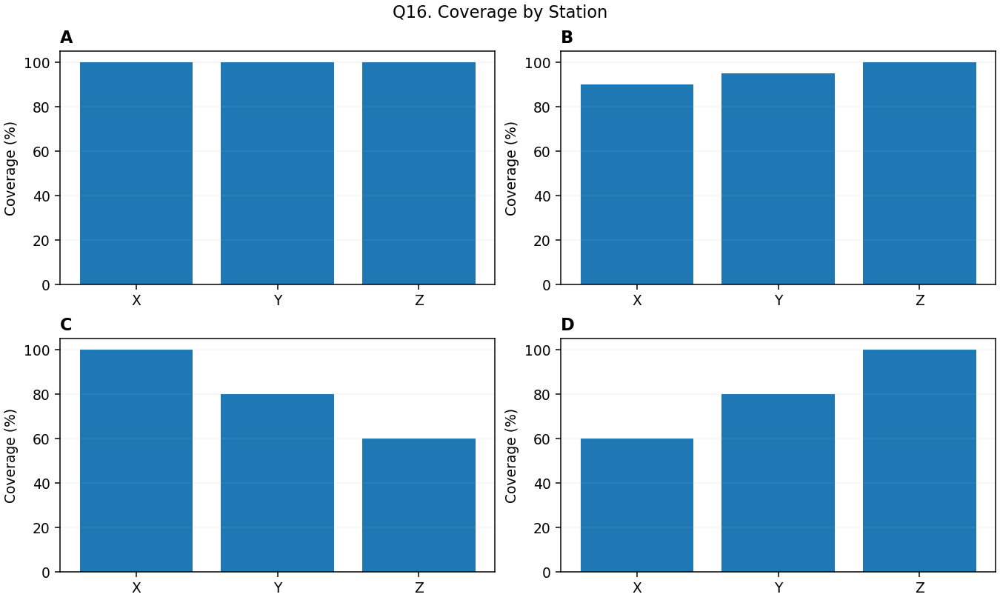

<details>
<summary><strong>Q16. 정답 및 해설 확인</strong></summary>

**정답:** D

**해설:** 정답은 D입니다. 각 관측소의 수집률은 X 60%, Y 80%, Z 100%입니다.

**오답 해설:** A는 결측을 무시한 비율, B와 C는 계산 또는 순서가 다릅니다.

</details>

### Q17. 오류 데이터 제외

`valid` DataFrame의 `_reason` 열이 빈 문자열인 행만 선택해 `accepted`에 저장하세요.

<details>
<summary><strong>Q17. 정답 및 해설 확인</strong></summary>

**정답:** `accepted = valid[valid["_reason"].eq("")].copy()`

**해설:** 명시적 검증 상태를 기반으로 필터링합니다. `_reason`에 오류 사유가 포함된 기록을 조용히 집계에 포함하지 않도록 합니다.

</details>

### Q18. 상관과 원인

정류장 사고 건수가 많은 날에 지연도 길었습니다. 이것만으로 사고가 모든 지연의 원인이라고 할 수 있을까요?

<details>
<summary><strong>Q18. 정답 및 해설 확인</strong></summary>

**정답:** 아니요.

**해설:** 관련성만으로 인과관계를 확정할 수 없습니다. 시간대·운행량·기상·동시 발생 사건 등 다른 요인을 확인해야 합니다.

</details>

### Q19. Q19. Mean vs Sum

각 그룹 A=[90,110], B=[110,130], C=[130,150]입니다. `groupby().mean()` 결과에 해당하는 그래프를 고르세요.

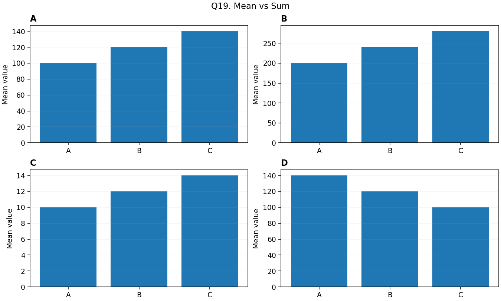

<details>
<summary><strong>Q19. 정답 및 해설 확인</strong></summary>

**정답:** A

**해설:** 정답은 A입니다. 그룹 평균은 각각 100, 120, 140입니다. B는 합계이며, C는 크기 축소, D는 순서 반전입니다.

**오답 해설:** B는 합계, C는 값 크기 오류, D는 그룹 순서 오류입니다.

**확인용 코드**

```python
import pandas as pd

df = pd.DataFrame({"group": ["A", "A", "B", "B", "C", "C"],
                   "value": [90, 110, 110, 130, 130, 150]})
print(df.groupby("group")["value"].mean())
```

</details>

### Q20. 집계 해시

같은 입력 파일로 같은 보고서를 다시 만들었는데 JSON의 숫자 결과가 달라졌습니다. 가장 먼저 확인할 항목은?

<details>
<summary><strong>Q20. 정답 및 해설 확인</strong></summary>

**정답:** 데이터 정렬·난수 시드·필터·시간대·집계 및 반올림 규칙

**해설:** 재현성은 파일명을 같게 쓰는 것으로 달성되지 않습니다. 동일한 입력과 동일한 정규화·정렬 규칙으로 결과를 생성해야 합니다.

</details>

### Q21. 완전성 계산

`slots`의 `available` 불리언 열을 이용해 전체 수집률(0~1)을 계산하는 한 줄을 작성하세요.

<details>
<summary><strong>Q21. 정답 및 해설 확인</strong></summary>

**정답:** `coverage = slots["available"].mean()`

**해설:** 불리언의 평균은 True의 비율입니다. 예정 슬롯별로 한 행씩 존재한다는 전제가 필요합니다.

</details>

### Q22. 자동 검증의 한계

PNG 파일의 생성과 이미지 크기 검사를 모두 통과했다면 그래프가 정확하다고 단정할 수 있나요?

<details>
<summary><strong>Q22. 정답 및 해설 확인</strong></summary>

**정답:** 아니요.

**해설:** 데이터 필터, 집계값, 축 단위, 범례 가독성, 시각적 왜곡은 별도 코드 검사와 사람의 시각 검토가 필요합니다.

</details>

### Q23. 누락률과 제외율

원본에서 오류 행 8개를 제외했으므로 누락 슬롯도 8개라고 보고서에 적었습니다. 왜 잘못되었을 수 있나요?

<details>
<summary><strong>Q23. 정답 및 해설 확인</strong></summary>

**정답:** 제외된 행과 원래 존재하지 않았던 슬롯은 다른 개념입니다.

**해설:** 오류 행이 예정 슬롯에 대응하거나 예정 외 행일 수 있으며, 실제 누락 슬롯은 전체 예정 조합과 유효 관측의 차이로 계산해야 합니다.

</details>

### Q24. Challenge 03 품질 게이트

정류장 기준정보에 같은 `stop_id`가 두 번 있고, merge 후 결과 행 수가 증가했습니다. 수집률 계산에 앞서 어떤 조치를 해야 하나요?

<details>
<summary><strong>Q24. 정답 및 해설 확인</strong></summary>

**정답:** 결합을 중단하고 참조 키 유일성을 검증합니다.

**해설:** `validate="many_to_one"` 또는 사전 고유성 검사로 행 증가를 막아야 합니다. 중복 참조는 집계값 자체를 바꾸므로 경고만 출력하고 계속 진행해서는 안 됩니다.

</details>


---

<a id="section-9-26"></a>
## 9.26. Final Review Checklist

**최종 제출 전 직접 확인할 항목**

- [ ] 원본 파일을 변경하지 않았습니다.
- [ ] 입력 데이터의 관측 단위와 기간·시간대가 명시되어 있습니다.
- [ ] 누락된 관측과 실제 0을 구분합니다.
- [ ] 중복·오류 행에 대한 사유 기록을 제공합니다.
- [ ] 합계·평균·비율에 올바른 단위와 분모를 사용합니다.
- [ ] 필터를 바꿨을 때 KPI·그래프·내보낸 데이터가 같은 조건을 사용합니다.
- [ ] 시간축과 축 범위가 서로 다른 데이터를 오해하게 만들지 않습니다.
- [ ] 정적 이미지·CSV·JSON의 핵심 값이 일치합니다.
- [ ] 재실행에 따른 분석 결과의 변경을 추적할 수 있습니다.
- [ ] 자동 테스트뿐 아니라 그림의 가독성을 직접 확인했습니다.
- [ ] 보고서의 한계와 데이터가 **가상 자료**라는 사실을 표시했습니다.

학습을 마친 후에는 데이터 분야·분석 도구가 달라져도 같은 기준으로 보고서를 검토할 수 있어야 합니다.

---

<a id="section-9-27"></a>
## 9.27. References & Directory Structure

### 참고 문서

- [Python Documentation](https://docs.python.org/3/)
- [Pandas User Guide](https://pandas.pydata.org/docs/user_guide/index.html)
- [Pandas Resampling](https://pandas.pydata.org/docs/reference/api/pandas.DataFrame.resample.html)
- [NumPy Reference](https://numpy.org/doc/stable/reference/)
- [Matplotlib Documentation](https://matplotlib.org/stable/)
- [Seaborn Documentation](https://seaborn.pydata.org/)
- [Plotly Python Documentation](https://plotly.com/python/)
- [Streamlit Documentation](https://docs.streamlit.io/)
- [Python unittest](https://docs.python.org/3/library/unittest.html)

### 폴더 구조

```text
Chapter-09/
├── README.md
├── requirements.txt
├── requirements-dashboard.txt
├── .gitignore
├── data/                 # 가상 실습 데이터 및 Data Dictionary
├── core/                 # 독립 검증·집계 함수
├── examples/             # 코드 및 시각화 예제 18개
├── exercises/            # 부분 완성형 문제 20개
├── projects/             # Mini 2 · Advanced 5 · Challenge 3
│   └── <project>/
│       ├── TASK.md
│       ├── HINTS.md
│       └── starter.py
├── solutions/            # 프로젝트·연습문제 모범 구현
│   └── <project>/
│       ├── reference_solution.py
│       └── EXPLANATION.md
├── figures/              # 실제 생성한 그래프 미리보기
│   ├── examples/
│   ├── projects/
│   ├── quiz/
│   └── interactive/
├── tests/                # 데이터 품질과 재현성 검사
└── dashboard.py          # Streamlit 설치 시 실행
```

`output/`은 실행할 때 생성되며 ZIP에는 포함하지 않습니다. 

---

[← Data Visualization](../README.md) · [Data Processing](../../Data_Processing/) · [↑ Contents](#contents)
