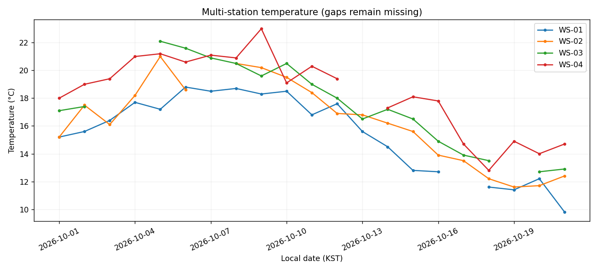

# Advanced Project 01. Weather Monitoring Dashboard

> **목표:** 여러 관측소의 기간별 기온을 비교하고 누락된 날짜를 찾습니다.

## 1. 문제 상황

관측소 여러 곳의 일별 기온을 비교하려고 합니다. 그러나 관측소마다 일부 날짜의 기록이 없고, 간혹 잘못된 관측소 ID도 포함되어 있습니다. 선택한 관측소와 기간을 기준으로 **실제로 관측된 값과 누락된 날짜**를 분리해 보여주는 비교 대시보드를 제작하세요.

## 2. 제공 데이터

| 파일 | 주요 열 | 의미 |
|---|---|---|
| `stations.csv` | `station_id, station_name, zone` | 관측소 기준정보 |
| `observations.csv` | `observation_id, station_id, local_date, temperature_c, rain_mm` | 관측 ID, KST 일자, 기온·강수량 |

제공된 CSV는 학습용 가상 데이터입니다. 파일은 이 프로젝트의 `data/`에 있습니다.

## 3. 데이터 검증 및 계산 기준

1. 기준정보에 없는 관측소, 중복 관측 ID, 잘못된 수치와 일자는 제외해 `audit.csv`에 남깁니다.
2. 기간의 모든 날짜와 선택 관측소의 곱집합을 생성해 관측 완전성을 계산합니다.
3. 누락된 기온을 직전 값이나 0°C로 바꾸지 않습니다.

**지표를 해석할 때 확인할 점**

관측 기록 자체의 개수와 관측하기로 예정된 날짜 수는 서로 다릅니다.

## 4. 구현 요구사항

1. `--start`, `--end`, `--stations` 옵션으로 조회 범위를 선택합니다.
2. 관측소·날짜별 `coverage.csv`에서 누락 여부를 표시합니다.
3. 관측소별 평균 기온, 강수 합계, 관측률을 `station_summary.csv`에 기록합니다.
4. 실제 관측값만 이어 그리되 누락 날짜에서는 그래프가 끊어지게 만듭니다.
5. 데이터 제외 사유를 `audit.csv`에 기록합니다.

## 5. 입력 및 결과물

| 구분 | 경로 |
|---|---|
| 입력 CSV | `data/` |
| 학습용 시작 코드 | `starter.py` |
| 모범 구현 | `../../solutions/advanced_01_weather_dashboard/reference_solution.py` |
| 실행 결과 | `../../output/advanced_01_weather_dashboard/` |

**출력 파일:** `audit.csv`, `coverage.csv`, `station_summary.csv`, `dashboard.png`



## 6. 구현 가이드

### STEP 01 — 입력 확인

관측소 기준정보의 ID가 고유한지 확인합니다.

### STEP 02 — 검증과 준비

관측 ID·수치·참조키·날짜를 검증하고 유효한 행을 분리합니다.

### STEP 03 — 분석과 집계

선택 관측소 × 모든 날짜의 슬롯을 만든 다음 left join을 수행합니다.

<details>
<summary><strong>구현 힌트 — 누락 슬롯 생성</strong></summary>

```python
days = pd.date_range(start, end, freq='D').strftime('%Y-%m-%d')
slots = pd.MultiIndex.from_product([station_ids, days])
```

</details>

### STEP 04 — 지표 확인

관측률 분모를 예정 날짜 수로 두고 평균 기온은 관측된 값만 계산합니다.

<details>
<summary><strong>구현 힌트 — 관측률 분모</strong></summary>

관측률은 선택된 기간의 **예정 슬롯 수**를 분모로 계산합니다. 관측이 없는 날짜를 평균 기온 계산에 포함하지 않습니다.

</details>

### STEP 05 — 출력 구성

누락 구간이 유지된 다중 선 그래프와 CSV를 저장합니다.

## 7. 테스트 시나리오

| 조건 | 기대 결과 |
|---|---|
| 관측소 전체 선택 | 관측소 4곳의 추이와 관측률 |
| 관측소 한 곳 선택 | CSV와 그래프가 해당 관측소만 표시 |
| 중간 날짜 누락 | `observed=False`, 꺾은선 공백 |
| 중복 관측 ID | 중복 행 제외 및 감사 기록 |
| 미등록 관측소 | 감사 기록, 요약에서 제외 |

## 8. 실행 및 완료 기준

Python 3.10 이상에서 Chapter 09 최상위 폴더를 기준으로 실행합니다.

```bash
python -m pip install -r requirements.txt
python solutions/advanced_01_weather_dashboard/reference_solution.py
python -m unittest discover -s tests -v
```

모범 구현을 실행해 결과의 기준을 확인한 뒤, `starter.py`에 직접 구현한 코드를 별도의 입력·출력 폴더로 실행해 비교하세요. `starter.py`의 미구현 함수는 완성 전까지 예외를 발생시킵니다.

**완료 기준:** 요구된 파일이 생성되고 검증 정책·분모·단위·시간대·선택 범위가 일치해야 합니다. 자동 검증과 별도로 그림의 축·글자·범례의 가독성도 확인하세요.

---
[← Chapter 09](../../README.md) · [↑ Project Top](#advanced-project-01-weather-monitoring-dashboard)
