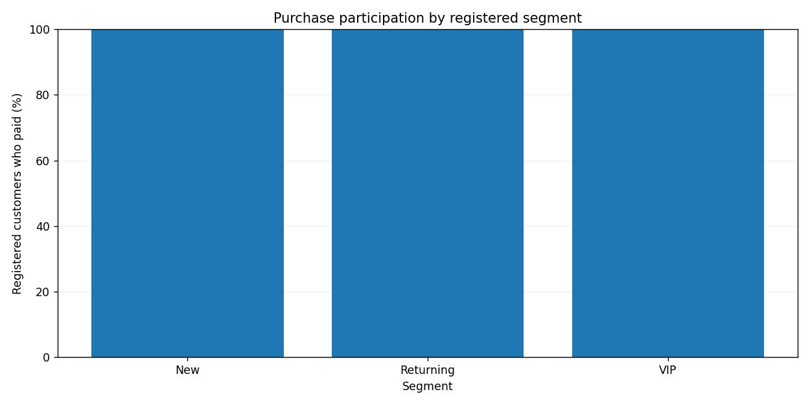

# Advanced Project 02. Customer Behavior Analysis

> **목표:** 고객군별 구매 참여율과 구매자당 매출을 올바른 분모로 계산합니다.

## 1. 문제 상황

고객 정보와 주문 내역이 분리되어 있습니다. 구매 고객만 기준으로 참여율을 계산하면 구매하지 않은 고객이 사라져 비율이 왜곡됩니다. 모든 등록 고객을 기준으로 참여율을 계산하고, 실제 결제 주문만 매출에 반영하는 고객 행동 분석 결과를 제작하세요.

## 2. 제공 데이터

| 파일 | 주요 열 | 의미 |
|---|---|---|
| `customers.csv` | `customer_id, segment, joined_on` | 등록 고객·고객군 |
| `orders.csv` | `order_id, customer_id, ordered_on, amount_krw, status` | 주문·고객 참조·주문일·금액·paid/refunded |

제공된 CSV는 학습용 가상 데이터입니다. 파일은 이 프로젝트의 `data/`에 있습니다.

## 3. 데이터 검증 및 계산 기준

1. 등록 고객의 `customer_id`가 중복되면 기준정보 오류로 처리합니다.
2. 주문 ID 중복, 미등록 고객, 음수·비유한 금액, 잘못된 상태·일자를 제외하고 감사 기록에 남깁니다.
3. 참여율 분모는 해당 고객군의 **전체 등록 고객 수**, 분자는 선택 기간에 `paid` 주문이 있는 고유 고객 수입니다.
4. 환불된 주문은 매출과 구매자 수에 포함하지 않습니다. 구매자가 0명인 고객군의 구매자당 매출은 자료 없음입니다.

**지표를 해석할 때 확인할 점**

지표의 분모를 먼저 정의해야 서로 다른 고객군을 공정하게 비교할 수 있습니다.

## 4. 구현 요구사항

1. `--start`, `--end`로 주문 기간을 선택합니다.
2. 고객군별 등록 고객 수·구매자 수·유료 주문 수·매출을 계산합니다.
3. 참여율과 구매자당 평균 매출을 각각 올바른 분모로 계산합니다.
4. 검증 제외 행을 `audit.csv`로 분리합니다.
5. 막대그래프는 참여율 0~100% 축을 사용합니다.

## 5. 입력 및 결과물

| 구분 | 경로 |
|---|---|
| 입력 CSV | `data/` |
| 학습용 시작 코드 | `starter.py` |
| 모범 구현 | `../../solutions/advanced_02_customer_behavior/reference_solution.py` |
| 실행 결과 | `../../output/advanced_02_customer_behavior/` |

**출력 파일:** `audit.csv`, `segment_summary.csv`, `dashboard.png`



## 6. 구현 가이드

### STEP 01 — 입력 확인

고객 기준정보와 주문 데이터를 키로 연결할 수 있는지 확인합니다.

### STEP 02 — 검증과 준비

주문 ID·금액·상태·날짜·참조 고객을 검증합니다.

### STEP 03 — 분석과 집계

선택 기간과 `paid` 조건을 적용한 후 구매 고객을 고유 ID로 셉니다.

<details>
<summary><strong>구현 힌트 — 고유 구매 고객 수</strong></summary>

```python
paid_segments = paid.merge(customers[['customer_id', 'segment']], on='customer_id')
buyers = paid_segments.groupby('segment')['customer_id'].nunique()
```

</details>

### STEP 04 — 지표 확인

전체 등록 고객 수를 별도로 집계해 참여율의 분모로 사용합니다.

<details>
<summary><strong>구현 힌트 — 분모 확인</strong></summary>

등록 고객 테이블을 기준으로 요약을 만든 뒤 결제 고객 집계를 **왼쪽 결합**하면 구매가 없는 고객군도 유지할 수 있습니다.

</details>

### STEP 05 — 출력 구성

고객군별 매출과 참여율을 CSV·그래프로 검증합니다.

## 7. 테스트 시나리오

| 조건 | 기대 결과 |
|---|---|
| 기간 전체 조회 | 결제 상태만 매출 집계 |
| 환불 주문 추가 | 참여율·매출에 영향 없음 |
| 고객군에 결제 0건 | 참여율 0%, 구매자당 매출 자료 없음 |
| 미등록 고객 주문 | 감사 로그에 제외 사유 |
| 조회 기간 축소 | 매출·참여율 동시 변경 |

## 8. 실행 및 완료 기준

Python 3.10 이상에서 Chapter 09 최상위 폴더를 기준으로 실행합니다.

```bash
python -m pip install -r requirements.txt
python solutions/advanced_02_customer_behavior/reference_solution.py
python -m unittest discover -s tests -v
```

모범 구현을 실행해 결과의 기준을 확인한 뒤, `starter.py`에 직접 구현한 코드를 별도의 입력·출력 폴더로 실행해 비교하세요. `starter.py`의 미구현 함수는 완성 전까지 예외를 발생시킵니다.

**완료 기준:** 요구된 파일이 생성되고 검증 정책·분모·단위·시간대·선택 범위가 일치해야 합니다. 자동 검증과 별도로 그림의 축·글자·범례의 가독성도 확인하세요.

