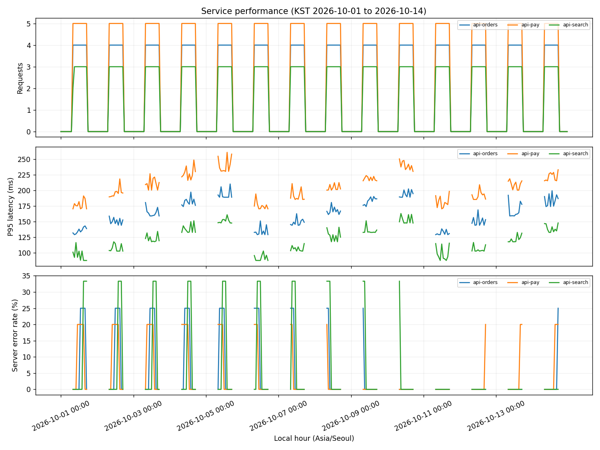

# Advanced Project 03. Service Performance Monitoring

> **목표:** 검증된 API 요청의 P95·서버 오류율을 KST 시간대별로 비교합니다.

## 1. 문제 상황

검색·주문·결제 API의 요청 기록은 서비스마다 응답 속도와 오류 발생 형태가 다릅니다. **선택 서비스와 조회 기간이 KPI·시간대별 그래프·다운로드 CSV에 동일하게 적용**되도록 성능 모니터링 대시보드를 구현하세요.

## 2. 제공 데이터

| 파일 | 주요 열 | 의미 |
|---|---|---|
| `service_catalog.csv` | `service_id, service_name` | 등록된 서비스 |
| `requests.csv` | `request_id, timestamp_utc, service_id, latency_ms, status_code` | 고유 요청, UTC 시각, 서비스, 지연(ms), HTTP 코드 |

제공된 CSV는 학습용 가상 데이터입니다. 파일은 이 프로젝트의 `data/`에 있습니다.

## 3. 데이터 검증 및 계산 기준

1. `request_id`가 중복되면 첫 행을 포함한 **모든 중복 행**을 제외합니다.
2. 응답 시간이 음수·NaN·무한대이거나, 상태 코드가 **100~599 범위의 정수**가 아니면 제외합니다. `200.5`는 유효하지 않습니다.
3. 등록되지 않은 `service_id`와 잘못되거나 누락된 UTC 시각은 제외합니다. UTC를 `Asia/Seoul`로 변환한 뒤 날짜와 시간대를 계산합니다.
4. 모든 제외 행의 원본 행 번호 및 **모든** 제외 사유를 `audit.csv`에 남깁니다.
5. 유효 요청에 `quantile(0.95, interpolation="linear")`를 적용해 P95를 계산합니다.
6. 서버 오류율은 `500~599 응답 수 / 전체 유효 요청 수 × 100`으로 계산합니다.
7. 유효 요청이 0건이면 P95와 서버 오류율을 **자료 없음**으로 표시합니다. 유효 요청이 있고 서버 오류가 0건이면 오류율은 **0%**입니다.

**지표를 해석할 때 확인할 점**

P95는 상위 지연 구간을, 서버 오류율은 응답의 안정성을 보여줍니다. 빠른 응답이라도 오류가 빈번할 수 있으므로 두 지표를 함께 확인합니다.

## 4. 구현 요구사항

1. 서비스 다중 선택(`--services`) 및 KST 날짜 조회(`--start`, `--end`)를 구현합니다.
2. 요청 수, P95(ms), 서버 오류율(%)을 서비스별·시간대별로 산출합니다.
3. `summary.csv`, `kpi_display.csv`, `hourly.csv`, `valid_requests.csv`, `audit.csv`를 저장합니다.
4. `dashboard.png`, Plotly `dashboard.html`에 동일 필터를 반영합니다.
5. 데이터 없는 시간대에 P95·오류율 0을 임의로 부여하지 않습니다. 수치 CSV의 결측값은 공란으로 유지하고, 화면과 `kpi_display.csv`에서는 `자료 없음`으로 표시합니다.

## 5. 입력 및 결과물

| 구분 | 경로 |
|---|---|
| 입력 CSV | `data/` |
| 학습용 시작 코드 | `starter.py` |
| 모범 구현 | `../../solutions/advanced_03_service_monitor/reference_solution.py` |
| 실행 결과 | `../../output/advanced_03_service_monitor/` |

**출력 파일:** `audit.csv`, `valid_requests.csv`, `summary.csv`, `kpi_display.csv`, `hourly.csv`, `dashboard.png`, `dashboard.html`



## 6. 구현 가이드

### STEP 01 — 입력 확인

서비스 기준정보와 요청 CSV의 필수 열·고유키를 확인합니다.

### STEP 02 — 검증과 준비

중복 ID, 지연시간, HTTP 코드, 서비스 ID, UTC 시각을 검증하고 행별 제외 사유를 모두 기록합니다.

<details>
<summary><strong>구현 힌트 — 중복 ID 전체 식별</strong></summary>

```python
duplicate = frame.duplicated(subset=['request_id'], keep=False)
```

</details>

### STEP 03 — 분석과 집계

유효 요청의 시각을 KST로 변환하고 선택한 기간·서비스로 한 번 필터링합니다.

### STEP 04 — 지표 확인

서비스별 요청 수, P95, 오류율을 계산하고 빈 그룹은 별도로 처리합니다.

<details>
<summary><strong>구현 힌트 — P95의 선형 보간</strong></summary>

```python
p95_ms = valid_latency.quantile(0.95, interpolation='linear')
```

[선형 보간 계산 예시](./REFERENCES.md#p95-linear)

</details>

### STEP 05 — 출력 구성

예정 시간 축을 생성해 요청이 없는 시간대를 CSV에 보존합니다.

<details>
<summary><strong>구현 힌트 — 빈 구간 처리</strong></summary>

시간대별 요청 수는 0일 수 있지만, 요청이 없는 구간의 P95와 오류율은 **0이 아니라 결측값**입니다.

</details>

### STEP 06 — 일관성 확인

동일 필터 결과에서 정적 그래프·인터랙티브 그래프·CSV를 생성합니다.

## 7. 테스트 시나리오

| 조건 | 기대 결과 |
|---|---|
| 응답시간 100·200·300ms | P95 290ms |
| 중복 request_id 2행 | 두 행 모두 제외 |
| 상태 코드 200.5 | 정수가 아니므로 제외 |
| 음수·inf 지연시간 | 감사 기록 후 제외 |
| 서버 오류 0건·요청 n건 | 오류율 0% |
| 유효 요청 0건 | P95·오류율 자료 없음 |
| UTC 자정 근처 요청 | KST 날짜로 집계 |
| 기간·서비스 변경 | CSV와 정적·대화형 그림 동시 변경 |

## 8. 실행 및 완료 기준

Python 3.10 이상에서 Chapter 09 최상위 폴더를 기준으로 실행합니다.

```bash
python -m pip install -r requirements.txt
python solutions/advanced_03_service_monitor/reference_solution.py
python -m unittest discover -s tests -v
```

모범 구현을 실행해 결과의 기준을 확인한 뒤, `starter.py`에 직접 구현한 코드를 별도의 입력·출력 폴더로 실행해 비교하세요. `starter.py`의 미구현 함수는 완성 전까지 예외를 발생시킵니다.

**완료 기준:** 요구된 파일이 생성되고 검증 정책·분모·단위·시간대·선택 범위가 일치해야 합니다. 자동 검증과 별도로 그림의 축·글자·범례의 가독성도 확인하세요.

[P95 계산과 감사 기록 참고](./REFERENCES.md)

---
[← Chapter 09](../../README.md) · [↑ Project Top](#advanced-project-03-service-performance-monitoring)
