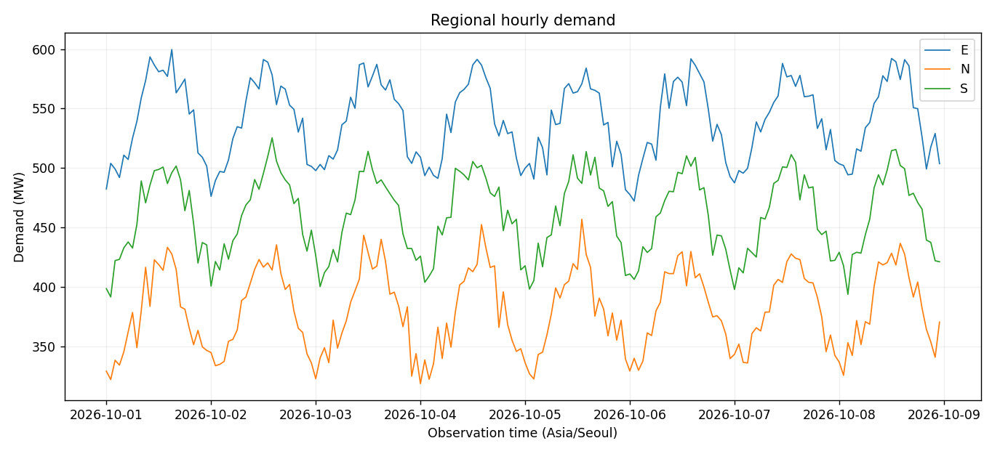

# Advanced Project 04. Regional Electricity Demand Analysis

> **목표:** UTC 전력 수요를 KST 시간 단위로 정렬하고 완전한 날짜만 에너지 합계를 확정합니다.

## 1. 문제 상황

지역별 전력 수요 기록은 UTC로 저장되며 측정 단위는 MW입니다. 하루의 기록이 누락되어 있어도 관측값을 단순 합산하면 완전한 하루의 에너지 사용량처럼 오해할 수 있습니다. 지역별 시간대 추이와 일별 관측 완전성을 함께 제시하세요.

## 2. 제공 데이터

| 파일 | 주요 열 | 의미 |
|---|---|---|
| `regions.csv` | `region_id, region_name` | 지역 기준정보 |
| `demand.csv` | `reading_id, timestamp_utc, region_id, demand_mw` | UTC 시간별 평균 수요(MW) |

제공된 CSV는 학습용 가상 데이터입니다. 파일은 이 프로젝트의 `data/`에 있습니다.

## 3. 데이터 검증 및 계산 기준

1. 중복 reading_id, 같은 지역·KST 시간 중복, 미등록 지역, 음수 수요와 잘못된 시각은 제외합니다.
2. 각 기록은 1시간 구간의 **평균 MW**를 나타냅니다. 해당 구간의 에너지는 `MW × 1h = MWh`입니다.
3. 하루 24시간이 모두 관측된 경우에만 일별 확정 에너지(MWh)를 표시합니다. 그 외는 `partial`로 기록합니다.

**지표를 해석할 때 확인할 점**

MW와 MWh는 서로 다른 단위입니다. 하루 평균 MW를 하루 총에너지 MWh로 직접 표기해서는 안 됩니다.

## 4. 구현 요구사항

1. `--region` 필터를 구현합니다.
2. KST 날짜와 시간으로 시간별 수요를 정렬합니다.
3. 일별 관측 시간 수·평균 수요(MW)·관측 구간 에너지(MWh)를 계산합니다.
4. 24시간 완전 관측일에만 `energy_confirmed_mwh`를 기록합니다.
5. CSV와 정적 시계열 그래프를 생성합니다.

## 5. 입력 및 결과물

| 구분 | 경로 |
|---|---|
| 입력 CSV | `data/` |
| 학습용 시작 코드 | `starter.py` |
| 모범 구현 | `../../solutions/advanced_04_electricity_demand/reference_solution.py` |
| 실행 결과 | `../../output/advanced_04_electricity_demand/` |

**출력 파일:** `audit.csv`, `daily_energy.csv`, `dashboard.png`



## 6. 구현 가이드

### STEP 01 — 입력 확인

지역 기준정보와 시간별 측정 ID를 검증합니다.

### STEP 02 — 검증과 준비

UTC를 KST로 변환하고 같은 지역·시간 중복을 제외합니다.

### STEP 03 — 분석과 집계

지역별 KST 하루의 고유 관측 시간이 24개인지 검사합니다.

<details>
<summary><strong>구현 힌트 — 관측 시간 수</strong></summary>

```python
hour_count = frame.groupby(['region_id', 'local_date'])['hour'].nunique()
```

</details>

### STEP 04 — 지표 확인

각 1시간 기록을 이용해 관측 구간 MWh를 합산합니다.

<details>
<summary><strong>구현 힌트 — 수요와 에너지의 차이</strong></summary>

전력 수요(MW)는 순간적·구간 평균적 크기이고, 에너지(MWh)는 시간 적분 결과입니다. 이 입력은 1시간 평균이므로 1시간 구간마다 `MW × 1`을 더합니다.

</details>

### STEP 05 — 출력 구성

`complete/partial`과 확정값 유무를 CSV 및 추이 그래프에 반영합니다.

## 7. 테스트 시나리오

| 조건 | 기대 결과 |
|---|---|
| 완전한 하루 24행 | `complete`와 확정 MWh |
| 1시간 누락 | `partial`, 확정값 공란 |
| 음수 수요 | 감사 기록 후 제외 |
| 같은 지역·시간 중복 | 경쟁 기록 제외 |
| 지역 필터 변경 | 해당 지역의 CSV·그래프만 출력 |

## 8. 실행 및 완료 기준

Python 3.10 이상에서 Chapter 09 최상위 폴더를 기준으로 실행합니다.

```bash
python -m pip install -r requirements.txt
python solutions/advanced_04_electricity_demand/reference_solution.py
python -m unittest discover -s tests -v
```

모범 구현을 실행해 결과의 기준을 확인한 뒤, `starter.py`에 직접 구현한 코드를 별도의 입력·출력 폴더로 실행해 비교하세요. `starter.py`의 미구현 함수는 완성 전까지 예외를 발생시킵니다.

**완료 기준:** 요구된 파일이 생성되고 검증 정책·분모·단위·시간대·선택 범위가 일치해야 합니다. 자동 검증과 별도로 그림의 축·글자·범례의 가독성도 확인하세요.

