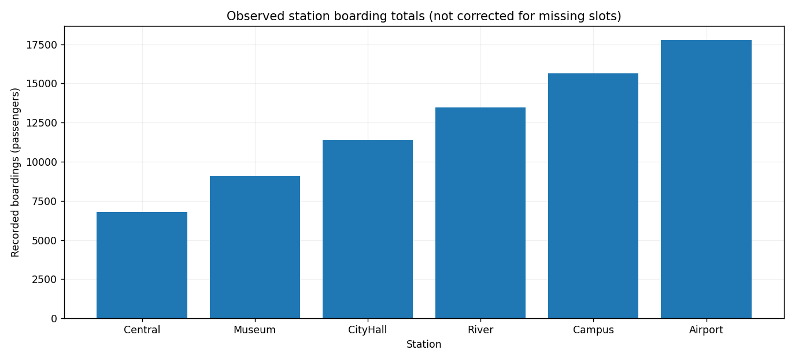

# Advanced Project 05. Urban Transportation Dashboard

> **목표:** 정류장별 시간당 이용량과 기록 누락을 구분한 대시보드를 만듭니다.

## 1. 문제 상황

도시철도 이용량을 정류장별로 비교할 때 기록이 없는 시간대와 실제 이용객이 없는 시간대가 혼재합니다. 예정 운영 시간대를 먼저 정의하고, 데이터 누락을 승차 인원 0명과 구별해 보고해야 합니다.

## 2. 제공 데이터

| 파일 | 주요 열 | 의미 |
|---|---|---|
| `stations.csv` | `station_id, station_name, line` | 정류장·노선 기준정보 |
| `boardings.csv` | `record_id, station_id, timestamp_kst, boardings` | KST 시간별 승차 인원 |

제공된 CSV는 학습용 가상 데이터입니다. 파일은 이 프로젝트의 `data/`에 있습니다.

## 3. 데이터 검증 및 계산 기준

1. 관측 기간은 **2026-10-01~10-10**, 운영 시간은 KST **06:00~21:00**의 16개 정시 슬롯입니다.
2. 예정 슬롯은 정류장 × 날짜 × 운영 시간으로 계산합니다.
3. 음수 인원, 미등록 역, 시간 중복 등 부적절한 행은 제외합니다.
4. 누락 시간은 `missing`이며 실제 승객 수 0명과 다릅니다.

**지표를 해석할 때 확인할 점**

관측되지 않았다는 사실 자체가 중요한 데이터 품질 지표입니다.

## 4. 구현 요구사항

1. `--line`으로 노선을 선택합니다.
2. 시간별 예정 슬롯을 계산하고 `hourly_coverage.csv`를 기록합니다.
3. 역별 예정·유효·누락 슬롯 수와 관측된 총승차 인원을 요약합니다.
4. 누락 구간을 해석할 수 있게 정적·인터랙티브 그림을 저장합니다.

## 5. 입력 및 결과물

| 구분 | 경로 |
|---|---|
| 입력 CSV | `data/` |
| 학습용 시작 코드 | `starter.py` |
| 모범 구현 | `../../solutions/advanced_05_urban_metro/reference_solution.py` |
| 실행 결과 | `../../output/advanced_05_urban_metro/` |

**출력 파일:** `audit.csv`, `hourly_coverage.csv`, `station_summary.csv`, `dashboard.png`, `dashboard.html`



## 6. 구현 가이드

### STEP 01 — 입력 확인

노선별 역 목록과 운영 시간·기간을 정의합니다.

### STEP 02 — 검증과 준비

행 검증 후 유효한 실제 기록을 분리합니다.

### STEP 03 — 분석과 집계

예정 시간 슬롯을 생성하고 관측 기록을 left join합니다.

<details>
<summary><strong>구현 힌트 — 예정 슬롯 결합</strong></summary>

```python
coverage = expected.merge(valid, on=['station_id', 'timestamp_kst'], how='left')
```

</details>

### STEP 04 — 지표 확인

누락과 0명 관측을 구분해 역별 요약을 계산합니다.

<details>
<summary><strong>구현 힌트 — 누락과 0명</strong></summary>

`boardings.isna()`는 기록 유무, `boardings.eq(0)`은 유효한 수치 0을 뜻합니다.

</details>

### STEP 05 — 출력 구성

그래프와 CSV가 같은 노선 필터를 사용하도록 연결합니다.

## 7. 테스트 시나리오

| 조건 | 기대 결과 |
|---|---|
| 노선 전체 조회 | 6개 역 × 10일 × 16시간 |
| L1만 선택 | 3개 역만 그림과 CSV에 유지 |
| 누락 시간 | `observed=False` |
| 실제 0명 관측 | `observed=True`·인원 0 |
| 미등록 역 기록 | 감사 로그 기록 |

## 8. 실행 및 완료 기준

Python 3.10 이상에서 Chapter 09 최상위 폴더를 기준으로 실행합니다.

```bash
python -m pip install -r requirements.txt
python solutions/advanced_05_urban_metro/reference_solution.py
python -m unittest discover -s tests -v
```

모범 구현을 실행해 결과의 기준을 확인한 뒤, `starter.py`에 직접 구현한 코드를 별도의 입력·출력 폴더로 실행해 비교하세요. `starter.py`의 미구현 함수는 완성 전까지 예외를 발생시킵니다.

**완료 기준:** 요구된 파일이 생성되고 검증 정책·분모·단위·시간대·선택 범위가 일치해야 합니다. 자동 검증과 별도로 그림의 축·글자·범례의 가독성도 확인하세요.

---
[← Chapter 09](../../README.md) · [↑ Project Top](#advanced-project-05-urban-transportation-dashboard)
