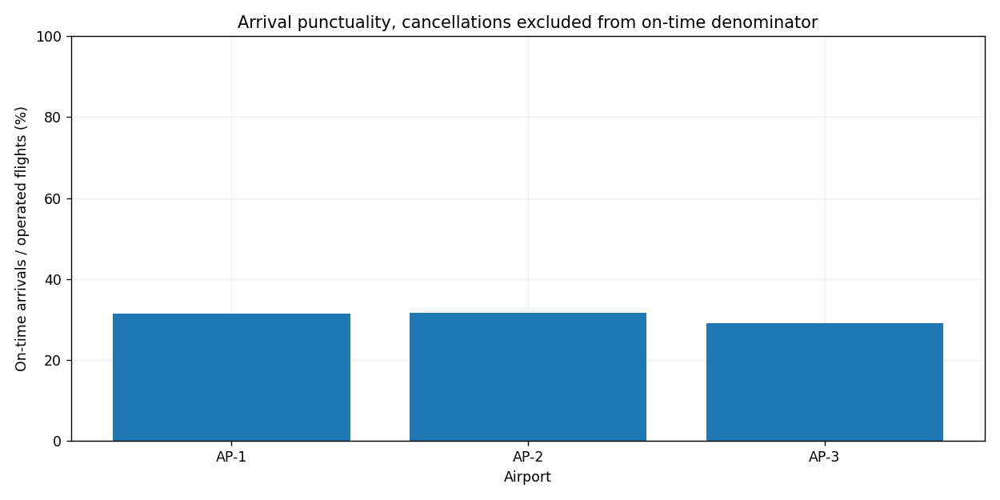

# Challenge 01. Airport Operations Analysis

> **목표:** 운항·결항·지연을 구분하고 서로 다른 분모의 항공 운영 지표를 산출합니다.

## 1. 문제 상황

공항 운영팀은 정시 도착률과 결항률을 함께 보고해야 합니다. 그러나 결항 항공편에는 도착 지연시간이 없으므로 일반 항공편과 같은 방식으로 계산할 수 없습니다. 취소와 지연을 분리한 일별·공항별 보고서를 자동 생성하세요.

## 2. 제공 데이터

| 파일 | 주요 열 | 의미 |
|---|---|---|
| `airports.csv` | `airport_id, airport_name` | 공항 기준정보 |
| `flights.csv` | `flight_id, flight_date, airport_id, airline, status, arrival_delay_min` | 예정 항공편·날짜·운항사·운항 상태·도착 지연(분) |

제공된 CSV는 학습용 가상 데이터입니다. 파일은 이 프로젝트의 `data/`에 있습니다.

## 3. 데이터 검증 및 계산 기준

1. 중복 flight_id의 모든 행, 미등록 공항, 잘못된 날짜·상태·지연값을 제외하고 감사 기록에 남깁니다.
2. `status=cancelled`의 지연값은 비워 두고, `status=operated`는 수치 지연값을 갖습니다. 음수 지연은 조기 도착이므로 유효합니다.
3. **정시 도착**은 운항한 항공편 중 도착 지연이 **15분 미만**인 경우입니다.
4. **정시 도착률**의 분모는 운항편 수, **결항률**의 분모는 전체 예정편 수입니다. 분모가 0이면 자료 없음입니다.

**지표를 해석할 때 확인할 점**

비율 계산 전에 분모의 모집단을 정의해야 합니다.

## 4. 구현 요구사항

1. `--airport`, `--start`, `--end` 필터를 구현합니다.
2. 공항별 예정·운항·결항·정시·15분 이상 지연 건수를 계산합니다.
3. 정시 도착률·결항률을 별도 계산합니다.
4. 일별·공항별 CSV, 감사 기록, PNG, 실행 요약 JSON을 생성합니다.
5. 선택 기간·공항을 변경했을 때 모든 출력의 분모가 맞는지 검증합니다.

## 5. 입력 및 결과물

| 구분 | 경로 |
|---|---|
| 입력 CSV | `data/` |
| 학습용 시작 코드 | `starter.py` |
| 모범 구현 | `../../solutions/challenge_01_airport_operations/reference_solution.py` |
| 실행 결과 | `../../output/challenge_01_airport_operations/` |

**출력 파일:** `audit.csv`, `airport_summary.csv`, `daily_summary.csv`, `summary.json`, `report.png`



## 6. 구현 가이드

### STEP 01 — 입력 확인

입력 검증과 참조 데이터 계약을 문서화합니다.

### STEP 02 — 검증과 준비

결항과 운항을 분리한 지표 함수를 작성합니다.

### STEP 03 — 분석과 집계

공항·기간 필터가 집계와 그림에 동일하게 적용되도록 연결합니다.

### STEP 04 — 지표 확인

정상·취소·중복·잘못된 항공편 시나리오를 작성합니다.

### STEP 05 — 출력 구성

일별 결과와 전체 KPI의 합계가 일치하는지 검증합니다.

## 7. 테스트 시나리오

| 조건 | 기대 결과 |
|---|---|
| 취소 항공편 추가 | 결항률 증가, 정시 도착률 분모 불변 |
| 15분 지연 | 지연 항공편으로 집계 |
| 14분 지연 | 정시 항공편으로 집계 |
| 조기 도착 -6분 | 유효한 정시 도착 |
| 중복 항공편 ID | 모든 중복 행 감사 제외 |
| 모두 결항 | 운항편 0이므로 정시 도착률 자료 없음 |

## 8. 실행 및 완료 기준

Python 3.10 이상에서 Chapter 09 최상위 폴더를 기준으로 실행합니다.

```bash
python -m pip install -r requirements.txt
python solutions/challenge_01_airport_operations/reference_solution.py
python -m unittest discover -s tests -v
```

모범 구현을 실행해 결과의 기준을 확인한 뒤, `starter.py`에 직접 구현한 코드를 별도의 입력·출력 폴더로 실행해 비교하세요. `starter.py`의 미구현 함수는 완성 전까지 예외를 발생시킵니다.

**완료 기준:** 요구된 파일이 생성되고 검증 정책·분모·단위·시간대·선택 범위가 일치해야 합니다. 자동 검증과 별도로 그림의 축·글자·범례의 가독성도 확인하세요.

