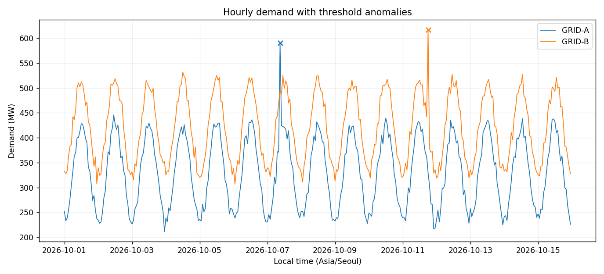

# Challenge 02. Energy Demand & Anomaly Detection

> **목표:** 시간별 전력 수요의 누락·이상 구간·장애 시간 비교를 자동화합니다.

## 1. 문제 상황

전력 수요가 급증한 시점을 확인하려면 단순 전체 평균보다 같은 시간대의 평소 수요와 비교하는 편이 유용합니다. 동시에 수집 누락은 정상적인 수요 감소로 해석하면 안 됩니다. 이상 구간 탐지와 장애 이력 비교를 자동화하는 보고서를 제작하세요.

## 2. 제공 데이터

| 파일 | 주요 열 | 의미 |
|---|---|---|
| `regions.csv` | `region_id, capacity_mw` | 지역 기준정보·설비 용량 |
| `readings.csv` | `reading_id, region_id, timestamp_utc, demand_mw` | UTC 시간별 평균 수요(MW) |
| `incidents.csv` | `incident_id, region_id, start_utc, end_utc, type` | 발생·종료 시각이 있는 장애 이력 |

제공된 CSV는 학습용 가상 데이터입니다. 파일은 이 프로젝트의 `data/`에 있습니다.

## 3. 데이터 검증 및 계산 기준

1. 예정 관측은 **2026-10-01~10-15 KST**, 지역별 매일 24개 정시 슬롯입니다.
2. 중복 식별자·시간 슬롯, 미등록 지역, 음수·비유한 수요, 잘못된 시각은 제외합니다.
3. 지역×시간대별 유효 수요의 **중앙값**을 기준선으로 사용합니다. `|수요 - 기준선| > --threshold-mw`인 경우 이상 구간입니다. 기본 임계값은 **120 MW**입니다.
4. 장애 구간은 `[start, end)`로 계산하며, 겹친 관측이 이상 구간의 원인이라고 단정하지 않습니다.
5. 결측이 포함된 날짜의 에너지 확정값은 제공하지 않습니다.

**지표를 해석할 때 확인할 점**

이상값의 정의는 기준선과 임계값에 의존합니다. 이상 탐지는 원인 판단과 별개입니다.

## 4. 구현 요구사항

1. `--region`, `--threshold-mw` 옵션을 구현합니다.
2. 예정 슬롯 대비 유효 관측·누락을 계산합니다.
3. 지역×시간대 중앙값과 잔차(residual)로 이상 구간을 탐지합니다.
4. 장애 구간 안의 관측 시간 수·이상 구간 수를 집계합니다.
5. 감사·누락·이상·일별 요약·정적 그림을 출력합니다.

## 5. 입력 및 결과물

| 구분 | 경로 |
|---|---|
| 입력 CSV | `data/` |
| 학습용 시작 코드 | `starter.py` |
| 모범 구현 | `../../solutions/challenge_02_energy_anomalies/reference_solution.py` |
| 실행 결과 | `../../output/challenge_02_energy_anomalies/` |

**출력 파일:** `audit.csv`, `coverage.csv`, `daily_summary.csv`, `anomalies.csv`, `incident_comparison.csv`, `report.png`, `summary.json`



## 6. 구현 가이드

### STEP 01 — 입력 확인

입력과 참조 기준의 유효성을 구분합니다.

### STEP 02 — 검증과 준비

지역·시간 슬롯 중복과 결측의 감사 정책을 설계합니다.

### STEP 03 — 분석과 집계

지역×시간대 중앙값과 잔차를 계산합니다.

### STEP 04 — 지표 확인

장애의 시작 포함·종료 제외 정책을 적용합니다.

### STEP 05 — 출력 구성

기간 완전성을 계산하고 하루 에너지 확정 조건을 확인합니다.

### STEP 06 — 일관성 확인

동일 데이터 재실행에서 파일 내용이 같아지는지 검사합니다.

## 7. 테스트 시나리오

| 조건 | 기대 결과 |
|---|---|
| 평소 시간대보다 185 MW 증가 | 기본 임계값에서 이상 관측 |
| 하루 중 1시간 누락 | partial 처리·확정 MWh 공란 |
| 임계값 300 MW | 기존 이상 탐지 수 감소 |
| 장애 종료와 같은 시각 | 해당 장애에 포함하지 않음 |
| 잘못된 지역 기준정보 | 정상 실행으로 보고하지 않음 |
| 같은 입력 재실행 | CSV·요약 JSON 동일 |

## 8. 실행 및 완료 기준

Python 3.10 이상에서 Chapter 09 최상위 폴더를 기준으로 실행합니다.

```bash
python -m pip install -r requirements.txt
python solutions/challenge_02_energy_anomalies/reference_solution.py
python -m unittest discover -s tests -v
```

모범 구현을 실행해 결과의 기준을 확인한 뒤, `starter.py`에 직접 구현한 코드를 별도의 입력·출력 폴더로 실행해 비교하세요. `starter.py`의 미구현 함수는 완성 전까지 예외를 발생시킵니다.

**완료 기준:** 요구된 파일이 생성되고 검증 정책·분모·단위·시간대·선택 범위가 일치해야 합니다. 자동 검증과 별도로 그림의 축·글자·범례의 가독성도 확인하세요.

---
[← Chapter 09](../../README.md) · [↑ Project Top](#challenge-02-energy-demand--anomaly-detection)
