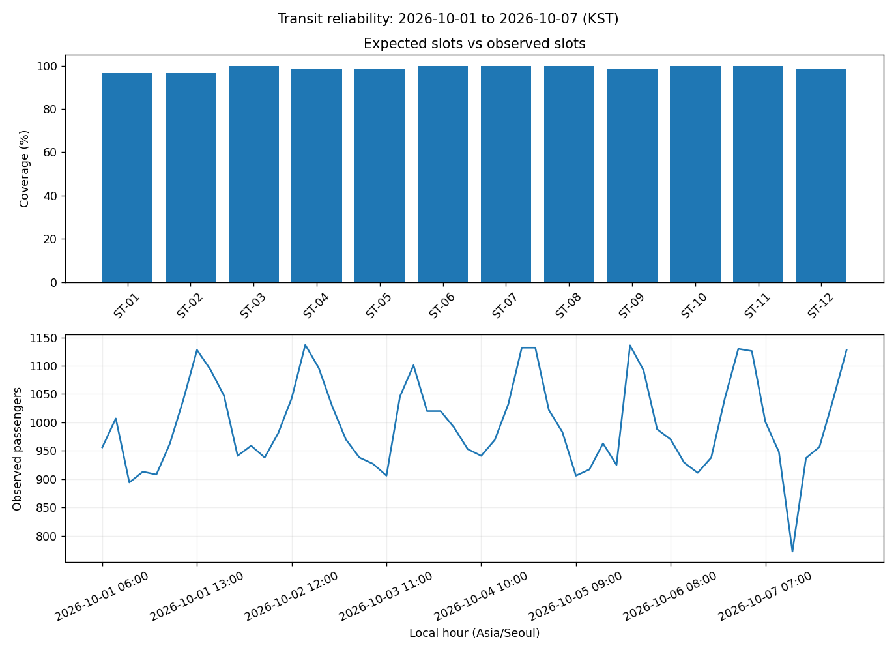

# Challenge 03. City Transit Reliability Platform

> **목표:** 데이터 감사부터 다중 출력·재현성 검증까지 한 번에 처리하는 교통 분석 시스템을 구현합니다.

## 1. 문제 상황

승차 인원 기록, 정류장 기준정보, 예정 관측, 장애 이력이 서로 다른 CSV에 저장되어 있습니다. 누락 시간대를 0명으로 잘못 해석하거나 장애 발생 시점과 시간 축을 어긋나게 비교하면 보고 결과가 달라집니다. 데이터 계약 검증, 관측 완전성, 장애 시간 비교, 정적·대화형 시각화, 재현성 검증을 통합한 플랫폼을 제작하세요.

## 2. 제공 데이터

| 파일 | 주요 열 | 의미 |
|---|---|---|
| `stops.csv` | `stop_id, line, stop_name` | 정류장·노선 기준정보 |
| `schedule.csv` | `stop_id, local_date, expected_hour` | KST 기준 예정 슬롯 |
| `operations.csv` | `observation_id, stop_id, timestamp_utc, boardings, delay_minutes` | UTC 실제 관측·승차 인원·지연(분) |
| `incidents.csv` | `incident_id, stop_id, opened_utc, closed_utc, category` | UTC 장애 시작·종료 및 분류 |

제공된 CSV는 학습용 가상 데이터입니다. 파일은 이 프로젝트의 `data/`에 있습니다.

## 3. 데이터 검증 및 계산 기준

1. 예정 슬롯은 운영 기록의 개수가 아닌 **`schedule.csv`**로 결정합니다. 중복 예정 슬롯·미등록 정류장은 입력 계약 위반입니다.
2. UTC 시각을 `Asia/Seoul`로 변환한 후 정류장·KST 날짜·정시 시간 슬롯에 대응시킵니다.
3. 동일 슬롯의 여러 관측값은 **모든 경쟁 행을 제외**하고 `duplicate_slot`을 기록합니다. 동일 `observation_id`의 모든 중복 행도 제외합니다.
4. 음수 승객 수·지연, 유효하지 않은 시각, 미등록 정류장, 예상 밖 시간 슬롯은 제외하고 각 행의 모든 사유를 감사 기록에 남깁니다.
5. 유효 관측이 없는 슬롯은 `missing`으로 표시하고 0명으로 대체하지 않습니다. 실제 0명 관측은 `valid`입니다.
6. 각 정류장의 하루 예정 슬롯이 모두 유효할 때만 `confirmed_boardings`를 제공합니다. 그렇지 않으면 `partial` 및 확정값 공란입니다.
7. 장애 시간 구간은 **`[start, end)`**입니다. 시간 구간이 겹쳐도 인과관계는 별도로 증명되지 않습니다.
8. 손상된 파일·기준정보 불일치는 종료 코드 1, 정해진 정책에 따른 오류 행 제외는 종료 코드 0이 될 수 있습니다.

**지표를 해석할 때 확인할 점**

데이터의 정확성, 관측 완전성, 시각화의 일관성, 동일 입력의 재현성을 각각 검증해야 합니다.

## 4. 구현 요구사항

1. `--data`, `--output`, `--line`, `--stops`, `--start`, `--end` CLI 옵션을 구현합니다.
2. 필수 열·기준정보·고유키·오류 행을 검증합니다.
3. 예정·유효·누락 슬롯을 교차 검증하고 모든 제외 사유를 원본 행 번호와 기록합니다.
4. 정류장·시간·날짜·장애별 분석 파일을 생성합니다.
5. CSV·정적 PNG·인터랙티브 HTML의 KPI 및 선택 조건을 일치시킵니다.
6. 입출력 SHA-256, 필터, 지표를 `manifest.json`으로 관리합니다.
7. 모든 결과물을 완성한 경우에만 실행을 성공으로 처리합니다.
8. Quality Gate의 정상·오류 주입·변형 입력·반복 실행 시나리오를 통과해야 합니다.

## 5. 입력 및 결과물

| 구분 | 경로 |
|---|---|
| 입력 CSV | `data/` |
| 학습용 시작 코드 | `starter.py` |
| 모범 구현 | `../../solutions/challenge_03_transit_reliability/reference_solution.py` |
| 실행 결과 | `../../output/challenge_03_transit_reliability/` |

**출력 파일:** `audit.csv`, `coverage.csv`, `station_summary.csv`, `daily_summary.csv`, `hourly.csv`, `incident_comparison.csv`, `overview.png`, `explorer.html`, `summary.json`, `manifest.json`



## 6. 구현 가이드

### STEP 01 — 입력 확인

계약 검증과 참조 데이터 오류·관측 행 오류 정책을 분리합니다.

### STEP 02 — 검증과 준비

원본 행마다 복수 사유를 감사 기록으로 남기고 슬롯 경쟁 기록을 모두 제외합니다.

### STEP 03 — 분석과 집계

예정 슬롯과 유효 관측을 조인하고 누락·0명·불완전한 날짜를 구분합니다.

<details>
<summary><strong>구현 힌트 — 예정 슬롯이 기준</strong></summary>

```python
coverage = schedule.merge(valid, on=['stop_id', 'local_date', 'expected_hour'], how='left')
```

복수 관측값을 제거한 **후** 예정 슬롯과 연결해야 합니다.

</details>

### STEP 04 — 지표 확인

정류장·노선·날짜 필터를 CSV·두 종류의 그림에 통일합니다.

### STEP 05 — 출력 구성

장애 `[start, end)` 기간의 유효·누락 슬롯과 승차 인원을 비교합니다.

<details>
<summary><strong>구현 힌트 — 장애 종료 시각</strong></summary>

장애 기간이 `10:00~12:00`이라면 `10:00`, `11:00`은 포함하고 `12:00`은 포함하지 않습니다. [시간 구간 참고](./REFERENCES.md#intervals).

</details>

### STEP 06 — 일관성 확인

산출물 해시 및 재실행 일관성을 검증합니다.

### STEP 07 — 최종 검증

정상·잘못된 입력·값 변경·부분 조회 시나리오를 통과시킵니다.

## 7. 테스트 시나리오

| 조건 | 기대 결과 |
|---|---|
| 기본 CSV | 672 예정 / 664 유효 / 8 누락 / 8행 감사 |
| 동일 슬롯 경쟁 기록 추가 | 두 기록 모두 제외 |
| KST 변환 경계 | UTC 9월 30일 기록이 KST 10월 1일로 집계 |
| 0명 관측 | 유효 슬롯 유지 |
| 참조정보 불일치 | 종료 코드 1 |
| 노선 L1만 선택 | 224 예정 슬롯 |
| 잘못된 음수·시각 | 감사 기록 후 정상 실행 가능 |
| 동일 입력 재실행 | PNG·HTML·CSV·Manifest 해시 동일 |
| 출력 값 변조 | 품질 검증에서 FAIL |

## 8. 실행 및 완료 기준

Python 3.10 이상에서 Chapter 09 최상위 폴더를 기준으로 실행합니다.

```bash
python -m pip install -r requirements.txt
python solutions/challenge_03_transit_reliability/reference_solution.py
python -m unittest discover -s tests -v
```

모범 구현을 실행해 결과의 기준을 확인한 뒤, `starter.py`에 직접 구현한 코드를 별도의 입력·출력 폴더로 실행해 비교하세요. `starter.py`의 미구현 함수는 완성 전까지 예외를 발생시킵니다.

**완료 기준:** 요구된 파일이 생성되고 검증 정책·분모·단위·시간대·선택 범위가 일치해야 합니다. 자동 검증과 별도로 그림의 축·글자·범례의 가독성도 확인하세요.

### Quality Gate 실행

```bash
python projects/challenge_03_transit_reliability/quality_gate.py --script solutions/challenge_03_transit_reliability/reference_solution.py
```

모든 테스트에서 PASS가 출력되고 종료 코드가 `0`이어야 합니다. 문제의 정의대로 제외한 관측 행이 존재해도 Audit Log가 일관되면 통과할 수 있습니다. 실패한 기준은 항목별로 출력되며, 프로그램을 수정한 뒤 다시 실행합니다. 학생 구현을 검증할 때는 `--script`에 자신의 CLI 경로를 지정하세요.

[예정 슬롯·시간대·재현성 설명](./REFERENCES.md)

