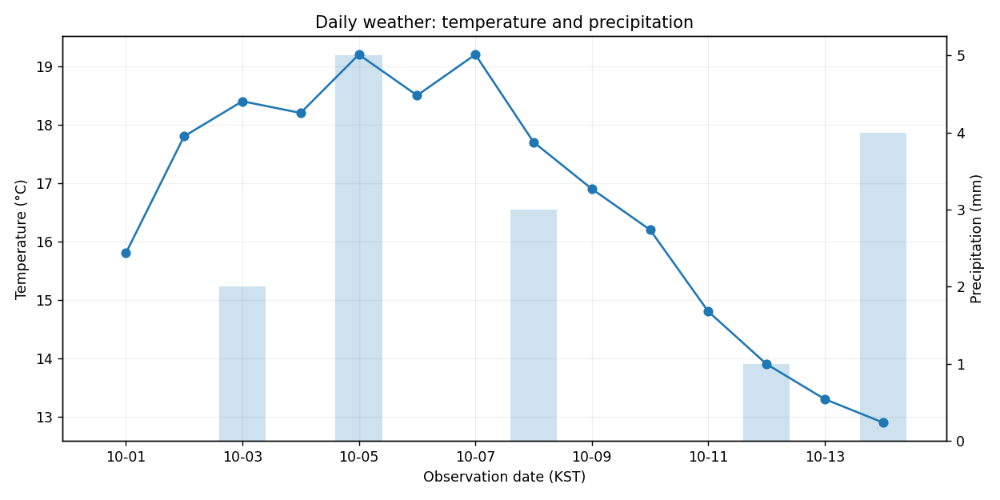

# Mini Project 01. Weather Visualization Report

> **목표:** 일별 기온과 강수량을 하나의 정적 보고서로 정리합니다.

## 1. 문제 상황

기상 관측 기록을 받아 특정 기간의 기온 변화와 강수 발생일을 요약하는 보고서를 제작합니다. 기온과 강수량은 단위와 크기가 다르므로 축을 구분해 표시해야 합니다. 표에 기록된 값과 그래프가 일치하는지도 확인하세요.

## 2. 제공 데이터

| 파일 | 주요 열 | 의미 |
|---|---|---|
| `weather_daily.csv` | `date, temperature_c, precipitation_mm` | 일별 관측일(KST), 기온(°C), 강수량(mm) |

제공된 CSV는 학습용 가상 데이터입니다. 파일은 이 프로젝트의 `data/`에 있습니다.

## 3. 데이터 검증 및 계산 기준

1. `date`는 하루에 한 행이며 중복이 없어야 합니다.
2. 기온은 수치이고 강수량은 0 이상의 수치입니다. 음수 강수량을 자동으로 0으로 바꾸지 않습니다.
3. 관측일을 오름차순으로 정렬합니다. 날짜별 값을 합치거나 임의로 보간하지 않습니다.

**지표를 해석할 때 확인할 점**

서로 다른 단위의 수치를 같은 y축에서 직접 비교하지 않습니다.

## 4. 구현 요구사항

1. 일별 관측 결과를 `daily_summary.csv`로 내보냅니다.
2. 기온은 선 그래프, 강수량은 막대그래프로 표현합니다.
3. 각 축에 단위를 표시하고 날짜를 오름차순으로 배치합니다.
4. 그래프를 `report.png`로 저장합니다.

## 5. 입력 및 결과물

| 구분 | 경로 |
|---|---|
| 입력 CSV | `data/` |
| 학습용 시작 코드 | `starter.py` |
| 모범 구현 | `../../solutions/mini_01_weather_report/reference_solution.py` |
| 실행 결과 | `../../output/mini_01_weather_report/` |

**출력 파일:** `daily_summary.csv`, `report.png`



## 6. 구현 가이드

### STEP 01 — 입력 확인

날짜 열과 두 측정 열의 자료형을 확인합니다.

### STEP 02 — 검증과 준비

날짜를 정렬한 뒤 그래프의 x축을 준비합니다.

### STEP 03 — 분석과 집계

기온·강수량의 서로 다른 y축과 범례를 구성합니다.

### STEP 04 — 지표 확인

CSV와 PNG의 수치와 레이블을 검토합니다.

## 7. 테스트 시나리오

| 조건 | 기대 결과 |
|---|---|
| 정상 14일 기록 | 14행 CSV와 PNG 생성 |
| 강수량 0인 날 | 막대 높이 0으로 표현 |
| 날짜 순서를 뒤섞기 | 출력은 날짜 오름차순 |
| 음수 강수량 | 유효하지 않은 원본으로 보고 실패 |

## 8. 실행 및 완료 기준

Python 3.10 이상에서 Chapter 09 최상위 폴더를 기준으로 실행합니다.

```bash
python -m pip install -r requirements.txt
python solutions/mini_01_weather_report/reference_solution.py
python -m unittest discover -s tests -v
```

모범 구현을 실행해 결과의 기준을 확인한 뒤, `starter.py`에 직접 구현한 코드를 별도의 입력·출력 폴더로 실행해 비교하세요. `starter.py`의 미구현 함수는 완성 전까지 예외를 발생시킵니다.

**완료 기준:** 요구된 파일이 생성되고 검증 정책·분모·단위·시간대·선택 범위가 일치해야 합니다. 자동 검증과 별도로 그림의 축·글자·범례의 가독성도 확인하세요.

