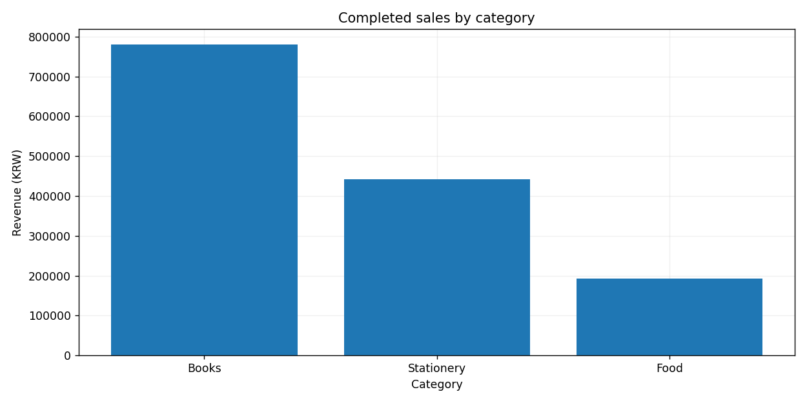

# Mini Project 02. Retail Sales Performance Report

> **목표:** 완료된 주문의 카테고리별 매출을 계산하고 시각화합니다.

## 1. 문제 상황

한 소매점이 주문 목록을 보고 카테고리별 매출을 비교하려고 합니다. 취소된 주문은 실제 매출로 볼 수 없습니다. 단순 주문 건수와 매출액을 구분해 요약표와 막대그래프를 제작하세요.

## 2. 제공 데이터

| 파일 | 주요 열 | 의미 |
|---|---|---|
| `orders.csv` | `order_id, date, category, quantity, unit_price_krw, status` | 고유 주문, 날짜, 품목 분류, 수량, 단가, completed/cancelled |

제공된 CSV는 학습용 가상 데이터입니다. 파일은 이 프로젝트의 `data/`에 있습니다.

## 3. 데이터 검증 및 계산 기준

1. `order_id`는 고유해야 하며 수량과 단가는 음수가 될 수 없습니다.
2. `status=completed`인 행만 매출 합계에 포함합니다. 취소 주문은 0원으로 집계하지 않고 제외합니다.
3. 매출액은 `quantity × unit_price_krw`로 계산하며 단위는 KRW입니다.

**지표를 해석할 때 확인할 점**

주문 건수가 많다고 매출액도 반드시 큰 것은 아닙니다.

## 4. 구현 요구사항

1. 주문 검증을 실시합니다.
2. 완료 주문만 사용해 카테고리별 주문 건수와 매출액을 계산합니다.
3. 매출액 내림차순으로 결과를 정렬합니다.
4. 분류명·KRW 단위가 포함된 막대그래프를 작성합니다.

## 5. 입력 및 결과물

| 구분 | 경로 |
|---|---|
| 입력 CSV | `data/` |
| 학습용 시작 코드 | `starter.py` |
| 모범 구현 | `../../solutions/mini_02_retail_report/reference_solution.py` |
| 실행 결과 | `../../output/mini_02_retail_report/` |

**출력 파일:** `category_revenue.csv`, `report.png`



## 6. 구현 가이드

### STEP 01 — 입력 확인

주문별 매출액 계산 열을 만듭니다.

### STEP 02 — 검증과 준비

완료된 주문만 필터링합니다.

### STEP 03 — 분석과 집계

`groupby`로 카테고리별 건수·매출액을 계산합니다.

### STEP 04 — 지표 확인

요약 CSV와 그래프를 비교합니다.

## 7. 테스트 시나리오

| 조건 | 기대 결과 |
|---|---|
| 기본 주문 데이터 | 완료 주문만 집계 |
| 취소 주문을 추가 | 매출 합계 불변 |
| 완료 주문 단가 변경 | 해당 카테고리 매출 반영 |
| 주문 ID 중복 | 중복 ID 검증 실패 |

## 8. 실행 및 완료 기준

Python 3.10 이상에서 Chapter 09 최상위 폴더를 기준으로 실행합니다.

```bash
python -m pip install -r requirements.txt
python solutions/mini_02_retail_report/reference_solution.py
python -m unittest discover -s tests -v
```

모범 구현을 실행해 결과의 기준을 확인한 뒤, `starter.py`에 직접 구현한 코드를 별도의 입력·출력 폴더로 실행해 비교하세요. `starter.py`의 미구현 함수는 완성 전까지 예외를 발생시킵니다.

**완료 기준:** 요구된 파일이 생성되고 검증 정책·분모·단위·시간대·선택 범위가 일치해야 합니다. 자동 검증과 별도로 그림의 축·글자·범례의 가독성도 확인하세요.

---
[← Chapter 09](../../README.md) · [↑ Project Top](#mini-project-02-retail-sales-performance-report)
