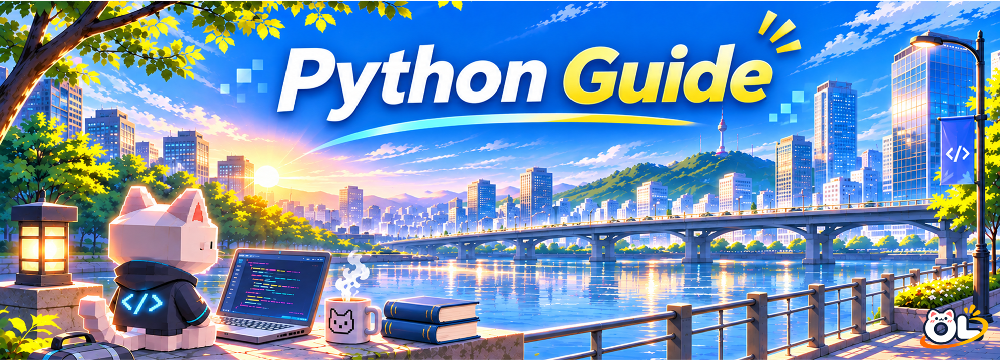

<p align="center">
  
</p>

<div align="center">

**From Fundamentals to Real-World Applications**

Python의 기본 문법부터 프로그램 설계와 실전 응용까지 단계적으로 학습하는 가이드북입니다.<br>
개념 설명과 예제를 통해 학습한 내용을 이해하고, 연습문제와 프로젝트를 통해 직접 활용해 볼 수 있습니다.

<p>
  
  
</p>

[학습과정](#contents) · [학습 자료](#learning-materials) · [프로젝트 구성](#mini-project) · [시작하기](#getting-started)

</div>

---

## Contents

### Part 1 — Python Fundamentals · Basic

변수와 연산자부터 자료구조, 조건문, 반복문, 함수까지 Python의 핵심 문법을 익힙니다. 학습한 내용을 연결하여 간단한 프로그램을 직접 만들어 봅니다.

<table align="center">
  <thead>
    <tr>
      <th align="center">Chapter</th>
      <th align="center">Topic</th>
      <th align="center">주요 내용</th>
    </tr>
  </thead>
  <tbody>
    <tr>
      <td align="center"><a href="./Chapter-01">01</a></td>
      <td align="center"><strong>Introduction to Python</strong></td>
      <td align="center">Python 소개, 개발 환경, 첫 프로그램 실행</td>
    </tr>
    <tr>
      <td align="center"><a href="./Chapter-02">02</a></td>
      <td align="center"><strong>Variables, Data Types &amp; Operators</strong></td>
      <td align="center">변수, 자료형, 산술·비교·논리 연산자</td>
    </tr>
    <tr>
      <td align="center"><a href="./Chapter-03">03</a></td>
      <td align="center"><strong>Input &amp; Output</strong></td>
      <td align="center"><code>print()</code>, <code>input()</code>, 형 변환, f-string</td>
    </tr>
    <tr>
      <td align="center"><a href="./Chapter-04">04</a></td>
      <td align="center"><strong>Data Structures</strong></td>
      <td align="center">List, Tuple, Dictionary, Set</td>
    </tr>
    <tr>
      <td align="center"><a href="./Chapter-05">05</a></td>
      <td align="center"><strong>Conditional Statements</strong></td>
      <td align="center"><code>if</code>, <code>elif</code>, <code>else</code></td>
    </tr>
    <tr>
      <td align="center"><a href="./Chapter-06">06</a></td>
      <td align="center"><strong>Loops</strong></td>
      <td align="center"><code>for</code>, <code>while</code>, <code>range()</code></td>
    </tr>
    <tr>
      <td align="center"><a href="./Chapter-07">07</a></td>
      <td align="center"><strong>User-Defined Functions</strong></td>
      <td align="center"><code>def</code>, 매개변수, <code>return</code></td>
    </tr>
    <tr>
      <td align="center"><a href="./Chapter-08">08</a></td>
      <td align="center"><strong>Fundamentals Project</strong></td>
      <td align="center">자료구조·조건문·반복문·함수를 활용한 종합 프로젝트</td>
    </tr>
  </tbody>
</table>

### Part 2 — Python Programming · Intermediate

기본 문법을 확장하여 파일과 데이터를 다루고, 프로그램을 구조적으로 설계하는 방법을 학습합니다. 자료구조와 알고리즘, 객체지향 프로그래밍도 함께 다룹니다.

<table align="center">
  <thead>
    <tr>
      <th align="center">Chapter</th>
      <th align="center">Topic</th>
      <th align="center">주요 내용</th>
    </tr>
  </thead>
  <tbody>
    <tr>
      <td align="center">09</td>
      <td align="center"><strong>Pythonic Code &amp; Sequences</strong></td>
      <td align="center">슬라이싱, Unpacking, Comprehension, <code>enumerate()</code>, <code>zip()</code></td>
    </tr>
    <tr>
      <td align="center">10</td>
      <td align="center"><strong>File I/O &amp; Path Management</strong></td>
      <td align="center"><code>pathlib</code>, 텍스트·CSV·JSON 파일 입출력</td>
    </tr>
    <tr>
      <td align="center">11</td>
      <td align="center"><strong>Modules, Packages &amp; Environments</strong></td>
      <td align="center"><code>import</code>, 모듈·패키지, <code>pip</code>, <code>venv</code></td>
    </tr>
    <tr>
      <td align="center">12</td>
      <td align="center"><strong>Exceptions &amp; Debugging</strong></td>
      <td align="center">예외 처리, 오류 추적, 디버깅</td>
    </tr>
    <tr>
      <td align="center">13</td>
      <td align="center"><strong>Object-Oriented Programming</strong></td>
      <td align="center">클래스와 객체, 메서드, 상속, 합성</td>
    </tr>
    <tr>
      <td align="center">14</td>
      <td align="center"><strong>Data Structures &amp; Collections</strong></td>
      <td align="center">Stack, Queue, Heap, Hash, <code>deque</code>, <code>heapq</code></td>
    </tr>
    <tr>
      <td align="center">15</td>
      <td align="center"><strong>Algorithms &amp; Problem Solving</strong></td>
      <td align="center">정렬·탐색, 재귀, DFS, BFS, 동적 계획법(DP) 입문</td>
    </tr>
    <tr>
      <td align="center">16</td>
      <td align="center"><strong>NumPy &amp; Pandas Essentials</strong></td>
      <td align="center">배열 연산, DataFrame, 데이터 선택과 기본 집계</td>
    </tr>
    <tr>
      <td align="center">17</td>
      <td align="center"><strong>Matplotlib Essentials</strong></td>
      <td align="center">Figure, Axes, Subplots, 그래프 작성과 저장</td>
    </tr>
    <tr>
      <td align="center">18</td>
      <td align="center"><strong>Testing &amp; Code Quality</strong></td>
      <td align="center">테스트, Type Hints, Logging, 코드 품질</td>
    </tr>
    <tr>
      <td align="center">19</td>
      <td align="center"><strong>Intermediate Project</strong></td>
      <td align="center">파일·객체·알고리즘을 결합한 종합 프로그램</td>
    </tr>
  </tbody>
</table>

### Part 3 — Applied Python & Projects · Applied

Python을 이용해 반복 작업을 자동화하고, 외부 데이터와 시스템을 연결하며, 실제로 사용할 수 있는 프로그램을 개발합니다.

<table align="center">
  <thead>
    <tr>
      <th align="center">Chapter</th>
      <th align="center">Topic</th>
      <th align="center">주요 내용</th>
    </tr>
  </thead>
  <tbody>
    <tr>
      <td align="center">20</td>
      <td align="center"><strong>Automation &amp; Scripting</strong></td>
      <td align="center">파일 관리, 반복 작업 자동화, 스크립트 실행</td>
    </tr>
    <tr>
      <td align="center">21</td>
      <td align="center"><strong>API &amp; Database Integration</strong></td>
      <td align="center">HTTP, REST API, JSON, SQLite</td>
    </tr>
    <tr>
      <td align="center">22</td>
      <td align="center"><strong>Real-Time &amp; Event-Driven Programming</strong></td>
      <td align="center">이벤트 처리, 스레드, <code>asyncio</code>, 실시간 데이터 수신</td>
    </tr>
    <tr>
      <td align="center">23</td>
      <td align="center"><strong>Application Design &amp; Integration</strong></td>
      <td align="center">모듈 연결, 설정 관리, 오류 처리, 실행·배포</td>
    </tr>
    <tr>
      <td align="center">24</td>
      <td align="center"><strong>Applied Python Project</strong></td>
      <td align="center">외부 데이터 수집·처리·저장·출력을 연결한 종합 프로젝트</td>
    </tr>
  </tbody>
</table>

## Learning Path

```text
Basic
기본 문법 · 자료구조 · 조건문 · 반복문 · 함수
  ↓
Intermediate
파일 처리 · OOP · 알고리즘 · 모듈화 · 테스트
  ↓
Applied
자동화 · API · 실시간 처리 · 응용 프로그램 개발
  ↓
Specialized Topics
데이터 처리 · 시각화 · AI · 컴퓨터 비전 · 로봇 · 자율주행
```

### Related Learning Materials

<table align="center">
  <thead>
    <tr>
      <th align="center">분야</th>
      <th align="center">자료</th>
      <th align="center">주요 내용</th>
    </tr>
  </thead>
  <tbody>
    <tr>
      <td align="center">데이터 처리</td>
      <td align="center"><a href="../MoreStudy/Data_Processing/">Data Processing</a></td>
      <td align="center">데이터 수집·정제·변환 및 처리 자동화</td>
    </tr>
    <tr>
      <td align="center">데이터 시각화</td>
      <td align="center"><a href="../MoreStudy/Data_Visualization/">Data Visualization</a></td>
      <td align="center">Matplotlib, Seaborn, Plotly, 대시보드</td>
    </tr>
    <tr>
      <td align="center">인공지능</td>
      <td align="center"><a href="../MoreStudy/AI/">Artificial Intelligence</a></td>
      <td align="center">머신러닝, 딥러닝, PyTorch 및 AI 응용</td>
    </tr>
    <tr>
      <td align="center">컴퓨터 비전</td>
      <td align="center"><a href="../MoreStudy/Computer_Vision/">Computer Vision</a></td>
      <td align="center">이미지·영상 처리 및 객체 인식</td>
    </tr>
    <tr>
      <td align="center">로봇 공학</td>
      <td align="center"><a href="../MoreStudy/Robotics/">Robotics</a></td>
      <td align="center">센서, 제어 및 로봇 프로그래밍</td>
    </tr>
    <tr>
      <td align="center">자율주행</td>
      <td align="center"><a href="../MoreStudy/Autonomous_Driving/">Autonomous Driving</a></td>
      <td align="center">경로 계획, 인지 및 시뮬레이션</td>
    </tr>
  </tbody>
</table>

## Learning Materials

<table align="center">
  <thead>
    <tr>
      <th align="center">구성</th>
      <th align="center">내용</th>
    </tr>
  </thead>
  <tbody>
    <tr>
      <td align="center"><strong>Concepts</strong></td>
      <td align="center">핵심 개념, 문법, 사용 방법</td>
    </tr>
    <tr>
      <td align="center"><strong>Examples</strong></td>
      <td align="center">실행 코드, 실행 결과, 코드 해설</td>
    </tr>
    <tr>
      <td align="center"><strong>Summary</strong></td>
      <td align="center">Chapter 핵심 내용 정리</td>
    </tr>
    <tr>
      <td align="center"><strong>Exercise</strong></td>
      <td align="center">객관식·주관식, 코드 해석, 오류 수정</td>
    </tr>
    <tr>
      <td align="center"><strong>Mini Project</strong></td>
      <td align="center">주어진 요구사항에 맞춰 프로그램을 직접 구현하는 과제</td>
    </tr>
    <tr>
      <td align="center"><strong>Solutions</strong></td>
      <td align="center">Exercise 정답 및 해설</td>
    </tr>
  </tbody>
</table>

### Mini Project

<table align="center">
  <thead>
    <tr>
      <th align="center">Level</th>
      <th align="center">목표</th>
      <th align="center">문제 유형</th>
    </tr>
  </thead>
  <tbody>
    <tr>
      <td align="center"><strong>Basic</strong></td>
      <td align="center">개념 확인</td>
      <td align="center">학습한 문법으로 기본 기능 구현</td>
    </tr>
    <tr>
      <td align="center"><strong>Advanced</strong></td>
      <td align="center">개념 응용</td>
      <td align="center">여러 개념과 조건을 결합한 문제 해결</td>
    </tr>
    <tr>
      <td align="center"><strong>Professional</strong></td>
      <td align="center">실무형 구현</td>
      <td align="center">실제 사용 상황을 가정한 입력 검증과 예외 처리</td>
    </tr>
    <tr>
      <td align="center"><strong>Challenge</strong></td>
      <td align="center">종합 문제 해결</td>
      <td align="center">복합 요구사항과 제약조건, 효율성까지 고려한 구현</td>
    </tr>
  </tbody>
</table>

## Getting Started

Python 프로그램을 실행하려면 Python 3가 필요합니다. 코드 편집기는 Visual Studio Code를 권장합니다.

- [Python 다운로드](https://www.python.org/downloads/)
- [VS Code의 Python 사용 안내](https://code.visualstudio.com/docs/languages/python)

설치 후 터미널에서 버전을 확인합니다.

```bash
python --version
```

Windows에서는 `py --version`, macOS·Linux에서는 `python3 --version`을 사용해야 할 수 있습니다.

다음 코드를 `hello.py` 파일에 저장합니다.

```python
name = "Python"
print(f"Hello, {name}!")
```

터미널에서 실행합니다.

```bash
python hello.py
```

**실행 결과**

```text
Hello, Python!
```

가상환경과 외부 라이브러리 설치 방법은 관련 Chapter에서 안내합니다.

## References

- [Python Documentation](https://docs.python.org/3/)
- [Python Tutorial](https://docs.python.org/3/tutorial/)
- [Python Standard Library](https://docs.python.org/3/library/)
- [Python Packaging User Guide](https://packaging.python.org/)
- [PEP 8 — Style Guide for Python Code](https://peps.python.org/pep-0008/)

---

<p align="center">
  <sub>© 2026 Choi Jae-Seong · ONEUL</sub>
  <br>
  <sub>
    Educational Content ·
    <a href="../LICENSE-CONTENT.md">CC BY-NC 4.0</a>
  </sub>
</p>

<p align="center">
  
</p>
