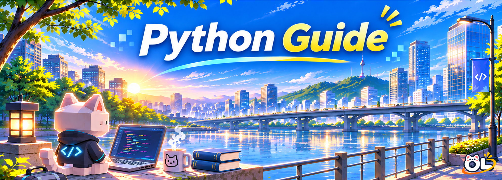

<p align="center">
  
</p>

<div align="center">
**From Fundamentals to Real-World Applications**

Python의 기본 문법부터 프로그램 설계와 실전 응용까지 단계적으로 학습하는 가이드북입니다.</br>
개념 설명과 예제를 통해 학습한 내용을 이해하고, 연습문제와 프로젝트를 통해 직접 활용해 볼 수 있습니다.

<p>
  
  
</p>

[학습과정](#contents) · [학습 자료](#learning-materials) · [프로젝트 구성](#mini-project) · [시작하기](#getting-started)

</div>

---

## Contents

### Part 1 — Python Fundamentals · Basic

변수와 연산자부터 자료구조, 조건문, 반복문, 함수까지 Python의 핵심 문법을 익힙니다. 학습한 내용을 연결하여 간단한 프로그램을 직접 만들어 봅니다.

| Chapter | Topic | 주요 내용 |
|:---:|---|---|
| 01 | **Introduction to Python** | Python 소개, 개발 환경, 첫 프로그램 실행 |
| 02 | **Variables, Data Types & Operators** | 변수, 자료형, 산술·비교·논리 연산자 |
| 03 | **Input, Output & String Formatting** | `print()`, `input()`, 형 변환, f-string |
| 04 | **Python Data Structures** | List, Tuple, Dictionary, Set, 데이터 접근과 수정 |
| 05 | **Conditional Statements** | `if`, `elif`, `else`, 조건식과 중첩 조건문 |
| 06 | **Loops & Iteration** | `for`, `while`, `range()`, 반복 제어 |
| 07 | **Functions & User-Defined Functions** | `def`, 매개변수, 반환값, 변수 범위, 함수 분리 |
| 08 | **Fundamentals Project** | 자료구조·조건문·반복문·함수를 활용한 종합 프로젝트 |

### Part 2 — Python Programming · Intermediate

기본 문법을 확장하여 파일과 데이터를 다루고, 프로그램을 구조적으로 설계하는 방법을 학습합니다. 자료구조와 알고리즘, 객체지향 프로그래밍도 함께 다룹니다.

| Chapter | Topic | 주요 내용 |
|:---:|---|---|
| 09 | **Pythonic Code & Sequences** | 슬라이싱, Unpacking, Comprehension, `enumerate()`, `zip()` |
| 10 | **File I/O & Path Management** | `pathlib`, 텍스트·CSV·JSON 파일 입출력 |
| 11 | **Modules, Packages & Environments** | `import`, 모듈·패키지, `pip`, `venv` |
| 12 | **Exceptions & Debugging** | 예외 처리, 오류 추적, 디버깅 |
| 13 | **Object-Oriented Programming** | 클래스와 객체, 메서드, 상속, 합성 |
| 14 | **Data Structures & Collections** | Stack, Queue, Heap, Hash, `deque`, `heapq` |
| 15 | **Algorithms & Problem Solving** | 정렬·탐색, 재귀, DFS, BFS, 동적 계획법(DP) 입문 |
| 16 | **NumPy & Pandas Essentials** | 배열 연산, DataFrame, 데이터 선택과 기본 집계 |
| 17 | **Matplotlib Essentials** | Figure, Axes, Subplots, 그래프 작성과 저장 |
| 18 | **Testing & Code Quality** | 테스트, Type Hints, Logging, 코드 품질 |
| 19 | **Intermediate Project** | 파일·객체·알고리즘을 결합한 종합 프로그램 |

### Part 3 — Applied Python & Projects · Applied

Python을 이용해 반복 작업을 자동화하고, 외부 데이터와 시스템을 연결하며, 실제로 사용할 수 있는 프로그램을 개발합니다.

| Chapter | Topic | 주요 내용 |
|:---:|---|---|
| 20 | **Automation & Scripting** | 파일 관리, 반복 작업 자동화, 스크립트 실행 |
| 21 | **API & Database Integration** | HTTP, REST API, JSON, SQLite |
| 22 | **Real-Time & Event-Driven Programming** | 이벤트 처리, 스레드, `asyncio`, 실시간 데이터 수신 |
| 23 | **Application Design & Integration** | 모듈 연결, 설정 관리, 오류 처리, 실행·배포 |
| 24 | **Applied Python Project** | 외부 데이터 수집·처리·저장·출력을 연결한 종합 프로젝트 |

## Learning Path

```text
Basic
기본 문법 · 자료구조 · 조건문 · 반복문 · 함수
  ↓
Intermediate
파일 처리 · OOP · 알고리즘 · 모듈화 · 테스트
  ↓
Applied
자동화 · API · 실시간 처리 · 응용 프로그램 개발
  ↓
Specialized Topics
데이터 처리 · 시각화 · AI · 컴퓨터 비전 · 로봇 · 자율주행
```

### Related Learning Materials

| 분야 | 자료 | 주요 내용 |
|---|---|---|
| 데이터 처리 | [Data Processing](../MoreStudy/Data_Processing/) | 데이터 수집·정제·변환 및 처리 자동화 |
| 데이터 시각화 | [Data Visualization](../MoreStudy/Data_Visualization/) | Matplotlib, Seaborn, Plotly, 대시보드 |
| 인공지능 | [Artificial Intelligence](../MoreStudy/AI/) | 머신러닝, 딥러닝, PyTorch 및 AI 응용 |
| 컴퓨터 비전 | [Computer Vision](../MoreStudy/Computer_Vision/) | 이미지·영상 처리 및 객체 인식 |
| 로봇 공학 | [Robotics](../MoreStudy/Robotics/) | 센서, 제어 및 로봇 프로그래밍 |
| 자율주행 | [Autonomous Driving](../MoreStudy/Autonomous_Driving/) | 경로 계획, 인지 및 시뮬레이션 |

## Learning Materials

| 구성 | 내용 |
|---|---|
| **Concepts** | 핵심 개념, 문법, 사용 방법 |
| **Examples** | 실행 코드, 실행 결과, 코드 해설 |
| **Summary** | Chapter 핵심 내용 정리 |
| **Exercise** | 객관식·주관식, 코드 해석, 오류 수정 |
| **Mini Project** | 주어진 요구사항에 맞춰 프로그램을 직접 구현하는 과제 |
| **Solutions** | Exercise 정답 및 해설 |

### Mini Project

| Level | 목표 | 문제 유형 |
|---|---|---|
| **Basic** | 개념 확인 | 학습한 문법으로 기본 기능 구현 |
| **Advanced** | 개념 응용 | 여러 개념과 조건을 결합한 문제 해결 |
| **Professional** | 실무형 구현 | 실제 사용 상황을 가정한 입력 검증과 예외 처리 |
| **Challenge** | 종합 문제 해결 | 복합 요구사항과 제약조건, 효율성까지 고려한 구현 |

## Getting Started

Python 프로그램을 실행하려면 Python 3가 필요합니다. 코드 편집기는 Visual Studio Code를 권장합니다.

- [Python 다운로드](https://www.python.org/downloads/)
- [VS Code의 Python 사용 안내](https://code.visualstudio.com/docs/languages/python)

설치 후 터미널에서 버전을 확인합니다.

```bash
python --version
```

Windows에서는 `py --version`, macOS·Linux에서는 `python3 --version`을 사용해야 할 수 있습니다.

다음 코드를 `hello.py` 파일에 저장합니다.

```python
name = "Python"
print(f"Hello, {name}!")
```

터미널에서 실행합니다.

```bash
python hello.py
```

**실행 결과**

```text
Hello, Python!
```

가상환경과 외부 라이브러리 설치 방법은 관련 Chapter에서 안내합니다.

## References

- [Python Documentation](https://docs.python.org/3/)
- [Python Tutorial](https://docs.python.org/3/tutorial/)
- [Python Standard Library](https://docs.python.org/3/library/)
- [Python Packaging User Guide](https://packaging.python.org/)
- [PEP 8 — Style Guide for Python Code](https://peps.python.org/pep-0008/)

---

<p align="center">
  
</p>
