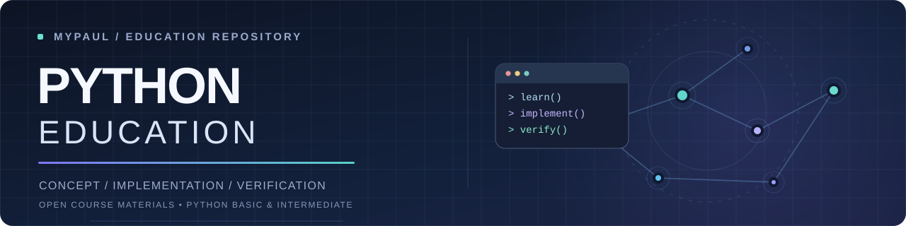
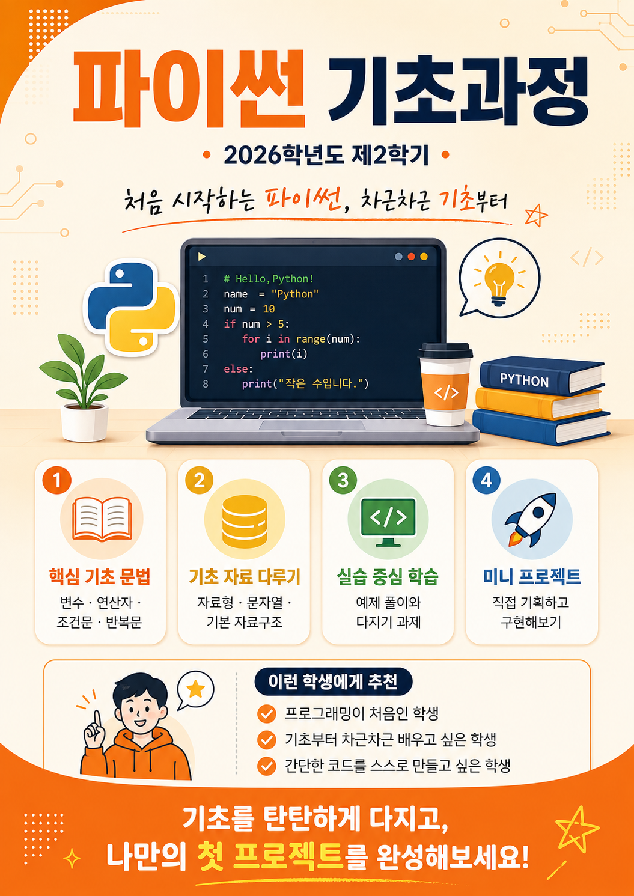
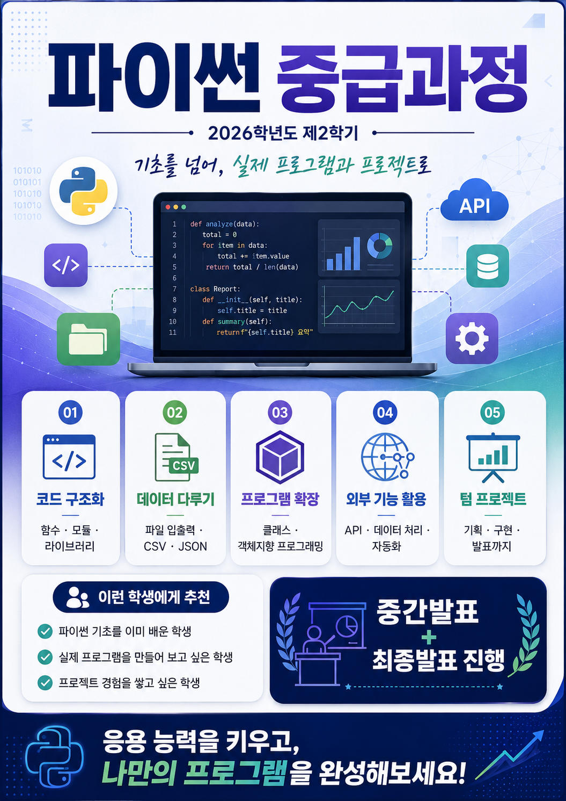

  

  <strong>개념을 이해하고, 코드로 구현하며, 실행 결과로 검증하는 프로그래밍 교육</strong>

  <a href="./Classroom/PYTHON-2026-09/Basic">Python Basic</a> ·
  <a href="./Classroom/PYTHON-2026-09/Intermediate">Python Intermediate</a> ·
  <a href="./Classroom">강의 아카이브</a> ·
  <a href="./MoreStudy">추가 학습 자료</a> ·
  <a href="https://github.com/JSeong2024/MYPAUL-PYTHONEDU/releases/latest">Classroom 런처</a> ·
  <a href="./ABOUT.md">교육 안내</a>

---

## 📖 소개

**MYPAUL-PYTHONEDU**는 Python 기초·중급 과정의 강의 노트, 예제 코드, 과제 및 보충 자료를 정리한 교육용 저장소입니다. 수업 자료는 `Classroom/`에서 학기별로 관리하고, 보충 학습 자료는 `MoreStudy/`에 모아두었습니다.

## 💻 MYPAUL Classroom

**MYPAUL Classroom**은 GitHub에 공개된 강의 자료와 수업 일정, 공지사항을 확인할 수 있는 **Windows용** 학습 런처입니다. 과정별 강의실과 주차별 자료 조회, 통합 검색 및 파일 다운로드 기능을 제공합니다.

| 항목 | 내용 |
| :--- | :--- |
| 최신 공개 버전 | [v0.4.15](https://github.com/JSeong2024/MYPAUL-PYTHONEDU/releases/tag/v0.4.15) |
| 지원 환경 | Windows |
| 배포 파일 | [`MYPAUL_Classroom.exe`](https://github.com/JSeong2024/MYPAUL-PYTHONEDU/releases/download/v0.4.15/MYPAUL_Classroom.exe) |

**실행 방법**

1. 위 링크에서 `MYPAUL_Classroom.exe`를 다운로드합니다.
2. 다운로드한 파일을 실행합니다.
3. 강의실을 선택하여 수업 일정과 학습 자료를 확인합니다.

런처는 공개 GitHub 자료의 **조회 및 다운로드 전용**으로 동작하며, GitHub 로그인이나 Python 설치가 필요하지 않습니다. 실행 환경에 따라 Microsoft Edge WebView2 Runtime이 필요할 수 있습니다.

[전체 릴리스 및 이전 버전](https://github.com/JSeong2024/MYPAUL-PYTHONEDU/releases) · [최신 릴리스 확인](https://github.com/JSeong2024/MYPAUL-PYTHONEDU/releases/latest)

## 🎓 진행중인 수업

| 과정 | 주요 내용 | 강의실 |
| :--- | :--- | :--- |
| **Python Basic** | 기초 문법, 자료형, 제어 구조, 문제 해결 | [기초과정](./Classroom/PYTHON-2026-09/Basic) |
| **Python Intermediate** | 자료구조, 알고리즘, 응용 프로그래밍 | [중급과정](./Classroom/PYTHON-2026-09/Intermediate) |

## 🧩 학습 방식

학습한 개념을 직접 구현하고, 실행 결과를 분석하며 해결 방법을 개선하는 과정을 중시합니다.

## 🔬 추가 학습 자료

[추가 학습 자료](./MoreStudy)

## 🗂️ 강의 아카이브

- [전체 강의 아카이브](./Classroom) · [2026-09](./Classroom/PYTHON-2026-09) · [2026-03](./Classroom/PYTHON-2026-03) · [2025-09](./Classroom/PYTHON-2025-09)

### 2026년 2학기 강의 안내

| Python Basic | Python Intermediate |
| :---: | :---: |
|  |  |
| [강의 계획서 (PDF)](./Classroom/PYTHON-2026-09/%5B강의%20계획서%5D마이폴_파이썬%20기초과정_2026_2.pdf) | [강의 계획서 (PDF)](./Classroom/PYTHON-2026-09/%5B강의%20계획서%5D마이폴_파이썬%20중급과정_2026_2.pdf) |

---

## ⚖️ License & Copyright

Copyright © 2025–2026 Choi Jae-Seong.

- **Software & Source Code:** [MIT License](./LICENSE)
- **Original Educational Content:** [CC BY-NC 4.0](./LICENSE-CONTENT.md)
- **Third-Party Materials:** 각 원저작자의 이용 조건 적용

라이선스의 적용 범위와 자료 이용 안내는 [ABOUT.md](./ABOUT.md)를 참고하세요.
